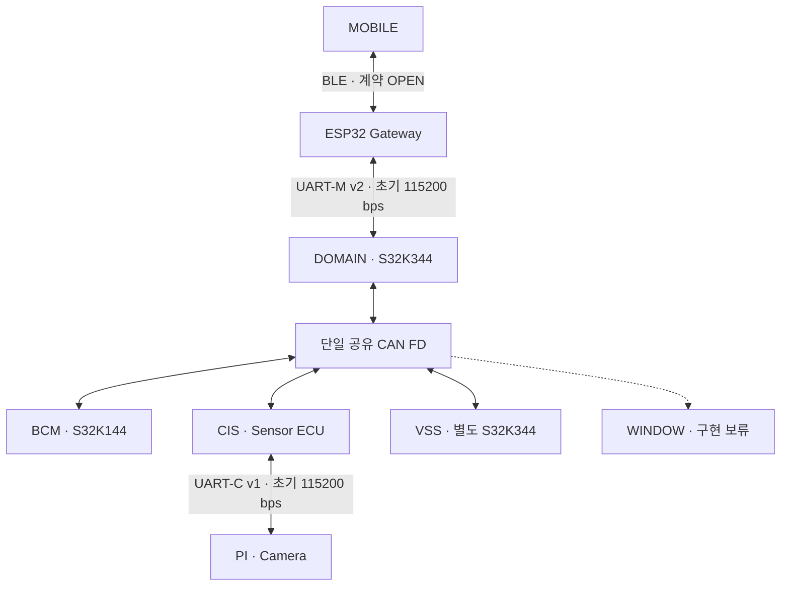

# 전체 연결과 책임

Interface v2 · r1 · [규격과 연동 조건](07_CROSS_NODE_INTERFACE_RULES.md#status)

DOMAIN이 차량 허용·목표·위험을 판단하고, 실행 노드가 로컬 보호와 실제 결과를 만든다. Network는 기능을 다시 판단하지 않고 유효한 의미 데이터를 목적지에 전달한다.

Pi와 DOMAIN은 직접 연결하지 않는다. CAN 공칭 속도 500 kbps/데이터 속도 2 Mbps는 PROPOSED 상태다. 핀·전압·트랜시버와 실제 타이밍은 보드 자료를 근거로 확인해야 한다. UART 두 구간은 115200 bps로 시작하며 전송량/응답 측정 후 필요한 구간만 상향 검토한다.

## 노드별 책임

| 노드 | Application 의미 책임 | Network 책임 |
|---|---|---|
| DOMAIN | 차량 권한·목표·명령ID·위험·모바일 결과 | C2 Port 변환, 수신 검증, 중계·조회 응답 흐름, 기동·순번 관리 |
| BCM | 도어·공조·실내조명 실행·로컬 보호·관측·결과 | 명령 타깃/수명 검증, 상태·결과 프레이밍·통신 상태 |
| CIS | 환경·거리·센서 품질·Pi 추가 평가 | Pi 원본 보존, CAN/UART-C 검증·중계·통신 링크 상태 |
| PI | 카메라 관측·인원·비전 품질/고장 | Pi 기동·UART 프레임 처리·원본 AGE 보완 |
| VSS | 확정 이벤트·위험의 음향 중재·출력 상태 | 기존 INPUT의 전체 Snapshot을 NetVssStatus로 한 번 변환한다. Network는 CAN 검증·전체 사본 보존·C2 투영을 맡는다. 실제 생산·소비 경로의 연결은 E-S01~05 확인 대기 |
| ESP32 | 등록·근접·앱 주장 검증의 각 원천 | 현재 세션 연결·UART-M·BLE 전달·내부 감시 |
| WINDOW | 로컬 STOP/AntiPinch·끝단·결과·고장 | 명령/발생 식별 보존; 현재 구현은 보류 |

EXTERIOR_LIGHT는 제외했고 BCM INTERIOR_LIGHT는 유지한다. WINDOW 문서와 메시지는 설계를 보존하되 현재 보드 연결·모터 동작·펌웨어 구현 요구로 해석하지 않는다.

Application에서 Network로 제출한 호출의 로컬 성공 반환은 Network가 해당 입력을 로컬로 접수했다는 뜻이며, ECU의 기능 실행이 DONE에 도달했음을 의미하지 않는다. `Request`, `Command`, `Result`, `State`, `Event`, `Fault`를 구분하고 원본 Request/Session, DOMAIN commandId, 로컬 occurrence, 원본 update 및 링크 TX sequence를 서로 대체하지 않는다.

메시지 48종(CAN 22종/UART-M 23종/UART-C 3종)는 135개 논리 ID를 조합해 전달한다. DOMAIN_PERMISSION 한 메시지를 BCM/CIS/VSS/WINDOW 네 곳이 수신한다. 기존 C2 72개/Gateway 13개는 제공된 선언이며 메시지마다 함수를 추가하는 규칙이 아니다. 노드별 SDK/RTOS/Superloop 선택은 Network/App 계약의 호출과 수명을 만족하는 방식으로 별도 바인딩한다.

초기 실행은 **짧은 수신 ISR → 정적 Buffer/Queue → Superloop Codec/Adapter → 기존 C2/App Callback** 순서로 구성한다. CIS BOOT 변경 시 자동 복구가 연결되지 않았다면 해당 환경 데이터만 제한하며, 다른 정상 메시지의 송수신은 계속 수행한다. Permission은 DOMAIN의 원본 판단·품질을 전달하고 해당 원본의 사용 기한을 적용한다. [담당 및 실행 문맥](07_CROSS_NODE_INTERFACE_RULES.md#roles)

[노드·Data/API 시작](00_START_HERE.md) · [메시지 색인](05_MESSAGE_INDEX.md) · [기술 제약](06_TECHNICAL_CONSTRAINTS.md)

## 구현 문서로 이동

[노드별 Overview→Data→API](00_START_HERE.md#section-nodes)에서 로컬 호출을 확인한 뒤, [CAN 22종](05_MESSAGE_INDEX.md#section-can-messages)·[UART-M 23종](05_MESSAGE_INDEX.md#section-uart-m-messages)·[UART-C 3종](05_MESSAGE_INDEX.md#section-uart-c-messages)에서 상대 노드와 의미 타입을 찾는다. [공통 호출·수명](04_COMMON/20_API_USAGE_AND_FAILURE.md)과 [C enum→raw 변환](04_COMMON/30_ENUM_WIRE_MAPPING.md)은 양단에 적용하며 SDK/RTOS 배치를 확정하지 않는다.

상태 보고를 제출한 사실과 실제 동작 결과를 구분한다. [미확정 연동 조건](06_TECHNICAL_CONSTRAINTS.md#section-active-bindings)에 표시된 subtype·완료·원본 연결·허용·VSS 변환은 구현 완료를 뜻하지 않는다.
