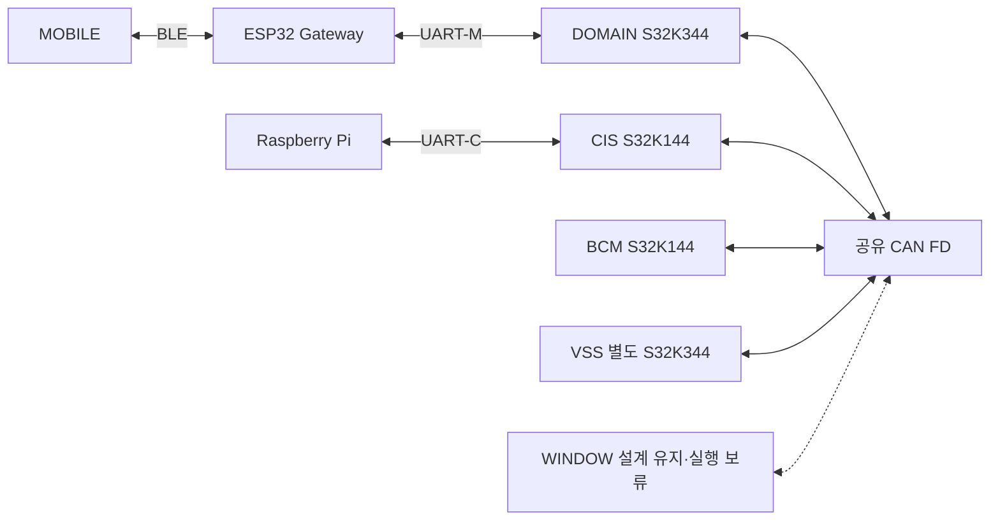

# Network — 원본 의미를 보존하는 송수신

Network는 기능 모듈이 생산한 값·품질·식별 정보를 다른 노드의 지정 입력으로 전달한다. 센서 측정, 차량 위험 판단, 권한 발급, 액추에이터 실행은 각 기능 담당자가 맡는다. 수신 검증 성공과 차량 기능 수행 성공은 서로 다른 사건이다.

## 전체 연결

물리 CAN은 하나이고 DOMAIN↔CIS 등의 관계는 그 버스 위의 메시지 경로다. Pi는 CIS를 통해 DOMAIN과 연결된다. ESP32와 MOBILE의 내부 구현·BLE 처리는 해당 담당자 소유이며, S32K Network가 이를 대신 구현하지 않는다. 상세 적용표는 [노드·링크 지도](02_NODE_LINK_MAP.md)에 있다.

## Layer별 책임

| Layer | 맡는 일 | 다음 문서 |
|---|---|---|
| L01 노드 통신 문맥 | 원 관측과 타입 인계의 동일성을 연결 | [L01](layers/L01_NODE_CONTEXT.md) |
| L02 타입 기반 인계 경계 | 기존 API에 맞게 변환하고 호출·반환·수명을 지킴 | [L02](layers/L02_TYPED_HANDOFF.md) |
| L03 링크별 메시지 처리 | 대기 자료, 송신 선택, 원 기동·순서 수용을 관리 | [L03](layers/L03_MESSAGE_SERVICE.md) |
| L04 프레임 검증과 변환 | 링크 형식과 필드를 검사하고 명시적으로 변환 | [L04](layers/L04_FRAME_CODEC.md) |
| L05 전송 수명과 장치 경계 | 버퍼 수명·장치 관측·통신 진단을 연결 | [L05](layers/L05_TRANSPORT_PORT.md) |

이 다섯 Layer는 설계 책임을 찾아가는 구조다. Layer마다 별도 Task·Queue·래퍼 함수를 만드는 지시는 아니다. DOMAIN의 C2 Rx·Query·Private Transition은 ISR 밖의 단일 담당 실행 문맥에서 순차적으로 호출한다. 초기 구현은 Superloop를 사용하며 RTOS Task는 필수 조건이 아니다. CIS 등 다른 노드에는 동일 RTOS 구성을 강제하지 않는다.

## 첫 송수신 경로

CIS 기능 모듈은 원 관측 번호와 품질을 붙인 후방 자료를 `CisNet_PublishRear`로 제출한다. Network는 호출 중 자료 전체를 복사하고, 실제 송신 시 AGE에 아직 반영되지 않은 로컬 대기 시간만 한 번 더한다. Codec가 필드별 프레임을 만들고 장치 Port가 이를 인계한다. 접수 뒤 Driver가 참조하는 동안 프레임은 불변이다.

DOMAIN Network는 Driver가 확보한 프레임·수신 시각을 함께 인수한다. 형식·필드 검증 후 원 기동과 순서를 확인한다. 같은 관측의 값·품질·AGE·번호를 한 묶음으로 C2 자료에 투영한 다음 `DomainIf_RxCisRear`를 호출한다. 함수 본체와 Manager 상태는 DOMAIN이 소유한다. 호출 성공 이후의 위험 판단과 VSS 경고 출력은 이 Network 인계의 완료 조건이 아니다.

거리 원시값 123은 0.1cm 단위이므로 123mm에 해당한다. 정수 cm로 잘랐다가 mm로 되돌리지 않는다. 값65535는 유효 거리로 소비하지 않고 무검출·고장 등 상태와 함께 해석한다. 필드와 코드표는 [Data 정본](data/CIS_REAR_DATA.md) 한 곳에 둔다.

## 실패와 복구

형식 오류는 정상 수신으로 세지 않는다. 정상 형식의 열화 품질은 보존하여 전달할 수 있다. 대기 공간 부족은 접수 실패이며, Driver 접수 후 실패는 별도 후발 관측이다. 원 기동·시각·버퍼 수명의 근거가 없으면 재시작 직후 과거 자료를 자동 재생하지 않는다. 다른 ECU의 정상 프레임으로 CIS의 생존 시각을 갱신하지 않는다.

실제 Queue 깊이, 시간원 wrap 처리, Driver 취소·완료·Bus-off 복구와 C2 원 관측 결합은 연결 담당자의 확인이 필요하다. CAN 전달 여유나 수신 중단 시간의 문서 후보를 실측 상한으로 쓰지 않는다. [흐름과 반례](flows/CIS_REAR_144_TO_344.md)에서 각 실패의 처리 위치를 확인한다.

[시작](00_START_HERE.md) · [책임 색인](03_LAYER_MODULE_INDEX.md)

## CAN 전체 확장

DOMAIN→BCM 명령·Permission, BCM 상태/결과/사건, CIS 관측/상태, DOMAIN↔VSS 경고/사건/상태, WINDOW 설계 경계를 [CAN 전체 상세](04_CAN_FD_OVERVIEW.md)에서 따라간다. M04는 현재 상태와 개별 항목을 구분하고 M05는 필드 변환에만 관여하며 M07/M08은 Driver의 실제 관측·참조 수명을 분리한다. [공통 흐름](flows/CAN_NETWORK_PATHS.md)은 분기와 재기동·실패 조건을 연결한다.

## UART-M 의미 전달과 조회

ESP32→DOMAIN의 문맥·요청·조회·경고 읽음4종은 현재 peer/Session과 원 identity를 보존하여 기존 C2/private 입력으로 인계한다. DOMAIN→ESP32의17 schema는 DOMAIN 보고6종과 원 CAN 투영11종이며, private ALIVE/QueryEnd2종은 기능 보고와 분리한다. UART-M 전체는23 Wire/23 Rx이고 VERSION2 양단 채택은 CF01의 미승인 후보다.

[UART-M 전체 상세](05_UART_M_OVERVIEW.md) → [M06 Stream/Codec](modules/M06_UART_CODEC.md) → [Router](functions/UART_M_ROUTER.md) → [상향](flows/UART_M_UPLINK.md)/[하향](flows/UART_M_DOWNLINK.md)을 따른다. [M02 조회](modules/M02_QUERY_CONTROL.md)는18 Getter의 성공 OUT을17 schema에 연결하고, 실제 응답 final TX와 원 Query의 종료 근거를 분리한다. [원 CAN 투영](flows/UART_M_CAN_PROJECTION.md)은 같은 입력의 C2 commit association을 확인하며 최신 raw와 값이 같다는 이유로 붙이지 않는다.

Driver accepted·final UART TX·참조 해제·ESP32 유효 RX·BLE/App 전달은 서로 다른 관측이다. 실제 바인딩·실행 관측이 없는 경계는 계속 HOLD다.

## UART-C 원 관측과 허용 중계

[UART-C 3종/25필드](06_UART_C_OVERVIEW.md) → [Pi 원 관측](flows/UART_C_PI_TO_CIS.md) / [DOMAIN 원 허용의 CIS relay](flows/UART_C_CIS_TO_PI_PERMISSION.md)를 따른다. Pi 결과와 상태는 별도 평가이며 원 품질·AGE를 보존한다. CIS relay 세대는 원 DOMAIN 판단의 수명을 재발급하지 않는다.

## DOMAIN Adapter와 Network 공통 Service

[DOMAIN 경계와 공통 Service](07_DOMAIN_ADAPTER_SERVICE.md)는 기존 C2 공개72개의 소유권과 Network TxPort26·DOMAIN/기능 Observer11의 연결을 설명한다. DOMAIN이 공개 본체와 차량 상태·판단을 소유하고 Network는 등록 요청, 검증된 수신 인계, 송신 사본과 결과 수명을 맡는다. 같은 값의 Snapshot과 원 CAN 관측을 근거 없이 결합하지 않는다.

[DOMAIN 명령→Network](flows/DOMAIN_COMMAND_TO_NETWORK.md)와 [Network 수신→DOMAIN](flows/NETWORK_TO_DOMAIN.md)을 따라 입력 복사, Queue 인수, Driver 접수·최종 결과·참조 해제, DOMAIN 수용과 실제 기능 완료를 구분한다. [공통 수명](functions/NETWORK_SERVICE_LIFETIME.md), [후발 실패·Health](functions/NETWORK_FAILURE_HEALTH.md), [Query·원본 연결](functions/DOMAIN_QUERY_PROVENANCE.md)은 기존 Codec와 Query 정본을 재사용하며 새 차량 cache나 Layer를 추가하지 않는다.

## 노드별 생산자와 소비자 연결

[노드별 경계 상세](08_NODE_BOUNDARIES.md)는 기존 메시지·Adapter·Service를 DOMAIN, BCM, CIS, VSS, ESP32, Pi, WINDOW, MOBILE의 실제 책임에 연결한다. CAN TX 성공과 액추에이터 실행, UART Query End와 App 표시, buffer release와 전송 결과를 각각 구분한다. ESP32 내부 Network는 ESP32 담당자가 소유하고 Pi는 CIS를 통해 DOMAIN과 연결한다. WINDOW는 실행·표시·감시 보류 상태로 설계만 유지한다.

## 종단 기능·오류·복구

[종단 상세](09_E2E_FAILURE_RECOVERY.md)는 원 SC01~SC18을 정상·실패·복구로 연결한다. 요청→실행 결과, 센서→판단→경고, VSS/WINDOW, Query/읽음, 공통 재기동·후발 실패를 기존 Node/Function/Data/API에 연결하고 로컬 접수·Driver terminal/release·상대 수용·실제 기능/표시를 각각 관측한다. SC11/12는 DEFERRED, SC18 직접 Wire/Rx는0/0이다.
