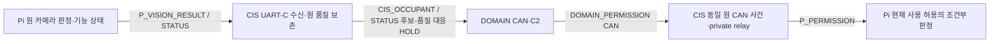

# UART-C 전체 상세 — Pi↔CIS 3 Wire·3 Rx·25필드

UART-C(P03)는 Pi의 비전 결과·상태를 CIS로 보내고 DOMAIN의 원 전원 허용 판단을 CIS가 Pi로 중계하는 경로다. Pi↔DOMAIN 직결이 아니며 Network가 카메라 알고리즘·CIS 측정·DOMAIN 정책을 대신하지 않는다. VERSION 1 / TYPE 0x60·0x61·0x62 상세는 미승인 문서 후보이고, 과거 2종 형식의 실제 지원 여부와 현 후보로의 전환은 확인하지 않았다.

[Network](01_NETWORK_OVERVIEW.md) → [노드 지도](02_NODE_LINK_MAP.md) → [Layer/Module](03_LAYER_MODULE_INDEX.md) → [M06](modules/M06_UART_CODEC.md#uart-c) → 아래 Function → [Data](data/UART_C_DATA.md) → 양방향 Flow 순서로 읽는다.

## 3종의 고정 추적

| Wire / Rx | Version / Type | 방향·P/Frame·필드 | 기존 producer → consumer | Data / Flow |
|---|---|---|---|---|
| WIRE-P03-P_VISION_RESULT / RX-P03-P_VISION_RESULT-CIS | 1 / 0x60 | PI→CIS / 19·29B / 11 | [PiNet_PublishVisionResult → CisApp_OnPiVisionResult](functions/uart_c/P_VISION_RESULT.md) | [NetVisionResult](data/UART_C_DATA.md#type-NetVisionResult) / [Pi→CIS](flows/UART_C_PI_TO_CIS.md) |
| WIRE-P03-P_VISION_STATUS / RX-P03-P_VISION_STATUS-CIS | 1 / 0x61 | PI→CIS / 16·26B / 7 | [PiNet_PublishVisionStatus → CisApp_OnPiVisionStatus](functions/uart_c/P_VISION_STATUS.md) | [NetVisionStatus](data/UART_C_DATA.md#type-NetVisionStatus) / [Pi→CIS](flows/UART_C_PI_TO_CIS.md) |
| WIRE-P03-P_PERMISSION / RX-P03-P_PERMISSION-PI | 1 / 0x62 | CIS→PI / 15·25B / 7 | [CisNetPriv_RelayPiPermission → PiApp_OnCisPermission](functions/uart_c/P_PERMISSION.md) | [NetPiPermission](data/UART_C_DATA.md#type-NetPiPermission) / [CIS→Pi](flows/UART_C_CIS_TO_PI_PERMISSION.md) |

전체 분모는 CAN 22/Rx 25 + UART-M 23/Rx 23 + UART-C 3/Rx 3 = **Wire 48/Rx 51**이다. 공개 typed API 5개와 Network private relay 1개의 기존 원형을 보존한다. NetDomainPermission 입력을 NetPiPermission 입력으로 바꾼 새 공개 relay는 만들지 않는다. 세 메시지의 모든 필드는 unsigned이고 다중 바이트는 LE다. C 구조체 padding이나 enum 메모리 폭을 Wire 폭으로 쓰지 않는다.

## 책임·함수·상태의 연결

| Layer / Module / Function 책임 | 실제 상세 정본 | 보존 상태·외부 근거 |
|---|---|---|
| L01 / M01 / F01~F03 | [원 Pi 품질·CAN 연결](flows/UART_C_PI_TO_CIS.md), [원 DOMAIN permission](flows/UART_C_CIS_TO_PI_PERMISSION.md) | ST01/02 원 association, 기능 원본/Manager는 외부 Owner |
| L02 / M03 / F10 | 세 leaf의 API, [typed Router](functions/UART_C_FRAME_ROUTER.md#dispatch) | 기존 Pi/CIS callback, borrowed 수명·실제 바인딩 OPEN |
| L03 / M04 / F11~F13 | [접수·AGE·순서](functions/UART_C_TX_RX_CONTROL.md) | ST05~07 pending/송신 근거/수신 순서, 새 차량 cache 없음 |
| L04 / M06 / F16~F18 | [Frame/Stream/Codec](functions/UART_C_FRAME_ROUTER.md) | ST08 byte와 원 시각, P03 별도 registry |
| L05 / M07·M08 / F19~F23 | [Driver 관측·참조](functions/UART_C_TX_RX_CONTROL.md#port-observe) | ST09~11 저장소/입력/Driver 세대, 실제 SDK 미확인 |
| L05 / M09 / F24~F25 | [오류·복구](functions/UART_C_TX_RX_CONTROL.md#recovery) | ST12 실제 통신 관측, UART에 CAN bus-off 생성 없음 |

기존 5 Layer·9 Module·25 Function 책임·12 State는 그대로다. F 번호는 책임 식별이며 구현 함수 개수나 Task 수가 아니다. M02 Query와 M05 CAN은 기존 정본을 재사용한다.

## 원본 품질과 허용의 핵심 조건

Result는 PiBoot/VisionSequence/AGE와 Presence·Count의 독립 validity/reason을 보존한다. Status는 별도 StatusSequence/AGE와 현재·최근 고장이고, READY만으로 과거 Result를 VALID/fresh로 만들지 않는다. CIS_OCCUPANT도 값별 품질을 각각 갖는다. 다만 **각 값별 한 벌**의 Wire 사유로 Pi 원 사유와 CIS 추가 사유를 동시에 완전하게 표현할 수 없다는 IF-O13/19 HOLD가 있다. 부분 품질 저하를 정상 0명이나 비탑승 판정으로 바꾸지 않는다.

Permission은 원 DOMAIN→CAN→CIS→UART-C→Pi 경로다. CISBoot/relayUpdate는 원 DOMAIN Boot/원 판단을 대체하지 않으며, 원 DOMAIN identity는 payload에 직접 없다. NetDomainPermission에 quality_reason은 없다. 없는 사유나 기한을 NONE/0/1500으로 채우지 않는다. 후방 활성 Power는 DOMAIN의 실제 재평가 약200ms·원 사용기한500ms 합의를 따른다. 500ms 도달부터 비사용이며 새 평가 없이 원 수명을 연장하지 않는다. CAN50ms 송신/150ms 수신 중단, UART-C500ms 반복/1500ms 수신 중단은 별개다. relay USE_LIMIT1500ms 후보와 같은 후방 원 판단을 전달할 때의 조건부500ms를 구별하고 양단 근거 없이 송신값을 변경하지 않는다. AGE 포화·반복·재기동·수신은 새 허용을 만들지 않는다.

## Frame·오류·수명

공통 외형은 A5 5A, VERSION 1, Type, P u16 LE, LINK_SEQUENCE u16 LE, payload, CRC u16 LE다. 전체 길이는 P+10, payload B0=Frame B8이며 CRC16-CCITT-FALSE는 B2..B(P+7)에 적용한다. P03의 정확한 P 19/16/15와 방향을 검사한 뒤 CRC가 정상인 완성 Frame 경계를 확보하고, 25필드를 임시 객체에 decode한다. CRC가 정상인 경계의 enum/의미 거부는 전체 Frame을 소비한다. header/CRC/조립 timeout 오류는 시작+1 위치부터 suffix를 재탐색한다. suffix의 원 timestamp를 보존하고 Worker 처리 지연과 실제 수신 시각을 구별한다.

로컬 접수 OK·Driver admission·최종 TX·참조 해제·상대 RX·callback 반환·기능 소비는 각기 별도다. 전체 사본을 확보하기 전에는 OK를 반환하지 않고, Driver가 참조하는 동안에는 바이트를 변경하지 않는다. release가 먼저 관측되어도 미확정 identity를 보존하며, void callback 반환을 permission 성공으로 계산하지 않는다. ISR은 짧은 raw/error 인계만 수행하고 parser와 의미 callback은 담당 Task/Superloop에서 처리하는 후보로 둔다.

## 시나리오·미결·현재 상태

SC06은 Pi 관측→CIS→DOMAIN 품질 연결, SC10은 Pi/CIS 기능 고장·상태, SC08은 원 허용의 fan-out/Pi 소비, SC18은 형식·용량·후발 실패의 공통 반례다. SC18을 UART-M/C의 Wire 26종 전체에 대한 직접 기능 연결로 과장하지 않는다. 원 요구 103개·시나리오 18개·Owner 미결 35개 OWNER_OPEN·C2 공개 API 72개/TxPort 26개/Observer 11개를 유지한다.

C2 v0.6/Vehicle v0.3은 미승인 후보이며 Generation 0·BOOT·CIS Environment는 회신 대기다. 기존 S6Q-01~14 이력은 보존하며, G6 이후 별도 후보에 반영한 고정 r1 Interface40개 동기화 결과와 남은 협의 영향을 구분한다. 추가 협의 반영과 공식·제품 채택은 별도 근거·승인 범위를 따른다. 과거 2종 프로파일, Driver/clock/수명, 원 품질 투영, Permission 합성·USE_LIMIT 선정·사유/association 미결과 공식 게시 HOLD를 임의로 닫지 않는다.

출처: S4C/B08 uart_c_contract 및 T35, S4A T25/T26/T09/T10/T37, S4C 시간/Driver 계약과 UART 공통 Frame. 원 [Interface](../interface/03_COMMUNICATION/30_UART_C.md)를 따른다. T35 보조 색인의 과거 SHA 불일치 HOLD는 출처 대장에 보존하며 후보를 승인된 계약으로 취급하지 않는다.
