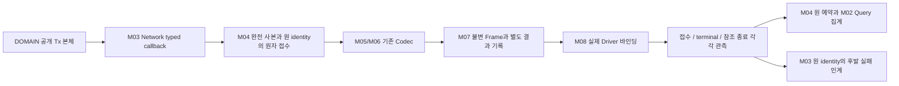
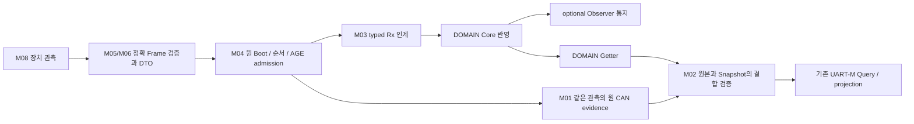

# DOMAIN Adapter와 Network 공통 Service

DOMAIN 경계와 Network 책임을 연결한다. 실제 제품 바인딩·컴파일·보드 검증과 공식 게시 승인을 뜻하지 않는다. C2 v0.5는 기존 설계의 역사적 선언 기반으로 보존한다. SW 후보는 G6 이후 PR #68의 r1 Interface 40개를 기준으로 최초 동기화했고, 2026-10-17 커밋 `00a43414`의 문서 보완을 추가 반영했으며, 그 안의 C2 v0.6/Vehicle v0.3은 여전히 미승인 후보로 실제 제품 Header·ABI 채택과 구분한다. 남은 협의 반영과 공식·제품 통합은 별도 근거·승인이 필요하다.

## 읽기 순서와 분모

1. 이 문서의 책임·흐름을 확인한다.
2. [Service Data](data/NETWORK_SERVICE_DATA.md)에서 원 공개 DTO와 내부 제안 자료를 구분한다.
3. [관리6·등록](functions/DOMAIN_REGISTRATION.md), [TxPort26](functions/DOMAIN_TX_PORT.md), [Rx22·Observer11](functions/DOMAIN_RX_ADAPTER.md), [Getter18·Query 원본 결합](functions/DOMAIN_QUERY_PROVENANCE.md)을 읽는다.
4. [접수·Queue·수명](functions/NETWORK_SERVICE_LIFETIME.md), [후발 실패·운영 counter·Health](functions/NETWORK_FAILURE_HEALTH.md)를 읽는다.
5. [DOMAIN 명령→Network](flows/DOMAIN_COMMAND_TO_NETWORK.md)와 [Network 수신→DOMAIN](flows/NETWORK_TO_DOMAIN.md)의 전체 경로를 따라 함수별 반례를 검토한다.

| 구분할 집계 기준 | 구성·해석 |
|---|---|
| C2 공개 함수72 | 관리6 + Rx22 + Tx26 + Getter18. 공개 본체 Owner는 DOMAIN이며 Network는 호출/Port 구현 경계를 연결 |
| DomainIf_TxPort_t26 | Tx26에 대응하는 Network callback. 공개 함수72에 더해 새로운 공개 함수98개로 계산하지 않음 |
| DomainIf_RxObserver_t11 | DOMAIN Core 뒤 기능별 optional 통지. Network가 11개 본체의 소유권을 인수하지 않음 |
| Getter 18개 / 모바일 스냅샷 메시지 형식 17종 | RequestResult 단건·RecentRequestResults 목록 Getter2가 같은 M_RESULT schema를 공유. Query 정본의 실제 인자·출력·기한·최종TX 집계 보존 |
| Wire48 / Rx51 | CAN22/Rx25, UART-M23/Rx23, UART-C3/Rx3의 기존 전체 범위. Rx22 공개 함수와 일대일이 아님 |
| 요구103 / Owner 미결35 / 시나리오18 | 기존 대장과 ID를 보존. 문서 작성으로 미결·HOLD를 닫지 않음 |

개별 API의 정확한 원형·인자 방향·필드 타입·실패 OUT·수명·실제 경로는 위 함수 문서와 Interface 정본에 둔다. 상기 숫자는 구현·지원 완료 개수가 아니다. 각 경로의 `DECLARED_SOURCE`, `PROPOSED_PRIVATE_FUNCTION`, `BINDING_OPEN`, 외부 HOLD를 함께 확인한다.

## 전체 책임과 설계 위치

기존 [5 Layer·9 Module·25 Function](03_LAYER_MODULE_INDEX.md)과 ST01~ST12를 그대로 사용한다. 새 Manager/Task/전역 차량 상태 cache·새 공개 ABI를 만들지 않는다.

| Layer / Module | 연결 책임 | 함수·자료 |
|---|---|---|
| L01 / M01 원본·문맥 | 원 DTO/meta, 생산 세대·Boot·Session, 같은 관측의 C2 반영과 원 CAN evidence 연결 | F01/F02, Rx Adapter·Query provenance |
| L01 / M02 Query | 기존 context 검증→Getter 순회→실 final TX 집계→Query End | F04/F05, 기존 UART_M_QUERY_CONTROL 재사용 |
| L02 / M03 타입 경계 | Port 등록 요청, typed Tx/Rx, 원 identity 있는 후발 실패 인계 | F06~F10, DOMAIN_REGISTRATION/TX_PORT/RX_ADAPTER |
| L03 / M04 메시지 Service | 원 입력 안정 접수·보관·선택·AGE·순서·만료/복구 | F11~F13, NETWORK_SERVICE_LIFETIME |
| L04 / M05·M06 Codec | 기존 CAN 및 UART-M/C의 정확한 Frame/필드 변환 | F14~F18, 기존 메시지 정본 유지 |
| L05 / M07·M08 | Frame 저장소, 접수·terminal·reference release, 실제 Driver/HAL 경계 | F19~F23, 링크별 Port 관측 재사용 |
| L05 / M09 | 실제 통신 사건 counter·link Health의 일관된 조회 자료 | F24/F25, NETWORK_FAILURE_HEALTH |

DOMAIN은 기능 판단·차량 상태/결과·설정·Snapshot/Getter와 공개 C2 본체를 소유한다. Network는 의미를 바꾸지 않는 인계, Codec, 안정 사본/Frame 수명, 링크 처리와 통신 관측을 소유한다. `DomainIf_IsInitialized=true`나 Port table 등록 성공을 차량 준비·상대 수신·실행 DONE으로 해석하지 않는다. 미확인 기능의 정상값·품질·Generation·Session을 Network가 생성하지 않는다.

## DOMAIN 명령에서 실제 전송 관측까지

1. DOMAIN 공개 본체가 기존 TxPort callback을 호출한다. callback은 정확한 인자 전체를 검사하고 해당 route·실패 sink·원 세대/문맥 준비를 확인한다.
2. caller 메모리가 반환 후 사라져도 유효한 의미 사본과 metadata/identity를 확보하여 Queue와 함께 원자 공개한 경우만 로컬 접수 OK다. Queue full·부분 복사·게시 실패에 OK를 내지 않는다.
3. 기존 링크 Service가 현재 원 문맥·기한·원 AGE·profile을 확인하고 Codec/Driver 경계로 넘긴다. Driver 호출 전 callback이 원 record를 찾을 수 있게 token/epoch를 게시한다.
4. Driver 접수, 최종 전송 결과, 참조 종료, 필수 결과 소비를 서로 독립적으로 기록한다. Frame을 먼저 반환할 수 있어도 원 identity/미확정 예약을 지우지 않는다.
5. 정본 범위의 후발 실패만 기존 `DomainIf_RxNetworkLocalFailure`로 원 항목에 연결한다. 송신 전 확정 제출 실패·만료·문맥 무효의 범위를 넘어 미확정 in-flight 오류를 임의 reason으로 바꾸지 않는다.

CAN callback9는 CAN 개별 경로6과 공통 Permission 생성 입력3으로 이어진다. callback3의 일부 값만 모아 완성 Permission이라고 반환하지 않는다. 완전한 원 평가/AGE/품질의 같은 snapshot 조립 근거가 없으면 해당 경로 NOT_AVAILABLE이다. 모바일 callback17은 기존 private Submit과 Query/자발 갱신 조건을 재사용한다. WINDOW·VSS 미결 경로는 기존 HOLD 상태로 상세 연결한다.

## 검증된 수신에서 DOMAIN과 Query까지

Raw 길이·CRC·예약값·enum·양단 profile 검증을 통과하지 못한 자료를 typed Rx나 정상 Health로 올리지 않는다. 유효 수신이어도 source가 INVALID/NO_DATA이면 그 품질을 보존한다. 같은 관측 반복으로 원 AGE를 젊게 만들지 않는다. exact duplicate의 링크 lastValidRx 처리는 원 메시지별 정상 수신 계약으로 별도 바인딩한다.

`DomainIf_Rx*` 원 반환값은 그대로 기록한다. Core 반영과 optional Observer 성공을 구분하며, Observer 오류 뒤 Core를 재실행하지 않는다. Rx OK 하나로 원 CAN 관측과 Getter Snapshot이 같은 관측이라는 것을 입증할 수 없다. 실패 반환인데 부분 반영 단계가 불명확하면 자동 재시도하지 않는다.

CIS 후방 수직 예에서 실제 `NetCisRear.rear_distance_deci_cm`의 한 단위는 0.1cm=1mm다. `CisRearState_t.rearDistanceMm`에 해당 원 정수를 보존하며, 존재하지 않는 `rear_distance_mm` 멤버나 `/10` 절삭을 새로 만들지 않는다. 상세한 품질·hasValid/존재 플래그·원 시각 의미는 [Rx 함수별 표](functions/DOMAIN_RX_ADAPTER.md)를 따른다.

Query는 [기존 제어 정본](functions/UART_M_QUERY_CONTROL.md)과 [원 CAN 투영](flows/UART_M_CAN_PROJECTION.md)을 재사용한다. Getter 성공 OUT만 사용하며 실패 OUT은 읽지 않는다. 모바일 DTO에 이미 사라진 원 Boot/AGE/발생 metadata를 현재값으로 채우지 않는다. 원 근거가 확인된 scope만 응답하고 최종 TX로 실제 집계한 후 End를 보낸다. 관리 context 검증·Getter성공·Queue 접수는 각각 Query 전송 완료가 아니다.

## 공통 수명·시간·오류 계약

| 구분 | 지켜야 할 조건 | 실제 근거가 없을 때 |
|---|---|---|
| caller 입력 수명 | callback 반환 전에 모든 의미 입력과 원 문맥의 안정 사본/허용된 동기 encode 완료 | 접수 OK 금지 |
| Frame 메모리 | 실제 참조 종료 또는 확실한 미노출·송신 전 중단 뒤에만 회수 | reference POSSIBLE 유지 |
| 결과/원 예약 | terminal과 필수 소비를 확인하고 원자 정리 | buffer 해제만으로 종료하지 않음 |
| identity record | Frame·원 예약·필수 소비 모두 정리한 뒤 제거 | 지연 callback/후발 실패 연결을 위한 별도 기록 보존 |
| 시간 | 단위·wrap·같은 로컬 clockEpoch가 입증된 관측만 차감 | UNKNOWN을 0ms로 치환하지 않음 |
| LocalFailure | 실제 로컬 접수 원 항목의 식별·생산 세대, 정확한 reason, 별도 전달/반영 상태 | 임의 실패 사유/새 identity 생성 또는 중복 Core 인계 금지 |
| Health | 실제 link 관측과 다섯 u32 포화 counter, hasValidRx 조건부 age | 차량 기능 상태 추정·지원하지 않는 DOMAIN UART-C 공급 금지 |

**제품 바인딩의 확인 근거**와 **실제 실행 관측 입력**, **내부 판정 결과**를 Data 문서에서 분리한다. “evidence가 확인됐다”는 임의 bool로 미확인 제품 계약을 우회하지 않는다. 내부 의사코드의 정규화 u64 clock은 실제 제품에 그 clock이 존재한다는 주장이 아니다. Clock/원자성/Driver 함수·callback 수명의 입증은 계속 BINDING_OPEN이다.

## 유지하는 제약과 검토 경계

Generation0·BOOT_ID·CIS Environment 회신 대기, C2 후보 ABI·원 SourceGeneration·실제 Session 타입/동일 버전 바인딩, WINDOW 구현 보류와 VSS profile 차이, UART profile 양단 채택, Queue/timeout/retry/Driver 참조·최종 결과/Health raw 공급·원본 결합의 외부 HOLD를 유지한다. T34/T35 보조 색인의 로컬 정규화 근거는 외부 설계 채택 승인이 아니다. 기존35 Owner 미결을 새 API·가짜 정상 callback·상수 ready로 닫지 않는다.

Queue 깊이·우선순위·Task 구조·reset 순서·등록 해제 의미를 새로 확정하지 않는다. G6 당시 공개 Interface39 봉인본과 최초 r1 Interface 40개와 이후 `00a43414`에 반영한 문서 보완을 구분해 보존한다. 기존 S6Q-01~14의 append-only 이력과 미결은 유지한다. 별도 후보의 r1 동기화 완료는 남은 협의 확정·공식 게시·제품 통합 권한을 부여하지 않는다. G5-0 공식 게시 HOLD와 G4-TOOL-01 OPEN_BEFORE_REUSE도 유지한다.

공개72·TxPort26·Observer11의 선언과 반환·OUT/포인터 수명은 원 Interface를 따른다. 실제 원형·소비 준비·호출 문맥·실패·복구·수명은 각 함수 정본에서 구체화하며, 문서 설계만으로 제품 실행 성공을 주장하지 않는다.

[전체 시작](00_START_HERE.md) · [Module 탐색](modules/00_MODULE_INDEX.md) · [CAN22](04_CAN_FD_OVERVIEW.md) · [UART-M23](05_UART_M_OVERVIEW.md) · [UART-C3](06_UART_C_OVERVIEW.md)
