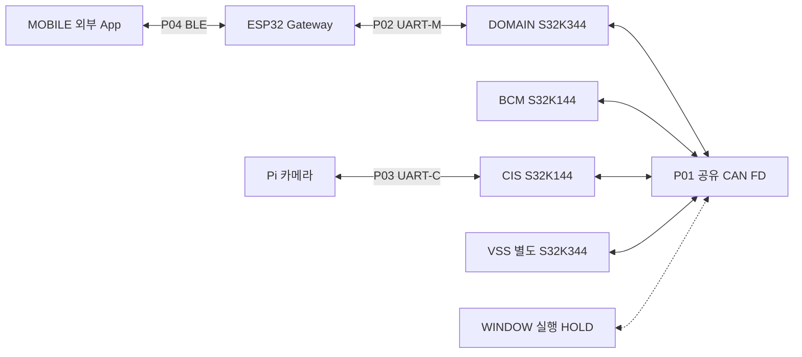

# 노드별 Network 경계 — 생산·인수·전송·실행의 구분

기존 CAN22/Rx25·UART-M23/Rx23·UART-C3/Rx3 상세를 각 노드의 실제 생산자와 소비자에 연결한다. 8 Node·17 Link, 기존5 Layer/9 Module/25 Function/12 State를 그대로 사용한다. 새 Wire·공개 API·제품 헤더·차량 Manager를 만들지 않는다.

## 노드에서 시작하는 읽기 순서

| Node | 보드·Owner 경계 | 상세·대표 정상/실패 흐름 |
|---|---|---|
| N01 DOMAIN | S32K344. DOMAIN이 공개 C2·Manager·판단 소유, Network는 callback/codec/인계·전송 수명 | [DOMAIN](nodes/DOMAIN.md): 원 명령 → BCM 결과 → MOBILE, 수신 → C2 → Query |
| N02 BCM | S32K144. App이 액추에이터·보호·실제 결과 소유 | [BCM](nodes/BCM.md): 명령 인수와 실행 결과를 분리 |
| N03 CIS | S32K144. Sensor App 원 관측과 Pi 중계를 구분 | [CIS/Pi](nodes/CIS_PI.md): Pi 관측 → CAN, 원 DOMAIN Permission → Pi |
| N04 VSS | DOMAIN과 별도 S32K344. App이 음향 중재·실제 출력 소유 | [VSS](nodes/VSS.md): 경고/사건 수신 → 실제 상태, CF02 HOLD |
| N05 ESP32 | Gateway. **ESP32 담당자가 내부 Network 전체 구현 소유** | [ESP32/MOBILE](nodes/ESP32_MOBILE.md): BLE/UART typed relay·독립 context·private 감독 |
| N06 Pi | 카메라 서비스. Pi Owner가 원 Vision/상태·실제 Permission 소비 소유 | [CIS/Pi](nodes/CIS_PI.md): DOMAIN과 직접 물리 링크 없음 |
| N07 WINDOW | 예정 S32K144. IMPLEMENTATION_HOLD / DESIGN_PRESERVED | [WINDOW](nodes/WINDOW.md): 비활성 timeout은 차량 고장 아님; STOP도 원 문맥 검증 |
| N08 MOBILE | 외부 App. 내부 Network Layer/API 강제 없음 | [ESP32/MOBILE](nodes/ESP32_MOBILE.md): App 활성 생산·요청·표시 계약 외부 경계 |

기존 각 노드의 Interface 개요·Data·API 전문을 근거로 정확한 선언·const 입력·호출자·생산자·실패·수명을 연결했다. DOMAIN의 공개72/TxPort26/Observer11은 [DOMAIN Adapter·Service 정본](07_DOMAIN_ADAPTER_SERVICE.md)에서 인수하고, 다른 노드의47개 기존 선언은 각 노드 문서에서 원문에 연결한다. 47은 BCM10+VSS4+WINDOW6+CIS8+Pi3+ESP32공개13/private3이며 새 함수 수가 아니다.

## 물리4·논리6·내부7 링크

| Link | 방향·메시지/경계 | 정확한 적용 위치·상태 |
|---|---|---|
| P01 | 공유 CAN FD 양방향, 22 Wire/25 Rx | [CAN](04_CAN_FD_OVERVIEW.md); 노드 BCM/CIS/VSS/WINDOW와 DOMAIN. WINDOW 실행 HOLD |
| P02 | DOMAIN↔ESP32 UART-M,23/23 | [UART-M](05_UART_M_OVERVIEW.md); VERSION2 CF01 후보 유지 |
| P03 | Pi↔CIS UART-C,3/3 | [UART-C](06_UART_C_OVERVIEW.md); 원 생산 품질·원 Permission AGE 유지 |
| P04 | MOBILE↔ESP32 BLE | [ESP32/MOBILE](nodes/ESP32_MOBILE.md); Wire48에 더하는 새 메시지 집합 아님 |
| R01 | DOMAIN 명령 → BCM / BCM 상태·결과·사건 → DOMAIN | [DOMAIN](nodes/DOMAIN.md#command-flow)·[BCM](nodes/BCM.md) |
| R02 | DOMAIN 원 허용 → CIS / CIS 환경·후방·승객·진단 → DOMAIN | [CIS/Pi](nodes/CIS_PI.md) |
| R03 | DOMAIN 경고·사건 → VSS / VSS 상태 → DOMAIN | [VSS](nodes/VSS.md); used51/60 자동 선택 금지 |
| R04 | DOMAIN Window 명령 / Window 상태·고장 | [WINDOW](nodes/WINDOW.md); 설계만 보존 |
| R05 | MOBILE↔ESP32↔DOMAIN | [ESP32/MOBILE](nodes/ESP32_MOBILE.md#relay-flow); 요청·Query·private와 차량 결과 구분 |
| R06 | Pi↔CIS↔DOMAIN | [CIS/Pi](nodes/CIS_PI.md); Pi 품질·원 순번과 CIS relay의 기동/순번 구분 |
| I01 | DOMAIN Owner ↔ Network callback/Rx | [DOMAIN](nodes/DOMAIN.md); Core/Observer/수명 실제 binding OPEN |
| I02 | BCM App ↔ BCM Network | [BCM](nodes/BCM.md); App void callback이 실행 결과 아님 |
| I03 | CIS Sensor/relay ↔ CIS Network | [CIS/Pi](nodes/CIS_PI.md); 단위·품질·AGE 원 평가 보존 |
| I04 | VSS App ↔ VSS Network | [VSS](nodes/VSS.md); Network와 음향 판단 소유권 분리 |
| I05 | ESP32 Core ↔ 자체 Transport | [ESP32/MOBILE](nodes/ESP32_MOBILE.md); 상대 Owner 계약이며 S32K 구현 강제 없음 |
| I06 | Pi Vision App ↔ Pi UART-C | [CIS/Pi](nodes/CIS_PI.md); Pi 내부 scheduling은 Owner 소유 |
| I07 | WINDOW App ↔ WINDOW Network | [WINDOW](nodes/WINDOW.md); 활성화 승인 전 감시/표시/실행 제외 |

## 모든 노드에 적용되는 인계 판정

1. 생산자가 원 값·품질·기동·순번·AGE·문맥을 정한다. Network는 수신 시각·중계 시각으로 원 평가를 갱신하지 않는다. 거리 raw deci_cm의1단위는1mm이며 정수 /10 변환을 하지 않는다.
2. 호출 뒤 보유할 송신/비동기 typed 입력은 전체 사본 또는 호출 중 동기 encode와 용량 확보를 요구한다. 성공 전에 원 identity와 저장소 인수를 원자적으로 확정한다. 동기 borrowed Rx/App 인계는 호출 동안 유효한 원 자료를 사용할 수 있다. enum 숫자 cast, view 구조만 복사, 실패 OUT 소비를 하지 않는다.
3. 전송 선택 시 아직 반영하지 않은 대기를 AGE에 정확히 한 번 누적한다. 원 Clock/wrap 근거가 없으면 대상 전송을 HOLD한다. 후방 활성 Power의 DOMAIN 실제 재평가 약200ms·원 사용기한500ms는 확정 합의다. UART 반복500ms·수신 중단1500ms와 조건부 relay USE_LIMIT는 용도가 다르며, 중계 수신으로 원 판단의 수명을 재시작하지 않는다. O05 합성 근거·원 association이 없으면 해당 사용 경로를 HOLD한다.
4. Queue 인수, Driver 접수, 실제 TX terminal, 참조 release, 상대 유효 RX, 상대 App 인수, 차량 실제 완료, MOBILE 표시 완료를 각각 분리한다. 먼저 도착한 release로 결과·예약 record까지 재사용하지 않는다.
5. 재기동/재연결 뒤 과거 token/epoch/원 Boot를 새 명령에 결합하지 않는다. SourceGeneration0·Boot 정책은 원 미결 그대로이며 Window 비활성이나 BLE 연결만으로 기능 결과를 합성하지 않는다.

각 분기의 함수·원형·C형 의사코드·수명은 위 노드 문서와 연결된 기존 정본에서 한 번씩 정의한다. 좁은 새 내부 함수는 `PROPOSED_PRIVATE_FUNCTION`이며 문서상의 부분 판정만 수행한다. 실제 실행 바인딩 승인이나 양단 채택을 bool 설정으로 대체할 수 없다.

## 적용 제약과 보류 상태

요구103·Owner 미결35·Wire48/Rx51·시나리오18 및 원대장은 변경하지 않는다. G6 당시 Interface39는 역사적 봉인 기준선이며, 현재 별도 SW 후보는 고정 r1 Interface40개를 참조한다. C2 v0.6/Vehicle v0.3 미승인 후보 지위는 보존한다. G55-A01~A06, CF01/CF02, 원 기동/세대·CIS Environment·품질 매핑·Driver/시간원·Query/End·WINDOW·공식 게시 등 외부 HOLD는 별도 통합 승인 전 계속 유지한다.

정확한 선언·원 Data·호출·수명은 각 노드와 함수 정본을 따른다. 정적 설계의 연결은 제품 실행시험을 대체하지 않으며 실제 Owner·Driver·Clock·Queue·callback 바인딩 근거가 필요한 경계는 계속 미확정이다.

[시작](00_START_HERE.md) · [전체 개요](01_NETWORK_OVERVIEW.md) · [노드 지도](02_NODE_LINK_MAP.md) · [책임 색인](03_LAYER_MODULE_INDEX.md)
