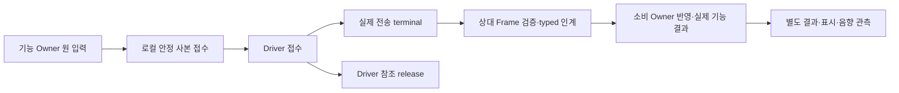

# 종단 간 기능·오류·복구 상세설계

[시작](00_START_HERE.md) · [Network 개요](01_NETWORK_OVERVIEW.md) · [Layer·Module·Function](03_LAYER_MODULE_INDEX.md) · [노드 경계](08_NODE_BOUNDARIES.md)

SC01~SC18의 기능 생산자부터 Network, 소비 Owner, 결과·표시·음향까지 연결한다. 각 경로의 정상 조건·실패 부작용·복구 근거를 설명한다. 전체 Wire48/Rx51과 Node8/Link17, Layer5/Module9/Function25/State12의 기존 구조 및 C2 책임 합의를 따른다.

## 기능을 따라 읽는 순서

1. 아래 원 시나리오 색인에서 기능을 고른다. 원 ID·제목·직접 Wire/Rx 집합은 S4C 정본을 따른다.
2. 해당 흐름의 발생 조건과 생산자, 원본 식별자·품질·AGE를 확인한다. 조건부 정상 경로와 현재 HOLD를 함께 읽는다.
3. 연결된 기존 Node→Module→Function→Data/API 정본에서 정확한 원형·반환·수명·의사코드로 내려간다. 이 문서는 같은 Codec·바이트표·공개 API 본체를 복제하지 않는다.
4. 각 SC의 실패/복구와 [공통 실패](flows/e2e/COMMON_FAILURE_RECOVERY.md)를 함께 확인한다. 문서 설명 완료와 제품 실행 확인을 구분한다.

| ID | 원 시나리오 제목 | 직접 Wire/Rx | 기능별 정상·실패·복구 |
|---|---|---:|---|
| SC01 | 수동 도어 요청·실행 결과·상태·음향 |7/7| [BCM 요청·결과](flows/e2e/BCM_REQUEST_RESULT.md#sc01) |
| SC02 | 공조 설정·센서 입력·실제 출력 및 보호 |10/10| [공조](flows/e2e/BCM_REQUEST_RESULT.md#sc02) |
| SC03 | 실내 조명 설정·적용·표시 |7/7| [조명](flows/e2e/BCM_REQUEST_RESULT.md#sc03) |
| SC04 | 디지털 키 문맥·자동 Unlock 상태/결과 |6/6| [디지털 키](flows/e2e/BCM_REQUEST_RESULT.md#sc04) |
| SC05 | 환경 센서 원값·부분 품질 수집과 표시 |3/3| [환경](flows/e2e/SENSORS_VISION_PERMISSION.md#sc05) |
| SC06 | Pi 카메라 판정·CIS 경유 전달과 잔류 탑승자 경고 연결 |7/7| [Vision·탑승자](flows/e2e/SENSORS_VISION_PERMISSION.md#sc06) |
| SC07 | 후방 관측→DOMAIN 위험 판단→음향·표시 |4/4| [후방](flows/e2e/SENSORS_VISION_PERMISSION.md#sc07) |
| SC08 | 원 Permission fan-out과 Pi 사용 허용 경유 |2/5| [Permission](flows/e2e/SENSORS_VISION_PERMISSION.md#sc08) |
| SC09 | BCM 보호 발생·현재 진단·가용성 |5/5| [BCM 진단](flows/e2e/BCM_REQUEST_RESULT.md#sc09) |
| SC10 | CIS·Pi 일부 고장 및 통신 Health 전달 |5/5| [CIS·Pi Health](flows/e2e/SENSORS_VISION_PERMISSION.md#sc10) |
| SC11 | 보류 WINDOW 이동·STOP·실제 결과·상태 |5/5| [WINDOW 명령](flows/e2e/WINDOW_VSS_HEALTH.md#sc11), DEFERRED |
| SC12 | 보류 WINDOW 끝단·끼임·Fault와 경고 |6/6| [WINDOW 보호](flows/e2e/WINDOW_VSS_HEALTH.md#sc12), DEFERRED |
| SC13 | VSS 일회 Event·지속 경고·복구 경계 |4/4| [VSS Event/Warning](flows/e2e/WINDOW_VSS_HEALTH.md#sc13) |
| SC14 | VSS 현재/최근 고장과 App 가용성 |4/4| [VSS Status](flows/e2e/WINDOW_VSS_HEALTH.md#sc14) |
| SC15 | 기존 상태·결과·경고 Query와 부분 응답·종결 |19/19| [Query](flows/e2e/QUERY_WARNING_SESSION.md#sc15) |
| SC16 | 경고 읽음 및 사용자 이탈 후 열린 도어 |3/3| [Warning ACK](flows/e2e/QUERY_WARNING_SESSION.md#sc16) |
| SC17 | 부팅·세대 변경·단절/재접속·결과 미확인 |9/12| [기동·복구](flows/e2e/COMMON_FAILURE_RECOVERY.md#sc17) |
| SC18 | 기존 전송 경계의 거부·부분 수신·용량·후발 실패 |0/0| [공통 오류](flows/e2e/COMMON_FAILURE_RECOVERY.md#sc18) |

표의 분모는 SC별 직접 집합이다. 시나리오 간 중복이 있어 합계가 전체48/51이 되지 않는다. SC08은 DOMAIN_PERMISSION 한 CAN Wire의 BCM/CIS/VSS/WINDOW 네 수신과 P_PERMISSION 한 수신을 합한2/5이고 WINDOW 분기는 실행 보류다. SC17도 Permission fan-out 때문에9/12다. **SC18은 원 직접 집합0/0**이며 BCM_DOOR_COMMAND·M_QUERY_END·P_VISION_RESULT 등은 오류 경계를 설명하는 보조 예시다. 추적 대상에서 공통 오류를 빠뜨리지도, 직접 Wire로 새 등록하지도 않는다.

## 단계마다 확인할 수 있는 사실

화살표는 설계 인과 경로이고 앞 단계 성공이 다음 단계 성공의 증거라는 뜻은 아니다. release는 terminal의 전후 어느 쪽에도 올 수 있다. 실제 Driver token/epoch·참조 계약이 확인되지 않으면 수명·결과를 미확정으로 둔다.

| 관측 축 | 성공으로 기록할 근거 | 대신할 수 없는 근거 |
|---|---|---|
| 로컬 접수 | 전체 입력·원 identity의 안정 사본과 원자 게시 | public/Callback 선언 존재, capacity 설정 |
| 전송·수명 | 실제 Driver token/epoch별 접수·terminal·release의 각 증거 | Queue OK, Link 복구, release만 도착 |
| 상대 typed 수용 | 해당 수신의 codec/admission·소비 반환/복사 계약 | CAN ACK, UART final TX, callback void 반환 |
| 기능 결과 | 원 명령/발생에 대응한 기능 Owner의 실제 결과·상태 | TX 성공, 결과 timeout, 희망 target |
| Query·표시·음향 | 원 Query의 실제 응답/End 순서·Gateway RX·App 소비 또는 VSS 실제 출력 관측 | enqueue count, Status PLAYING, 읽음 ACK |

## 기존 구현 책임을 재사용하는 지점

| 기능별 연결 | 기존 책임·정본 | 경로별 연결 |
|---|---|---|
| 요청→명령→실행→결과 | M01/M03/M04, [DOMAIN 명령](flows/DOMAIN_COMMAND_TO_NETWORK.md), [BCM](nodes/BCM.md) | 원 Request/Command/Result identity와 실제 실행의 종단 구분 |
| 센서→판정→경고 | M01/M03~M06, [CIS/Pi](nodes/CIS_PI.md), [후방](flows/CIS_REAR_144_TO_344.md) | 값별 품질/AGE·1mm·원 Permission 수명과 기능 Owner 연결 |
| Window/VSS | M03~M05/M07~M09, [WINDOW](nodes/WINDOW.md), [VSS](nodes/VSS.md) | 현재 HOLD·실제 보호/음향·현재/이력 고장 분리 |
| Query/ACK | M01/M02/M03/M06, [Query](functions/UART_M_QUERY_CONTROL.md), [association](functions/DOMAIN_QUERY_PROVENANCE.md#association) | Getter 성공 OUT·원 요청/현재 수신자·부분 응답·종결/읽음의 범위 |
| 공통 오류/재기동 | M04/M07~M09, [수명](functions/NETWORK_SERVICE_LIFETIME.md), [실패/Health](functions/NETWORK_FAILURE_HEALTH.md) | 버퍼/결과/예약 세 수명과 후발 callback·현재 기동 귀속 |

새 Layer·Module·Function ID·Task·Queue·공개/내부 helper 함수는 추가하지 않는다. 흐름의 C형 의사코드는 기존 선언의 호출 지점을 연결한 예이고 전체 본체는 원 정본을 따른다. 현재 책임별 상세는 [통합 색인](03_LAYER_MODULE_INDEX.md)에서 탐색한다.

## 시간·순서·적용 제약

Boot, producer generation, update/occurrence, TX/LINK_SEQUENCE, Request/Session/Query는 다른 축이다. 같은 TX 반복으로 원 AGE/발생/품질을 갱신하지 않는다. 원 시각과 로컬 단조시간을 섞어 빼지 않고, 이미 반영한 대기를 다시 더하지 않는다. epoch/wrap/바인딩 미확인은 HOLD이며 새 timeout 숫자를 만들지 않는다. C2 v0.6/Vehicle v0.3 후보의 sourceGeneration 필드가 있어도 Generation0·BOOT_ID lifecycle·CIS Environment 정책은 회신 대기다.

WINDOW 구현·표시·timeout, CF01 UART-M VERSION2, VSS A1 WARNING60(used60/frame64/DLC15) 내부 선택·WARNING51 이력·CF02 실제 양단 지원/ABI/시간 검증 HOLD, 실제 Driver·Clock·Owner 소비·same-observation·App/BLE 바인딩, G5-0 공식 게시 HOLD를 유지한다. 모든 기능을 일괄 막는 대신 근거가 없는 해당 투영/실행 경계를 표시하고 원 자료와 별개의 유효 경로를 보존한다. 실제 이식·실행 시험을 정적 설계 PASS로 대체하지 않는다.

이 문서의 조건부 경로는 실제 Owner·Driver·App 바인딩과 실행 검증을 대신하지 않는다. 기존 Interface 기준 S6/G6 검수 후 당시 r1 Interface 40개와의 최초 동기화를 완료했고, 이후 문서 변경은 `00a43414`에 별도로 반영했다. 남은 협의 변경과 공식·제품 통합은 별도 확정·승인 및 실제 검증 대상으로 유지한다.
