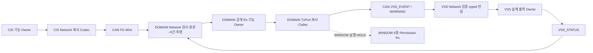

# CIS·WINDOW·VSS — 양단 수송과 소비 경계

[Network](../00_START_HERE.md) · [Node/Link](../02_NODE_LINK_MAP.md) · [Layer/Module](../03_LAYER_MODULE_INDEX.md) · [공통 CAN Flow](CAN_NETWORK_PATHS.md) · [노드 Data](../data/CAN_NODE_DATA.md)

CIS의 센서·Pi 판정은 DOMAIN에 입력되고, DOMAIN이 만든 이벤트·경고는 VSS로 간다. WINDOW의 다섯 전용 Wire와 공유 Permission의 WINDOW 수신은 문서상 연결만 유지한다. 현재 WINDOW의 실제 송수신·timeout·liveness·모터·STOP 작업을 열지 않는다. VSS 경고는 CF02 양단 형식이 미선택이므로 정상 소비가 막힌다.

화살표 사이의 CAN은 바이트 전송이다. 상대 ECU의 API를 송신 ECU에서 직접 호출하지 않는다. 공통 저장·Driver·admission·AGE는 [전송 제어](../functions/CAN_TRANSFER_CONTROL.md) 한 정본을 사용한다. 각 메시지의 고유 조건은 아래 독립 경로에 있다.

## CIS_REAR

`WIRE-P01-CIS_REAR` → `RX-P01-CIS_REAR-DOMAIN`. `CisNet_PublishRear` → 송신 Network의 완전 사본 → 고정 offset Encode → CAN → 실제 수신 frame 사본 → Decode/admission → `DomainIf_RxCisRear`.

[함수·양단 API](../functions/can/CIS_REAR.md) · [자료](../data/CIS_REAR_DATA.md)

기존 [CIS_REAR 전체 Flow](CIS_REAR_144_TO_344.md)를 재사용한다. raw123=123mm·같은 update와 AGE의 별도 비교·후발 Driver/queue 실패는 기존 여덟 파일의 절차 한 번만 적용한다.

## CIS_ENVIRONMENT

`WIRE-P01-CIS_ENVIRONMENT` → `RX-P01-CIS_ENVIRONMENT-DOMAIN`. `CisNet_PublishEnvironment` → 송신 Network의 완전 사본 → 고정 offset Encode → CAN → 실제 수신 frame 사본 → Decode/admission → `DomainIf_RxCisCabinEnvironment`.

[함수·양단 API](../functions/can/CIS_ENVIRONMENT.md) · [자료](../data/CAN_NODE_DATA.md#CIS_ENVIRONMENT)

원본 전환: 온도·습도·조도 각각의 원 생산 세대, temperature/humidity/illuminance_sequence. CAN BOOT/TX는 외피 식별이다. temperature_age_ms, humidity_age_ms, illuminance_age_ms를 독립 누적한다. 다른 채널 갱신이 원 시각을 재시작하지 않는다.

소비 전에 cabinTemperature/cabinHumidity/cabinIlluminance에 원 raw를 그대로 옮긴다. 각 ValueQuality_t.validity/reason은 이름으로 변환하고 meta.updateSequence와 meta.ageMs에는 같은 채널의 원 순번과 소비시점 AGE를 넣는다. meta.quality는 validity/reason 숫자 비교로 만들지 않는다. 세대 연결과 DataQuality 투영이 합의된 경우에만 전체 C2 객체를 전달한다.

온도·습도 원 사용기한은 각각2500ms이며 도달 시 비사용한다. 조도 TTL과 기존 품질의 나머지 대응·실제 VSM/독립 Meta 연결은 검증 대기다. 새 frame 없는 만료·수신중단·Boot 변경은 [M09 로컬 사건→기존 C2](../functions/can/CIS_ENVIRONMENT.md#local-invalidation) 경로다. 환경 sourceGeneration을 추가하지 않으며 Boot 후 낮은seq의 C2 수용 규칙 부족은 [별도 경계](../functions/can/CIS_ENVIRONMENT.md#boot-binding-gap)에 남긴다.

정상/조건부 예: 온도 -123raw는 -1.23°C, 습도65535+INVALID/SENSOR_FAULT와 조도70000lx를 함께 보존한다. 유효하지 않은 습도만으로 정상 온도·조도를 버리지 않는다. 실패·경계: 조도70000을 uint16으로 절삭하거나 습도 고장 때문에 온도를0°C로 바꾸면 거부 대상이다. 온도 -32768+VALID, 습도10001, 조도200001은 거부한다. 올바른 sentinel+INVALID는 malformed가 아니다.

## CIS_OCCUPANT

`WIRE-P01-CIS_OCCUPANT` → `RX-P01-CIS_OCCUPANT-DOMAIN`. `CisNet_PublishOccupant` → 송신 Network의 완전 사본 → 고정 offset Encode → CAN → 실제 수신 frame 사본 → Decode/admission → `DomainIf_RxCisOccupant`.

[함수·양단 API](../functions/can/CIS_OCCUPANT.md) · [자료](../data/CAN_NODE_DATA.md#CIS_OCCUPANT)

원본 전환: 원 pi_boot_id+vision_sequence와 CAN CIS BOOT/TX를 따로 보존한다. vision_function_status는 같은 occupant update의 CIS 상태다. vision_age_ms는 Pi 최초 판정 이후 누적이다. CIS 보관·CAN 송신·DOMAIN 소비의 미반영 구간만 더한다.

소비 전에 presence0/1은 occupantPresent false/true로 이름 대응하고 count0..5는 occupantCount에 보존한다. UNKNOWN255는 품질과 별개로 확인된 부재/0명이 아니며 비사용 저장값 규칙이 없으면 typed 투영을 HOLD한다. presenceQuality/countQuality는 같은 vision_sequence·소비 AGE를 쓰되 각각 validity/reason을 유지한다. sourceGeneration은 검증된 Pi 계보만 사용한다. visionFunctionStatus는 같은 입력의 상태를 이름 변환한다.

Pi 원 기록과 현재 제한은 구별한다. 같은 관측의 새 적법 TX·원값 불변·실제 제한 사건은 [CIS_OCCUPANT 전용 검사](../functions/can/CIS_OCCUPANT.md#restriction-check)를 통과한 경우에만 기존 C2로 전달한다. sourceGeneration의 Pi 계보·Core/Getter 실제 연결과 bool에255 UNKNOWN을 손실 없이 표현하는 소비 계약은 여전히 확인 대상이다.

정상/조건부 예: Pi Boot10/vision7이 CIS Boot20/TX90으로 중계되어도 sourceGeneration을20으로 바꾸지 않는다. count2와 presence YES의 각 품질을 함께 전달한다. 실패·경계: 새 CIS_STATUS READY로 오래된 occupant update의 vision_function_status·품질·AGE를 갱신하지 않는다. presence255 또는 count255의 정상 품질 저하는 raw DTO에 보존한다. C2 비사용 표현이 미합의면 정상 callback 대신 HOLD다.

## CIS_STATUS

`WIRE-P01-CIS_STATUS` → `RX-P01-CIS_STATUS-DOMAIN`. `CisNet_PublishStatus` → 송신 Network의 완전 사본 → 고정 offset Encode → CAN → 실제 수신 frame 사본 → Decode/admission → `DomainIf_RxCisStatus`.

[함수·양단 API](../functions/can/CIS_STATUS.md) · [자료](../data/CAN_NODE_DATA.md#CIS_STATUS)

원본 전환: CIS 생산 세대+update_sequence는 상태 평가, last_fault_occurrence는 최근 고장 발생이다. 두 번호를 합치지 않는다. source_age_ms는 상태 평가 후 시간이다. 새 status 전송이 과거 센서 관측의 AGE를 초기화하지 않는다.

소비 전에 ecuState와 다섯 기능 상태를 의미 이름으로 대응한다. raw interface READY0→CIS_INTERFACE_AVAILABLE0, UNAVAILABLE1→CIS_INTERFACE_UNAVAILABLE2, RECOVERING2→CIS_INTERFACE_RECOVERING3이다. faultMask/activeFaultCode/recovering/lastFaultCode/lastFaultOccurrenceId/affectedFunctionMask를 같은 입력에서 구성한다. sourceGeneration은 원 CIS 계보, meta는 원 UPDATE/소비 AGE와 확인한 품질 투영으로만 채운다.

현재 차단 조건: IF-O09, IF-O15, IF-O19, IF-O24: 원 세대와 SignalMeta 품질 산출 및 C2 반영 연결을 확인하기 전 기능 정상화는 HOLD다.

정상/조건부 예: active_fault0이어도 last_fault5/발생9는 최근 고장 이력으로 남는다. RECOVERING은 실제 회복 완료가 아니다. 실패·경계: interface raw1을 C2 enum1로 cast하거나 fault_mask의 bit9를 센서 정상 상태로 처리하면 안 된다. fault_mask0x1FF는 정의된 비트 집합,0x200은 예약 비트다. affected_function0x40도 거부한다.

## WINDOW_COMMAND

`WIRE-P01-WINDOW_COMMAND` → `RX-P01-WINDOW_COMMAND-WINDOW`. `DomainIf_TxWindowCommand` → 송신 Network의 완전 사본 → 고정 offset Encode → CAN → 실제 수신 frame 사본 → Decode/admission → `WindowApp_OnDomainCommand`.

[함수·양단 API](../functions/can/WINDOW_COMMAND.md) · [자료](../data/CAN_NODE_DATA.md#WINDOW_COMMAND)

원본 전환: DOMAIN 원 commandId·원 DOMAIN 기동·TARGET_BOOT_ID를 보존한다. CAN TX_SEQUENCE를 명령 ID로 쓰지 않는다. command.command_age_ms는 최초 명령 생성 이후 누적이다. ACCEPT_LIMIT200ms 대1s 미결을 임의 결정하지 않는다.

소비 전에 C2 WindowCommand_t OPEN/CLOSE/STOP/VENT/MOVE_TO_POSITION의0..4를 Net 대응 이름1..5로 바꾼다. context.commandId를 보존하되 원 COMMAND_AGE 근거·TARGET_BOOT_ID·ACCEPT_LIMIT·source_context 축약은 확인된 Owner 바인딩에서만 얻는다. context.commandAgeMs는 원 명령 생성 AGE로 누적 후 u16 포화한다. context.meta.ageMs는 판단 자료의 나이이며 명령 생성 AGE로 대체하지 않는다.

현재 차단 조건: WINDOW_EXECUTION_HOLD, IF-O03, IF-O04, IF-O07, IF-O18, G05: 송수신·liveness·모터 실행·STOP 작업까지 현재 비활성이다.

정상/조건부 예: 현재의 정상 결과는 미활성 경로를 접수하지 않는 HOLD다. 향후 별도 활성 합의 후에도 STOP은 출처·대상 기동·명령 ID·AGE·형식을 통과해야 한다. 실패·경계: 계속 이동 permission 상실만으로 정당한 STOP 수송을 막거나 permission 회복만으로 예전 이동을 재개하지 않는다. 이 조건 설명은 현재 실행 보류를 해제하지 않는다. channel1·목표101은 거부 대상. VENT70 또는80 중 어느 쪽도 현재 생산 기본값으로 채택하지 않는다.

## WINDOW_STATE

`WIRE-P01-WINDOW_STATE` → `RX-P01-WINDOW_STATE-DOMAIN`. `WindowNet_PublishState` → 송신 Network의 완전 사본 → 고정 offset Encode → CAN → 실제 수신 frame 사본 → Decode/admission → `DomainIf_RxWindowState`.

[함수·양단 API](../functions/can/WINDOW_STATE.md) · [자료](../data/CAN_NODE_DATA.md#WINDOW_STATE)

원본 전환: WINDOW 생산 세대+update_sequence는 실제 상태 평가다. fully_open_state는 현재 상태이며 FULLY_OPENED 사건과 다르다. source_age_ms는 실제 상태 평가 후 시간이다. 늦은 STATE 수신을 새 위치 관측으로 만들지 않는다.

소비 전에 motionState는 raw255→WINDOW_MOTION_UNKNOWN0, raw0..3→STOPPED/OPENING/CLOSING/ANTIPINCH_REVERSING 이름 대응이다. ecuState·positionPercent·meta는 해당 원 필드다. channel은 Wire에 없고 단일채널0 바인딩이 필요하다. fullyOpen/fullyClosed는0/1에만 대응한다. protection/reverse를 CLEAR/ACTIVE로 임의 축약하지 않는다. sourceGeneration은 원 WINDOW 계보 확인 전 합성하지 않는다.

현재 차단 조건: WINDOW_EXECUTION_HOLD, IF-O07, IF-O18, IF-O24, G05: 보호 상태4종+역전 여부를 C2 AntiPinchState_t 두 값으로 축약할 근거가 없다. 끝단 UNKNOWN255의 bool 표현도 미확인이다.

정상/조건부 예: 조건부 위치37%·CLOSING은 실제 보고값으로 보존한다. 현재 실행은 HOLD이며 이 값을 수신했다고 모터 명령을 만들지 않는다. 실패·경계: timeout으로 STOPPED·fullyClosed 또는 protection DONE을 생성하지 않는다. position255는 확인불가,100은 완전닫힘 비율이다. 두 값의 의미를 바꾸지 않는다.

## WINDOW_EVENT

`WIRE-P01-WINDOW_EVENT` → `RX-P01-WINDOW_EVENT-DOMAIN`. `WindowNet_SendEvent` → 송신 Network의 완전 사본 → 고정 offset Encode → CAN → 실제 수신 frame 사본 → Decode/admission → `DomainNetPriv_OnWindowEvent`.

[함수·양단 API](../functions/can/WINDOW_EVENT.md) · [자료](../data/CAN_NODE_DATA.md#WINDOW_EVENT)

원본 전환: WINDOW 기동+event_kind+occurrence_id와 related_domain_boot/related_request_sequence를 구분한다. 로컬 발생의 연결0은 실제 무연계다. event_age_ms는 최초 전이/끼임 발생 후 시간이다. 반복 송신으로 새 발생번호를 만들지 않는다.

소비 전에 기존 DomainNetPriv_OnWindowEvent가 원 DTO/meta를 같은 사건으로 보존한다. ANTIPINCH에만 DomainIf_RxWindowAntiPinch 후보를 연결한다. C2 occurrenceId는 원 발생번호, meta는 원 품질·AGE 근거이나 outputDisabled/movementStopped/protectionState/reason을 이 Event Wire만으로 완성할 수 없다. END를 AntiPinch로 인계하지 않는다.

현재 차단 조건: WINDOW_EXECUTION_HOLD, IF-O07, IF-O18, IF-O24, G05: END 소비자와 requestSequence↔commandId 귀속 및 AntiPinch 보호 근거가 미합의다.

정상/조건부 예: FULLY_OPENED occurrence9의 반복은 같은 사건이다. 현재는 실행 HOLD이며 END를 삭제해 전체 성공으로 만들지 않는다. 실패·경계: FULLY_CLOSED 전이를 ANTIPINCH로 축약하거나 CAN ACK로 outputDisabled=true를 채우지 않는다. 로컬 event의 related_domain_boot0/related_request_sequence0은 허용 후보이며 현재 DOMAIN 명령을 자동 연결하지 않는다.

## WINDOW_RESULT

`WIRE-P01-WINDOW_RESULT` → `RX-P01-WINDOW_RESULT-DOMAIN`. `WindowNet_SendResult` → 송신 Network의 완전 사본 → 고정 offset Encode → CAN → 실제 수신 frame 사본 → Decode/admission → `DomainIf_RxWindowCommandResult`.

[함수·양단 API](../functions/can/WINDOW_RESULT.md) · [자료](../data/CAN_NODE_DATA.md#WINDOW_RESULT)

원본 전환: request_domain_boot+request_sequence+channel은 원 DOMAIN 명령 연결 후보이며 WINDOW 송신 BOOT/TX와 다르다. 이 Wire에는 결과 원 평가 AGE/UPDATE가 없다. C2 meta를 TX_SEQUENCE나 최근 수신 시각으로 생성하지 않는다.

소비 전에 commandId는 원 명령의 확정된 대응표에서만 연결한다. result/reason은 의미 이름 변환을 쓰고 C2 전용 MOTOR_FAULT/SENSOR_FAULT/TIMEOUT/OTHER 등을 임의 축약하지 않는다. channel0은 유지한다. SignalMeta 전체 근거가 없으면 DomainIf_RxWindowCommandResult를 호출하지 않는다.

현재 차단 조건: WINDOW_EXECUTION_HOLD, IF-O02, IF-O07, IF-O24, CAN_RESULT_NOT_PRESENT_CONTEXT, G05: REQUEST_SEQUENCE와 commandId 대응·결과 meta 생성 근거가 미합의다.

정상/조건부 예: 현재는 실행 HOLD다. 향후 같은 원 명령 DONE 뒤 늦은 IN_PROGRESS가 와도 종결 상태를 되돌리지 않는 경계를 유지한다. 실패·경계: CAN ACK 또는 Driver TX만으로 result DONE·C2 confirmation을 만들지 않는다. result255는 일반 enum 선언 존재만으로 CAN에서 허용하지 않는다. 원 명령 귀속이 불명확한0도 자동 새 명령으로 만들지 않는다.

## WINDOW_FAULT

`WIRE-P01-WINDOW_FAULT` → `RX-P01-WINDOW_FAULT-DOMAIN`. `WindowNet_PublishFault` → 송신 Network의 완전 사본 → 고정 offset Encode → CAN → 실제 수신 frame 사본 → Decode/admission → `DomainNetPriv_OnWindowFault`.

[함수·양단 API](../functions/can/WINDOW_FAULT.md) · [자료](../data/CAN_NODE_DATA.md#WINDOW_FAULT)

원본 전환: WINDOW 원 생산 세대+occurrence_id와 update_sequence를 별도로 보존한다. source_age_ms는 고장 평가 후 시간이다. 고장 발생 시각이나 last event AGE를 대신하지 않는다.

소비 전에 DomainNetPriv_OnWindowFault는 NetWindowFault/meta의 전체 근거를 보존한다. 확인된 category/code/status 이름을 FaultInfo_t에 투영할 수 있는지 먼저 확인하며 원 발생·AGE·세대의 손실을 숨기지 않는다. 실제 동일 입력의 C2 반영 증거가 없으면 raw↔snapshot 연결을 만들지 않는다.

현재 차단 조건: WINDOW_EXECUTION_HOLD, IF-O07, IF-O15, IF-O24, WINDOW_FAULT_PROJECTION, G05: 좁은 FaultInfo 투영·발생 계보 바인딩은 미합의다.

정상/조건부 예: fault_status NONE이면서 최근 occurrence를 보존할 수 있다. 현재는 실행 HOLD이며 미연결 WINDOW에 필수 통신고장을 만들지 않는다. 실패·경계: RECOVERING 수신을 고장 완전 해제·모터 재가동 허가로 바꾸지 않는다. fault_code255 OTHER는 명시 후보지만256은 미지원이다. fault_status3은 거부한다.

## VSS_EVENT

`WIRE-P01-VSS_EVENT` → `RX-P01-VSS_EVENT-VSS`. `DomainIf_TxVssOneShotEvent` → 송신 Network의 완전 사본 → 고정 offset Encode → CAN → 실제 수신 frame 사본 → Decode/admission → `VssApp_OnDomainEvent`.

[함수·양단 API](../functions/can/VSS_EVENT.md) · [자료](../data/CAN_NODE_DATA.md#VSS_EVENT)

원본 전환: DOMAIN 원 생산 세대+event_kind+occurrence_id가 의미 사건이다. related_command_id는 별도 명령 연결이다. original_age_ms는 최초 사건 후 경과, use_limit_ms는 원 사용 한도다. 후보500ms와 구 실제 음향 시작2초 요구의 기준을 임의 통합하지 않는다.

소비 전에 C2 VSS_EVENT_VEHICLE_WELCOME/GOODBYE/DOOR_LOCK_COMPLETE/DOOR_UNLOCK_COMPLETE/DOOR_LOCK_ERROR0..4를 Net 대응 이름1..5로 바꾼다. occurrenceId는 보존하고 meta.quality와 meta.ageMs만 원 품질/AGE로 연결한다. meta.updateSequence는 이 Wire와 중복 판정에 사용하지 않으며 원 DTO 값을0으로 강제하지 않는다. availability3 UNSUPPORTED는 HOLD다. hasRelatedCommand=true일 때 실제 relatedCommandId 연결을 보존한다.

현재 차단 조건: IF-O02, IF-O16, D-03, D-05, IF-O09, IF-O12: use-limit/실제 시작 기준과 필수 후발 실패 sink 바인딩이 미합의다. C2 UNSUPPORTED 가용성에는 동등 raw가 없다.

정상/조건부 예: 원 occurrence17을 TX10/11로 보완 전송해도 한 사건이며 새 재생 요구로 만들지 않는다. VSS App의 void 반환은 실제 음향 시작·완료가 아니다. 실패·경계: 환영 이벤트 미발생을 timeout으로 판정하거나 LOCAL TX 성공으로 VSS 재생 완료를 보고하지 않는다. 원 AGE가 확인한 use-limit을 넘거나 경계 비교 정책이 미합의면 새 재생 입력을 제한한다. use-limit500을 자동 기본값으로 넣지 않는다.

## VSS_WARNING_STATE

`WIRE-P01-VSS_WARNING_STATE` → `RX-P01-VSS_WARNING_STATE-VSS`. `DomainIf_TxVssWarningState` → 송신 Network의 완전 사본 → 고정 offset Encode → CAN → 실제 수신 frame 사본 → Decode/admission → `VssApp_OnDomainWarningState`.

[함수·양단 API](../functions/can/VSS_WARNING_STATE.md) · [자료](../data/CAN_NODE_DATA.md#VSS_WARNING_STATE)

원본 전환: 끼임·탑승자·후방 각 source_boot/source_sequence와 DOMAIN rear_activation_sequence는 서로 다른 판단 근거다. 세 original_age_ms와 rear_activation_age_ms를 각각 누적한다. 후방 거리 근거의 시각을 활성 평가의 시각으로 쓰지 않는다.

소비 전에 세 DomainIf_WarningInputEvidence_t의 source.generation/sequence/ageMs, quality/reason/availability를 각 독립 Wire 묶음으로 연결한다. C2 UNCONFIRMED·UNSUPPORTED는 동등 raw가 없어 CLEAR/UNAVAILABLE로 바꾸지 않는다. rearDetectionActivation과 rearActivationMeta/reason은 독립 DOMAIN 평가다. C2에는 activation_meta_format 멤버가 없고 확장 marker는 채택 profile의 Codec 책임 후보다.

현재 차단 조건: CF02, IF-O01, IF-O02, IF-O06, IF-O17, WINDOW_ANTIPINCH_HOLD: used51/60 양단 선택 전 정상 encode/decode/typed 소비 HOLD. profile enum 값 자체는 팀 채택 증거가 아니다.

정상/조건부 예: 현재 정상 진입은 CF02 HOLD다. used60이 향후 채택되어도 세 위험의 원 근거와 후방 활성 평가를 별도로 전달하며 VSS가 거리를 재평가하지 않는다. 실패·경계: DLC15나 B51=1로used60을 자동 선택하지 않는다. B51..59가0이어도used51을 선택하지 않는다. 두 후보 모두64B다. used51은B51..63 padding0, used60은B51..59 의미+ B60..63 padding0이다. format0을 활성 품질OK로 합성하지 않는다.

## VSS_STATUS

`WIRE-P01-VSS_STATUS` → `RX-P01-VSS_STATUS-DOMAIN`. `VssNet_PublishStatus` → 송신 Network의 완전 사본 → 고정 offset Encode → CAN → 실제 수신 frame 사본 → Decode/admission → `DomainNetPriv_OnVssStatus`.

[함수·양단 API](../functions/can/VSS_STATUS.md) · [자료](../data/CAN_NODE_DATA.md#VSS_STATUS)

원본 전환: VSS 생산 세대+update_sequence는 서비스 평가, last_fault_occurrence는 최근 고장 이력이다. source_age_ms와 last_fault_age_ms는 독립이다. 최근 고장 AGE65535는 오래된 이력의 포화 하한이다.

소비 전에 DomainNetPriv_OnVssStatus가 service.state/availability/acceptingEvents/faultActive를 의미 이름으로 구성하고 service.meta에 원 update/소비 AGE를 연결한다. faultMask/lastFaultCode/lastFaultOccurrenceId/lastFaultAgeMs와 sourceGeneration은 원 VSS 보고의 근거로만 연결한다. LAST_FAULT_QUALITY0/3은 최근 기록 존재의 뜻이며 C2 faultQuality 전체 의미와 동등하지 않다. FaultInfo 선택·현재 고장 우선순위는 원문만으로 확정할 수 없다.

현재 차단 조건: IF-O06, IF-O15, IF-O17, IF-O09, IF-O24, VSS_STATUS_PROJECTION: R4/R6 원 Snapshot→DTO, C2 서비스/고장 품질·세대 및 두 소비 경계의 부분 성공 집계가 미합의다.

정상/조건부 예: fault_active0·fault_mask0이어도 최근 fault3/occurrence5/AGE65535/quality0은 이력으로 남는다. VSS PLAYING은 개별 Event 완료가 아니다. 실패·경계: CAN link lost를 FAULT_MASK의 AUDIO_OUTPUT_FAILURE로 만들거나 기록품질2를0/3으로 축약하지 않는다. fault_mask0x1F는 정의 비트,0x20은 예약이다. last_fault_quality1/2는 malformed다. NO_DATA3은 실제 기록없음과 함께 해석한다.

## 실패와 복구의 책임 전환

송신 함수가 인자 오류·준비 부족·공간 부족을 반환하면 원 caller는 접수되지 않은 사실을 알 수 있다. 성공한 뒤 실패는 원 사본의 식별로 연결하며 과거 OK를 차량 FAILED로 바꾸지 않는다. Driver accepted 이후는 M07 프레임을 불변으로 유지하고 최종 결과와 참조 해제를 각각 확인한다. bus-off나 local reset 뒤에도 참조 중인 주소를 재사용하지 않는다. 옛 callback·중복 결과로 새 프레임을 완료하거나 두 번 해제하지 않는다.

수신에 형식 오류가 있으면 정상 typed 전달·liveness·순번 장부를 갱신하지 않는다. 형식 유효한 열화 품질은 원 상태로 보존한다. 수신 저장 공간 부족 시 순번 장부를 먼저 전진시키지 않는다. C2 반환 실패·private 두 경계의 부분 성공은 실제 반환과 대상별 결과로 남긴다. 성공한 Core 입력을 optional Observer 실패 때문에 다시 적용하지 않는다.

회복은 장치·profile·현재 기동·시간·필수 소비자 준비를 재확인하는 조건이다. 과거 의미 자료의 자동 송신·새 identity·AGE0·기능 허용 복원이 아니다. WINDOW STOP 예외는 별도 활성화 후의 조건부 수송 설명이며 현재 보류를 해제하지 않는다. CF02는64B/DLC15·format marker 관측으로 선택하지 않는다. 원 미결·Interface 변경은 S6 이후 통합 기록에서 유지하며 이 Flow가 정책을 확정하지 않는다.
