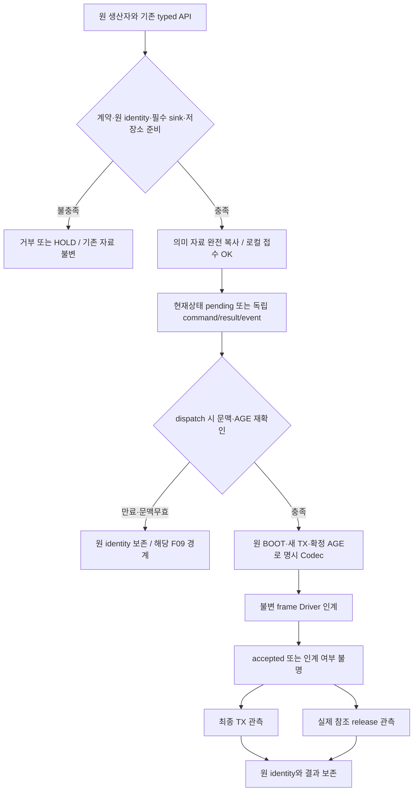
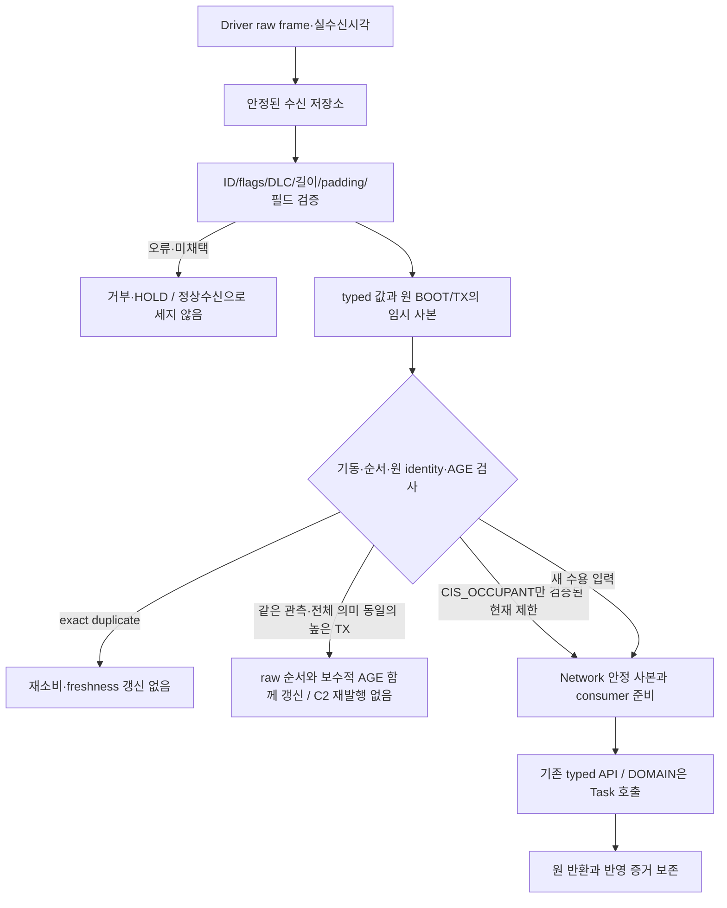

# CAN 공통 송수신 흐름과 관측 경계

[CAN 전체 지도](../04_CAN_FD_OVERVIEW.md) · [공통 함수](../functions/CAN_TRANSFER_CONTROL.md) · [Codec](../functions/CAN_COMMON_CODEC.md) · [Data](../data/CAN_COMMON_DATA.md) · [BCM/Permission](CAN_BCM_AND_PERMISSION.md) · [CIS/WINDOW/VSS](CAN_CIS_WINDOW_VSS.md)

## 정상 전송의 조건과 순서

로컬 접수 이후 producer의 포인터를 보유하지 않는다. Driver 결과가 불명확하면 같은 항목으로 추가 송신을 하지 않는다. release가 먼저 와도 결과 identity는 보존하고, terminal이 먼저 와도 reference가 남아 있으면 frame을 재사용하지 않는다. 기능 완료는 원 ECU의 결과/실제 피드백과 DOMAIN Owner 정책이 있어야 판단할 수 있다.

## 수신과 typed 인계

원장 공개는 안정 사본 확보 뒤에만 한다. reserve/copy 실패가 sequence를 앞당겨 정상 재시도를 버리게 하지 않는다. consumer가 부분 반영했는지 불명확하면 성공으로 표시하거나 무조건 재호출하지 않는다. VSS state/fault처럼 한 입력에서 둘 이상의 공개 인계가 필요한 경계는 실제 원자성/부분 성공 계약이 확인되기 전 해당 정상 분기를 HOLD한다.

## 메시지 성격별 저장과 수명

| 성격 | 저장·재전송 규칙 | 금지하는 해석 |
|---|---|---|
| 현재 관측/상태 | 동일 source key의 non-inflight pending만 조건부 교체. 원 UPDATE/품질·AGE 유지 | 새 TX가 새 관측이라는 주장 |
| 명령 | 원 commandId·생성 계보·target BOOT·command AGE·acceptLimit 보존 | 새 Session/Boot로 재명명, 지연만료를 reset |
| 결과/사건 | 원 command/request/occurrence identity를 독립 보관. 중복과 늦은 상태를 검증 | 이전 결과 덮어쓰기, terminal 뒤 ACCEPTED로 후퇴 |
| Permission | 세 입력의 원 평가·품질·AGE를 따로 보관, 합성 계약 전 HOLD | 한 입력만 새로 왔다고 전체 fresh |
| WARNING_STATE | CF02 양단 profile과 원 위험·활성근거 보존 | 64B 길이/뒤0바이트로 51/60 자동 선택 |

## 오류·복구와 실행 보류

Malformed/예약 enum은 정상 typed 소비 없이 거부한다. 구조가 유효한 열화 품질은 메시지 정책에 따라 보존할 수 있지만 무검출·CLEAR·READY로 바꾸지 않는다. 원 Boot/Generation·clock/AGE·sourceSnapshot 연결이 확인되지 않으면 합리적으로 보이는 기본값을 만들지 않는다.

Bus-off/reboot는 새 제출 중단과 원 저장소/관측 보존으로 시작한다. 실제 Driver 취소/release와 profile·clock·현재 peer·sink 준비를 확인한 뒤 해당 경로만 재개한다. old callback은 로컬 수명 식별로 격리하고 old observation을 새 Generation으로 승격하지 않는다. VSS의 중단된 one-shot을 자동 재생하지 않으며 새 유효 현재 경고의 재중재는 원 기능 Owner 계약을 따른다.

WINDOW 명령/상태/사건/결과/고장과 Permission→WINDOW 수신은 문서상의 조건만 보존한다. 실제 Tx/Rx·모터·timeout/liveness·VSS 끼임 의존 경고를 활성화하지 않는다. 추후 실행 승인 후 유효 STOP을 다루더라도 identity/target/AGE 검사는 유지하며, 지속 이동 Permission 상실만으로 정당 STOP을 차단하지 않는 기존 예외를 함께 검토한다.

## 정적 반례의 연결

| 반례 | 차단/보존 위치 |
|---|---|
| malformed 뒤 원장만 증가 | Codec→M04 사이에서 정상 원장 갱신 금지 |
| 같은 관측의 TX20 인계 후 TX15 도착 | [순서 분류](../functions/CAN_TRANSFER_CONTROL.md#rx-order), nonwrap 근거 없으면 HOLD |
| AGE가 queue/relay에서 두 번 더해짐 또는 Driver delay0으로 처리 | [AGE 누적](../functions/CAN_TRANSFER_CONTROL.md#age), 구간별 중복/누락 금지 |
| Queue 접수OK 뒤 caller가 DTO 변경 | [안정 접수](../functions/CAN_TRANSFER_CONTROL.md#admission), 원 사본 불변 |
| release 후 늦은 TX failure | [Driver 관측](../functions/CAN_TRANSFER_CONTROL.md#port), identity를 남겨 귀속 |
| Manager sink가 없는데 접수OK | [F09](../functions/CAN_TRANSFER_CONTROL.md#failure), 선행 준비 실패 |
| WINDOW 미연결 또는 WARNING profile 부재 | 정상 기능 경로 HOLD, 새 승인/통신고장 정책 없음 |

이 표는 정적 설계 반례다. ECU·CAN Driver·실보드에서 실행한 시험 결과가 아니다. 기존 [CIS_REAR 흐름](CIS_REAR_144_TO_344.md)의 상태·수명 검수 범위도 그대로 유지한다.
