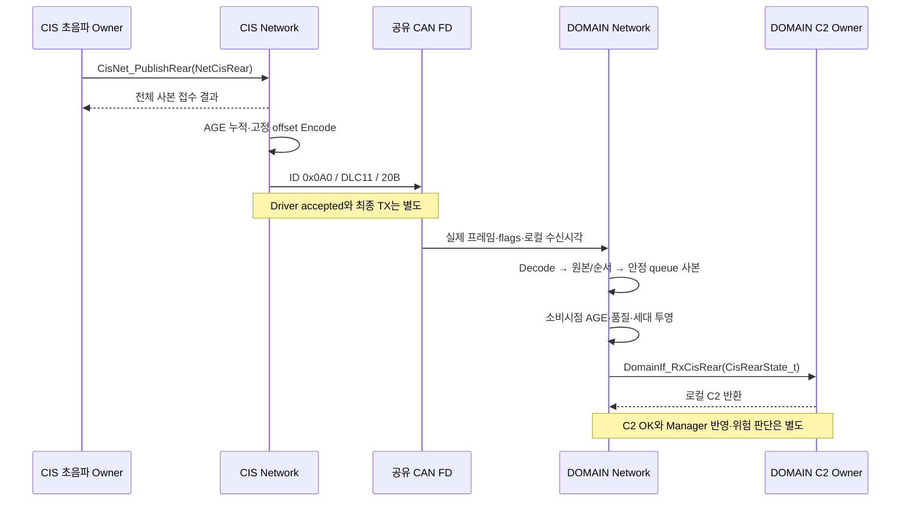

# CIS_REAR — S32K144 관측에서 S32K344 typed Rx까지

이 흐름은 CIS가 만든 후방 관측을 Network가 보존·운송하고 DOMAIN의 `DomainIf_RxCisRear`에 전달하는 경로다. DOMAIN의 위험 판단, VSS 음향 출력, MOBILE 표시 완료는 이 문서가 완결했다고 주장하는 범위가 아니다. 원 SC07의 Network 입력 구간만 구체화하며 SC17/SC18의 재기동·전송 오류를 그 경로에서 검토한다.

## 참여자와 탐색

Wire를 가로질러 C 함수를 직접 호출하지 않는다. CIS 내부 함수와 DOMAIN 내부 함수는 서로 다른 MCU에서 실행된다.

| 단계 | 소유 Layer/Module | 실제 상세 | 핵심 입력→출력·완료 경계 |
|---|---|---|---|
| 1. 관측 생성 | CIS 센서 Owner, Network L01/M01 연결 | [Data](../data/CIS_REAR_DATA.md#meaning) | 원 UPDATE·거리·품질·원 AGE. 센서 알고리즘/임계값은 외부 |
| 2. 접수 | L02/M03→L03/M04, F10/F11 | [CisNet_PublishRear](../functions/CIS_REAR_TX_SUBMIT.md) | borrow→완전한 의미 사본; OK는 로컬 접수 |
| 3. 송신 선택 | L03/M04, F12 | [NetRear_Dispatch](../functions/CIS_REAR_TX_DISPATCH.md) | 실제 대기 AGE·확인된 Boot/TX 순번, source UPDATE 보존 |
| 4. Encode | L04/M05, F15 | [NetRear_Encode](../functions/CIS_REAR_CODEC.md#encode) | 고정 offset 의미19B+padding1B, 구조체 메모리 복사 없음 |
| 5. 장치 송신 | L05/M07/M08, F19/F21/F22 | [Driver 관측](../functions/CAN_PORT_RECOVERY.md) | 안정 주소의20B, 접수·결과·참조 해제 분리 |
| 6. 장치 수신·Decode | L05/M07→L04/M05, F20/F14 | [NetRear_ReceiveFrame](../functions/CIS_REAR_RX_ADMISSION.md#receive-frame) → [NetRear_Decode](../functions/CIS_REAR_CODEC.md#decode) | 안정된 Driver view→Network 사본, CRC/ID/profile/DLC/길이/field/padding 검증 |
| 7. 원 관측 수용 | L03/M04·L01/M01, F13/F01 | [NetRear_Admit](../functions/CIS_REAR_RX_ADMISSION.md) | same frame Net/meta, queue 보관 성공 뒤 장부 진전 |
| 8. typed 인계 | L02/M03, F08 | [NetRear_Deliver·DomainIf](../functions/DOMAIN_CIS_REAR_INGRESS.md) | raw123→123mm, 원 품질·AGE·계보 보존, DOMAIN 본체 호출 |
| 9. 결과·복구 관측 | L05/M08/M09, F23/F24 | [NetRear_ObservePort](../functions/CAN_PORT_RECOVERY.md) | 실제 오류/회복과 버퍼 수명. 기능 결과 합성 없음 |

## 정상 수치 예시

다음 값은 **정적 문서 계산 사례**이며 센서 측정·제품 golden vector·실측 시험이 아니다. 양단 profile, 기동·순서·품질 대응·소비 바인딩이 확인됐다고 가정한 경로를 설명한다.

1. CIS의 한 원 관측 UPDATE9는 거리123raw, VALID/NONE/VALID_DISTANCE다. 원 AGE20ms로 `CisNet_PublishRear`에 제출하며 Boot7은 Network의 확인된 기동 근거다.
2. 접수 뒤 CIS에서 아직 반영하지 않은 대기4ms가 확인되면 최종 encode AGE는24ms다. TX_SEQUENCE11은 예시 프레임 번호이며 UPDATE9와 독립이다.
3. ID0x0A0/DLC11/20B에 B0 Boot7, B4 TX11, B8 UPDATE9, B12 AGE24, B14 거리123, B16 VALID1, B17 NONE0, B18 VALID_DISTANCE0, B19 padding0을 **고정 폭 LE**로 기록한다. 본문에 응용 CRC·버전 byte를 추가하지 않는다.
4. DOMAIN은 실제 수신시각을 보존한다. 미반영 전달 구간5ms와 DOMAIN 수신 후3ms가 각각 입증됐다면 소비 AGE32ms다. **예시5ms의 가정은 후보 hop5ms가 실제 지연 상한임을 입증하지 않는다.** Driver 뒤 대기가 미관측이면32ms를 정확한 전체 AGE/상한으로 확정하지 않는다.
5. 원 세대·품질 투영이 확인된 조건에서 rearDistanceMm=123, 원 UPDATE9, 누적 AGE32ms를 같은 입력으로 DOMAIN에 전달한다. DOMAIN_IF_OK는 그 로컬 호출의 성공이며 Manager의 실제 반영·위험 판정·VSS 실행은 별도다.

같은 관측이 TX12로 반복되어도 UPDATE9가 새 관측10이 되지 않는다. DOMAIN 로컬 Boot가 바뀌었다고 원 CIS Boot7을 덮어쓰지 않는다. AGE가 더 작게 보이는 반복은 같은 소비시점에서 기존 나이와 비교한다.

## 반례와 기대 처리

| 입력/사건 | 검사·처리 위치 | 기대 결과·복구 조건 |
|---|---|---|
| raw123 유효 거리 | Adapter/Data | 123mm. 정수 cm12→120mm로 절삭하지 않음 |
| raw65535+VALID+NONE+NO_OBJECT | Codec/Adapter | 유효 무검출을 보존. 거리65535mm 또는 FAULT와 동일시하지 않음 |
| raw65535+FAULT/UNAVAILABLE | Adapter | 원 상태·열화 품질을 보존. 위험 CLEAR/NO_OBJECT 합성 금지 |
| VALID_DISTANCE+65535 | 송신검사/Decode | 명시 모순 거부. 정상 callback·liveness 없음 |
| validity2/reason10/status6 | Codec | 예약 코드 거부, DEFAULT 정상값 없음 |
| DLC11인데 실제19B 또는21B | ReceiveFrame/Decode | 정확 길이 불일치 거부. padding 채움/잘라내기 없음 |
| B19=1 | Decode | nonzero padding 거부 |
| 다른 ID/extended/RTR/FDF0/BRS 불일치 | Decode | 선택한 profile과 불일치. 다른 버전으로 자동 전환하지 않음 |
| CRC 오류를 Driver가 알림 | M08/M05 | 정상 Net 객체 생성 없음. payload CRC를 따로 찾지 않음 |
| CAN fragment/불완전 프레임 | M07 | 이 경로는 분절 미사용. 다른 frame과 합쳐20B를 만들지 않음 |
| Boot0 | Decode | Wire 예약값 거부. C2 Generation0 정책과 혼동하지 않음 |
| 같은 Boot/TX, 같은 본문 | Admission | 중복. 원 관측 재호출 없음 |
| 같은 Boot/TX 또는 같은 UPDATE, 다른 의미 본문 | Admission | identity 충돌, 기존 자료 보존·ORDER_HOLD |
| TX 증가·UPDATE 동일·AGE 감소 | Admission | 같은 소비 시점에서 비교하여 기존 나이 보존, fresh 생성 없음 |
| 동일 관측 TX10→TX20 수용 뒤 TX15 도착 | Admission | 동일 Boot·합의된 비wrap 전제에서 최신 TX20 기준으로 제한. 반복 수신에도 최신 프레임 관측을 보수적 AGE와 함께 반영 |
| 보수적 AGE70ms, 마지막 원 TX20/AGE15ms의 완전 재수신 | Admission | 원 프레임 AGE15ms끼리 비교해 무변경 중복 처리. 보수적70ms를 raw 비교값으로 쓰지 않음 |
| 반복 관측의 최신 프레임 사본/AGE 갱신 실패 | Admission | 원 TX 장부·원 필드·보수적 AGE 모두 불변. 부분 갱신으로 뒤 입력을 잘못 차단하지 않음 |
| 같은 Boot에서 낮은 TX/UPDATE | Admission | 지연·역순·wrap 미합의. 단순 대소 비교로 최신성 확정하지 않음 |
| 새 Boot/낮은 seq, 원 CIS reboot | M01/M04 | 실제 기동 수용 근거 후 새 문맥 분리. 이전 자료에 새 계보를 자동 부여하지 않음 |
| DOMAIN만 reboot | M08/M01 | 로컬 시계·저장소 연결 재확인, 원 CIS 계보 보존 |
| u32 clock wrap/epoch 불명확 | AGE | 숫자 뺄셈만으로 경과 확정 금지, TIME_HOLD |
| AGE65535 또는 사용 한도 근거 없음 | AGE/소비 | 포화 하한·불확정을 유지. TTL 미검증을 fresh로 바꾸지 않음 |
| TX Queue가 가득 참 | Publish/Dispatch | NO_CAPACITY. 기존 사본·Driver 참조 버퍼 덮어쓰기 없음 |
| RX Queue가 가득 참 | Admission | 새 접수 거부. 실패 프레임의 순번 장부를 먼저 진전시키지 않음 |
| C2 초기화 전/미바인딩 | Deliver | 정상 DOMAIN 호출·성공 기록 없음. 원 사본·원 AGE 유지 |
| C2 QUEUE_FULL/REJECTED | Deliver | 원 반환 보존, 성공·cache 반영으로 기록하지 않음. 재호출 조건 확인 |
| 접수 OK 뒤 Driver 최종 실패 | M07/M08 | 최초 OK를 소급 변경하지 않음. 실제 통신 실패 관측, 차량 FAILED 합성 없음 |
| Driver 제출 결과 미확인인데 다른 TX 공간이 남음 | Dispatch | 원 관측을 해당 시도에 예약. 새 버퍼·새 순번으로 재선택 금지; 결과·참조 확인 후 원 AGE·순서 재평가 |
| Driver가 프레임 참조 중 | M07 | AGE·seq 수정과 공간 재사용 금지. 명시 해제 근거 필요 |
| 옛 Driver callback 도착 | M08 | 제출 identity와 Driver 수명 대조, 새 프레임을 완료시키지 않음 |
| 같은 완료/해제 통지 반복 또는 성공·실패 상충 | M07/M08 | 한 번만 결과·참조 해제를 반영. 상충 결과는 보존·HOLD, 재해제/이중 집계 없음 |
| REFERENCE_RELEASED인데 false 또는 대상 없는 사건에 개별 submitted 포함 | Port 관측 | 내부 후보 인자 계약 위반. INVALID_ARGUMENT, 기존 소유권·결과 변경 없음 |
| Bus-off·복구 통지 | M08/M04 | 장치 회복·참조 해제·profile·기동·필수 소비 확인 후 새 관측부터 평가 |
| 정상 CAN 수신 지속·같은 낡은 관측 | 감독/소비 | 링크 수신 중단과 source TTL 분리. 품질 fresh를 복원하지 않음 |

## 종결 범위와 남은 조건

후방 typed 인계가 설계상의 Network 종점이다. DOMAIN 위험 판단·VSS_WARNING_STATE·M_CIS_REAR 표시까지 SC07 전체를 완료한 것으로 세지 않는다. CF02는 VSS_WARNING_STATE 사용51/60B의 선택 미결이며 두 후보 모두 물리64B라는 사실만으로 해소되지 않는다. CF01·UART-C·Permission·WINDOW 기존 외부 HOLD도 영향 없는 이 경로의 작성으로 닫히지 않는다.

이 흐름의 실행에는 양단 CAN profile, 기동·순번 수용, CIS 품질·세대 투영, 같은 raw와 C2 입력의 연결, 단조 시간, Driver 비동기 수명, DOMAIN 필수 소비 바인딩이 필요하다. 문서가 정한 복사·거부·반영 순서는 로컬 설계이고 실제 RTD/HAL/핀/MB/Queue Depth/RTOS/보드 검증이 아니다. 모든 노드에 RTOS나 Superloop를 공통 강제하지 않는다.

[Network](../00_START_HERE.md) · [Node/Link](../02_NODE_LINK_MAP.md) · [Layer/Module](../03_LAYER_MODULE_INDEX.md) · [Data](../data/CIS_REAR_DATA.md)
