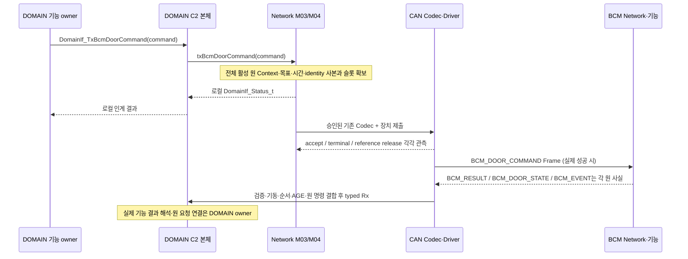

# DOMAIN 명령·Permission·Mobile 결과의 Network 경로

[개요](../07_DOMAIN_ADAPTER_SERVICE.md) · [TxPort26](../functions/DOMAIN_TX_PORT.md) · [등록](../functions/DOMAIN_REGISTRATION.md) · [수명](../functions/NETWORK_SERVICE_LIFETIME.md) · [후발 실패](../functions/NETWORK_FAILURE_HEALTH.md)

세 흐름은 공개 C2를 재구현하지 않고 DOMAIN의 의미 결정과 Network의 복사·전송 책임을 연결한다. 모두 DOMAIN MCU 내부에서는 typed C 함수, 다른 MCU와는 CAN/UART Frame을 사용한다. 상대 노드의 Application 함수는 그 노드의 수신 Network가 호출하며 DOMAIN에서 원격 C 함수로 실행하지 않는다. 문서의 private 함수는 설명용 `PROPOSED_PRIVATE_FUNCTION`이고 실제 등록·Owner 합의·Driver 실행은 `BINDING_OPEN`이다.

| 단계 | 기존 계층·모듈·책임 | 결과의 정확한 의미 |
|---|---|---|
| 원 결정 | DOMAIN Manager/기능 owner | 목표 또는 실제 결과의 의미·원 ID·생성 시점 결정 |
| typed 인계 | L02/M03/F06·F07, M01 원 자료 | 등록된 TxPort를 통한 검증·호출, 공개 C2 본체는 DOMAIN 소유 |
| 접수·시간·순서 | L03/M04/F11·F12 | 완전 사본·원 문맥·시간 기준·슬롯의 원자 게시 |
| 바이트 변환 | L04/M05 CAN 또는 M06 UART-M | 기존 leaf의 모든 명시 필드·enum·CRC/길이 검증 |
| 장치 인계 | L05/M07·M08 | Driver accept·terminal·reference release를 구분 |
| 후발 관측 | L05/M09와 M03/F09 | 확인된 로컬 실패·계측을 원 identity로 인계; 차량 DONE/FAILED 아님 |

<a id="bcm-door"></a>
## A. BCM 도어 명령 → Driver 제출 → 원 결과



```c
/* DECLARED_SOURCE — 본체 DOMAIN 소유 */
DomainIf_Status_t DomainIf_TxBcmDoorCommand( const DomainIf_BcmDoorCommand_t *command);
/* DECLARED_SOURCE — Network callback 멤버 */
DomainIf_Status_t (*txBcmDoorCommand)( const DomainIf_BcmDoorCommand_t *command);
/* B12 PROPOSED_PRIVATE_FUNCTION — 아래 정본을 재사용 */
DomainIf_Status_t NetCan_TxBcmDoorCommand(const DomainIf_BcmDoorCommand_t *command);
```

정확한 C2 자료는 [DomainIf_BcmDoorCommand_t](../data/CAN_BCM_DATA.md#type-DomainIf_BcmDoorCommand_t), 중첩 [CommandContext](../data/CAN_COMMON_DATA.md#type-DomainIf_CommandContext_t), Wire 자료는 [NetBcmDoorCommand](../data/CAN_BCM_DATA.md#type-NetBcmDoorCommand)다. 원형과 원 Command→Wire 투영 의사코드는 [BCM_DOOR_COMMAND 정본](../functions/can/BCM_DOOR_COMMAND.md)에 유지한다.

| 단계 | 자료·판정 | 보존 및 거부 |
|---|---|---|
| 1. 생성 | DOMAIN이 commandId, target, origin, commandAgeMs 및 실제 있는 RequestContext를 결정 | Network가 commandId/요청을 새로 발급하지 않음 |
| 2. 콜백 진입 | NULL, target LOCK/UNLOCK, 원 C2 enum·활성 조건, source 의미 검사 | 불법 값은 INVALID_ARGUMENT; 아직 raw 매핑 미확정은 NOT_AVAILABLE |
| 3. 원 자료 보존 | context.commandId/decisionSequence/hasRequestContext/원 Session·Request/단말/origin/commandAgeMs/meta와 target | meta.ageMs는 판단 자료 AGE이며 명령 birth AGE의 대체값 아님 |
| 4. 준비 및 원자 접수 | 현재 DOMAIN 생성 세대, 대상 BCM Boot와 원 명령 연결, 실제 등록·필수 failure sink·capacity 확보 | target Boot 불명·200ms/1s 기한/동등 경계 미합의·origin 축약 미확정이면 접수 성공 금지 |
| 5. 송신 직전 | 원 AGE에 아직 반영하지 않은 로컬 경과만 더하고 현재 target Boot/문맥 재검사 | clock 불연속/미확인 수송 구간을 0ms로 간주하지 않음; 포화65535를 fresh로 판정하지 않음 |
| 6. Codec/장치 | 기존 NetCan_EncodeBcmDoorCommand에 Net DTO와 NetCanSource를 전달 | CAN 후보 ID/필드/시간을 B15에서 변경하지 않음; encode OK는 전송 성공 아님 |
| 7. 후발 실패 | 로컬 OK 이후 최종 Driver **제출** 실패, 실제 송신 전 만료/문맥 무효의 근거 | 해당 기존 reason에 맞는 항목만 NetworkLocalFailure; 이미 전송 중 오류를 DRIVER_SUBMISSION_FINAL로 축약하지 않음 |
| 8. BCM 소비 | BCM Network가 Frame 검증·기동·명령 ID·AGE를 확인한 뒤 로컬 App에 전달 | void callback 반환은 모터/잠금 실제 완료 아님 |
| 9. 실제 결과 | BCM_RESULT의 원 COMMAND_DOMAIN_BOOT/commandId/kind·result/reason·도어 근거 검증 | CAN에 없는 C2 confirmation은 실제 추가 근거 없이 CONFIRMED로 만들지 않음 |

```c
// DOMAIN 기능 owner의 기존 호출 예. 공개 Wrapper와 private callback을 이중 호출하지 않는다.
DomainIf_Status_t admitted = DomainIf_TxBcmDoorCommand(&ownerDoorCommand);
switch (admitted) {
case DOMAIN_IF_OK:
    // Network가 원 자료와 슬롯의 안정된 로컬 인계를 끝낸 경계다.
    // ownerDoorCommand의 commandId/원 요청을 보존하고 실제 BCM 결과를 별도로 기다린다.
    break;
case DOMAIN_IF_QUEUE_FULL:
case DOMAIN_IF_NOT_AVAILABLE:
case DOMAIN_IF_NOT_INITIALIZED:
case DOMAIN_IF_REJECTED:
case DOMAIN_IF_UNSUPPORTED:
case DOMAIN_IF_INVALID_ARGUMENT:
default:
    // 실제 원 반환과 수용 여부를 보존한다. 같은 명령 무조건 반복·차량 FAILED 합성 금지.
    break;
}
```

후발 실패의 정확한 기존 원형은 다음과 같다. 본체는 DOMAIN 소유이며 Network는 [실패·Health 설계](../functions/NETWORK_FAILURE_HEALTH.md)에 따라 **관측한 단일 로컬 시도**를 기존 필수 경계에 전달한다. `identityGeneration`은 최초 admission의 command 생산 세대이고 대상 BCM Boot나 현재 App Session이 아니다. 수송 submission token/Port epoch는 내부 추적 자료이며 이 공개 DTO/Wire에 새 필드를 추가하지 않는다.

```c
/* DECLARED_SOURCE / DOMAIN_OWNED */
DomainIf_Status_t DomainIf_RxNetworkLocalFailure(const NetworkLocalFailure_t *failure);
/* DECLARED_SOURCE / DOMAIN_OWNED — 실제 BCM 결과의 별도 ingress */
DomainIf_Status_t DomainIf_RxBcmCommandResult( const DomainIf_BcmCommandResult_t *result);
```

참조가 먼저 해제되면 바이트 저장소를 반환할 수 있는 사실만 관측한다. 원 결과 pending·필수 전달 pending·중복 방지 identity는 유지한다. timeout만으로 reference release를 추정하거나 같은 명령을 새 slot으로 자동 재제출하지 않는다. 이미 DOMAIN에서 DISPATCHED인 항목을 `AbortBeforeDispatch`로 되돌리지 않는다. [BCM_RESULT](../functions/can/BCM_RESULT.md), [BCM_EVENT](../functions/can/BCM_EVENT.md), [BCM_DOOR_STATE](../functions/can/BCM_DOOR_STATE.md)는 각각 실제 결과·보호 사건·관측 상태의 정본이다.

HOLD: D-03/D-05/IF-O12/O-C10 필수 sink, O-C08 결과 미확인 수명, IF-O09 BOOT·생산 세대, G06 실제 Driver/Task, 명령 수명·origin 매핑의 기존 HOLD. B15는 새 제한시간/자동 재시도 횟수를 만들지 않는다.

<a id="permission"></a>
## B. 독립 C2 허용 입력 → 하나의 DOMAIN_PERMISSION

```text
DomainIf_TxCisPowerPermission        → txCisPowerPermission         ┐
DomainIf_TxWindowOperationPermission → txWindowOperationPermission ├→ 기존 M03 합성 경계
DomainIf_TxWindowDomainAlive          → txWindowDomainAlive          ┘   (원 평가별 안정 사본)
    → 전체 의미·공유 AGE/순번·POWER_OPERATION_STATE 근거 확인
    → DomainNet_PublishPermission(NetDomainPermission)
    → 기존 DOMAIN_PERMISSION CAN Codec/Queue/Driver
    → BCM/CIS/VSS의 각 검증 경계, WINDOW 소비는 구현 보류
```

3개 callback은 같은 자료형이 아니며 3개의 새로운 Frame도 아니다. [Permission 송신 정본](../functions/can/DOMAIN_PERMISSION.md)은 `NetDomainPermission`의 7개 필드인 vehicle_power_permission, power_permission_quality, power_operation_state, operation_allowed, operation_quality, update_sequence, source_age_ms를 정의한다. 이 자료에는 quality_reason, Pi relay revision, use_limit 필드가 없다. 부족한 항목을 C2의 가장 최신 한 값·0·OK·고정1500으로 채우지 않는다.

| C2 원 입력 | 자기 수명으로 보존할 자료 | 전체 Frame까지 남는 근거 |
|---|---|---|
| CisPowerPermission | vehiclePowerAllowed, quality, meta.quality/ageMs/updateSequence | POWER_OPERATION_STATE의 실제 생산자, 같은 합성 평가와 기한 |
| WindowOperationPermission | operationAllowed, quality, meta.quality/ageMs/updateSequence | WINDOW 실행 허용 정책, 공유 순번·AGE, 현재 기능 구현 보류 |
| WindowDomainAlive | domainLinkAvailable, meta.quality/ageMs/updateSequence | 생성 책임·실제 링크 감독과의 관계, 별도 heartbeat가 아닌 기존 합성 의미 |

r1의 [Permission 의미 투영](CAN_BCM_AND_PERMISSION.md#permission-projection)은 DOMAIN 정책 미확정 권장안이다. 확정 ALLOW/OK·정상 평가 DENY/OK를 구별하고 확인된 원인과 채택된 범위에서만 false+비정상 품질→255를 적용한다. UNKNOWN+OK 표현 불가와 quality/meta 충돌은 해당 투영 HOLD이며 입력 자체를 임의 DENY/OK로 바꾸지 않는다. Network가 기능 원인을 추측하지 않는다.

새 power 평가가 와도 오래된 operation/alive의 원 AGE와 순번은 갱신하지 않는다. 같은 now로 환산한 각 AGE 중 최대값은 기존 **보수적 합성 후보**이며 채택된 규칙으로 확정하지 않는다. Generation0·DOMAIN Boot 수명·CIS 정책 회신 전에는 해당 근거를 미확인으로 보존한다.

```c
/* DECLARED_SOURCE/기존 Network-private 제안 경계. App의 이중 호출 의무가 아니다. */
NetSubmitResult DomainNet_PublishPermission(const NetDomainPermission *message);

// M03 owner 직렬 문맥의 설명용 절차:
// 1. 실제 DOMAIN 의미/원인·투영 채택·quality/meta 일치를 확인한다. 미확인/충돌은 NOT_AVAILABLE.
//    정상 열화 품질만으로 INVALID_ARGUMENT를 반환하지 않는다. 원 partial source 전 멤버를 후보로 복사한다.
// 2. 기존 다른 partial source를 동일 시점으로 읽되 AGE/순번을 새 입력으로 덮지 않는다.
// 3. 실제 합성 규칙, POWER_OPERATION_STATE 생산자, 공유 순번·시간 비교가 없으면
//    partial source를 성공 접수한 것으로 게시하지 않고 NOT_AVAILABLE로 끝낸다.
// 4. 원 성공17 뒤 실패는17·마지막 성공 시각을 보존한다. 새 성공/AGE0을 만들지 않는다.
//    CAN 합성 UPDATE는 검증된 tuple/의미·품질 제한 변경의 별도 후보다. 원 성공 중복만으로 제한 폐기 금지.
//    source 사본/원 연결/완성 NetDomainPermission/송신 슬롯을 함께 예약한다.
// 5. 기존 PublishPermission 접수와 source 연결의 보존을 하나의 원자 경계로 게시한다.
//    이 결합을 제공할 실제 binding이 없으면 성공을 약속하지 않는다.
// 6. local OK는 원자 게시 완료만 의미한다. CAN 송신·CIS 사용·Pi 허용을 보장하지 않는다.
```

순서/등록/사본 정책의 상세는 [CIS power](../functions/DOMAIN_TX_PORT.md#txCisPowerPermission), [WINDOW operation](../functions/DOMAIN_TX_PORT.md#txWindowOperationPermission), [WINDOW alive](../functions/DOMAIN_TX_PORT.md#txWindowDomainAlive)에 있다. 현재 정보 부족을 실행 가능한 “완성된 composer”로 위장하지 않는다. 확인 후에도 공개 API·Wire·책임을 변경할 때는 S6 협의 큐와 별도 승인 근거가 필요하다.

[번호 공간과 대기/재시도](CAN_BCM_AND_PERMISSION.md#permission-sequences)는 실제 owner 제한 관측을 새 payload 성공 접수와 구별한다. 확인된 현재 제한 또는 원 만료 뒤 구 ALLOW의 미시작 pending/retry 재게시는 막고, 새 제한의 송신 실패를 성공이나 구 ALLOW 복구로 처리하지 않는다. malformed 입력·일반 접수 실패에서 제한을 추론하지 않는다. in-flight frame의 참조·terminal 수명은 기존대로 유지하며 원격 동시 무효화를 보장하지 않는다.

CIS에서 받은 동일 CAN pair의 App 소비와 Pi relay는 별도 형제 경계다. [B14 CIS→Pi Permission 흐름](UART_C_CIS_TO_PI_PERMISSION.md)의 원 DOMAIN 평가와 CIS relay AGE를 보존한다. CAN 후보50ms/150ms와 Pi 보고500ms/수신1500ms는 다른 축이며 큰 값으로 원 허용 수명을 늘리지 않는다. D-02/Q11/IF-O05/IF-O09/IF-O24, WINDOW G05/IF-O07과 UART-C 채택·사유·수명 HOLD를 유지한다.

<a id="mobile-result"></a>
## C. DOMAIN 실제 결과 → M_RESULT → 현재 수신 단말

```c
/* DECLARED_SOURCE / DOMAIN_OWNED */
DomainIf_Status_t DomainIf_TxMobileRequestResult( const DomainIf_MobileRequestResult_t *result);
/* DECLARED_SOURCE / Network callback 멤버 */
DomainIf_Status_t (*txMobileRequestResult)( const DomainIf_MobileRequestResult_t *result);
/* 기존 Network-private 제안 submitter: B13 정본 재사용 */
NetSubmitResult DomainNetPriv_SubmitMobileRequestResult(const DomainIf_MobileRequestResult_t *result, const DomainQueryResponseContext_t *query);
```

[C2 원 결과 전체 타입](../../interface/02_NODES/DOMAIN/12_DOMAIN_TYPES.md#type-domainif-mobilerequestresult-t), [M_RESULT 상세](../functions/uart_m/M_RESULT.md), [UART-M 보고 자료](../data/UART_M_REPORT_FIELDS.md), [기존 DOMAIN→ESP 흐름](UART_M_DOWNLINK.md)을 그대로 연결한다. Callback은 [NetDomain_TxMobileRequestResult 설명](../functions/DOMAIN_TX_PORT.md#txMobileRequestResult)처럼 기존 submitter를 `query=NULL`로 호출하고 반환값만 명시적으로 대응한다.

| 객체·시간 | 보존 필드와 생성자 | 금지하는 치환 |
|---|---|---|
| C2 결과 | DOMAIN의 deviceContextId, resultInfo.context(sessionId/requestId), hasVehicleResult, resultInfo의 활성 result/reason/confirmation, target, commandId, origin, resultAgeMs | local TX 실패에서 차량 FAILED를 생성하지 않음 |
| 현재 전달 envelope | Network가 확인한 recipient.device_context_id/session_id, DOMAIN boot, 자발 출력 query_id=0 | 원 RequestSession을 현재 recipient.session_id로 바꾸지 않음 |
| 원 결과 나이 | 원 resultAgeMs + 아직 더하지 않은 Network 대기 | 재연결·새 LinkSeq에서 0으로 초기화하지 않음 |
| local failure identity | 최초 publication 생성 세대·원 RequestContext/Device, 실제 있는 Command | 수신 대상 세대/Session으로 과거 결과를 재라벨하지 않음 |

예를 들어 요청 Session A의 결과를 현재 Session B인 같은 허용 단말로 전달할 수 있는지는 기존 접근/recipient 계약으로 확인한다. 확인돼도 원 결과 `request_session=A`와 전달 envelope `recipient.session_id=B`를 둘 다 유지한다. 단말 권한이나 과거 기록 접근을 임의 허용하는 예가 아니다. 현재 recipient를 결정할 source 근거가 없으면 NOT_READY다.

```c
/* PROPOSED_PRIVATE_FUNCTION 원형/본문은 TxPort 문서에 한 번만 정의한다. */
DomainIf_Status_t NetDomain_TxMobileRequestResult(const DomainIf_MobileRequestResult_t *result);

// 기존 공개 호출에서 오는 한 경로:
// DOMAIN public Tx → port->txMobileRequestResult → 위 callback
// → DomainNetPriv_SubmitMobileRequestResult(result, NULL)
// → 기존 M_RESULT Prepare/Encode → M04 Queue → UART-M Driver.
// query=NULL은 자발 출력이다. Query 응답은 M02가 같은 submitter에 별도 검증된 query를 전달한다.
```

`hasVehicleResult=false`이면 비활성 result 값을 읽어 FAILED/DONE으로 바꾸지 않는다. setting-only 결과의 commandId=0, result reason/confirmation/origin의 현재 표현 제한을 보존한다. 개별 RequestResult는 latest 상태처럼 덮지 않는다. Query 응답에 쓰인다는 이유로 Query 자체를 NetworkLocalFailure REQUEST_RESULT kind로 포장하지 않는다. Query 자체 실패는 기존 [Query 제어](../functions/UART_M_QUERY_CONTROL.md)의 관측·종결 경계이고, source 결과 항목의 후발 실패 적용 여부는 단일 실제 제출의 원 identity·필수 sink 근거로만 결정한다.

Driver accept/최종 TX/ESP32 유효 수신/BLE/Mobile 소비는 다른 단계다. Query의 ITEM_COUNT는 최종 로컬 UART TX가 실제 확인된 응답 수이고 callback OK 또는 enqueue count가 아니다. End 자체 실패·결과 미확인에서 성공 End를 생성하지 않는다. CF01/IF-O12/IF-O25/D-03/D-05 및 세션·원본 결합 HOLD를 그대로 유지한다.

<a id="counterexamples"></a>
## 세 흐름의 자체검수 반례

| ID | 입력·사건 | 설계에서 확인한 결과 |
|---|---|---|
| B15-FLOW-01 | 도어 목표가 이미 실제 상태와 같음 | Network OK/같은 값만으로 BCM DONE·actualUnlockTransition 생성 없음 |
| B15-FLOW-02 | commandAge=오래됨, 판단자료 meta.ageMs=새 값 | 명령 birth AGE를 새 센서 AGE로 대체하지 않음 |
| B15-FLOW-03 | 로컬 OK 후 Driver 임시 busy | 실제 최종 제출 실패 근거 전 DRIVER_SUBMISSION_FINAL 통지 금지 |
| B15-FLOW-04 | 이미 전송 중 오류 또는 결과 불명 | 기존 3 reason에 부당 축약하지 않고 원 attempt/diagnostic/HOLD 유지 |
| B15-FLOW-05 | release 선도착 후 다른 buffer 여유 | 원 결과 pending과 동일 identity 재제출 제한 유지 |
| B15-FLOW-06 | Permission 일부 입력만 갱신 | 다른 원 평가/AGE 불변; 완전 합성 미확인 NOT_AVAILABLE |
| B15-FLOW-07 | CAN150ms 후보를 Pi1500ms로 연장 | 금지; 원 사용 수명과 relay 보고/수신 시간을 독립 유지 |
| B15-FLOW-08 | M_RESULT 원 Session A, recipient B | 권한·binding 확인 후에도 A/B를 별도 보존 |
| B15-FLOW-09 | Query 10 enqueue, 8 final TX, 2 결과 미확인 | count10/성공 End 금지; 미확인은 확정 실패2와도 다름 |
| B15-FLOW-10 | WINDOW/CF02 함수가 문서에 모두 선언됨 | 해당 구현 보류 유지; 선언/문서 PASS는 제품 활성화가 아님 |

이 흐름은 정적 설계이며 외부 HOLD를 유지한다. G6 이후 현재 별도 후보에는 고정 r1 Interface40개 참조와 승인 범위의 문서 보완을 반영했다. 추가 협의 변경은 별도 승인과 영향 검증을 거쳐 반영하며, 실제 제품·Header·Driver 채택 근거는 여전히 필요하다.
