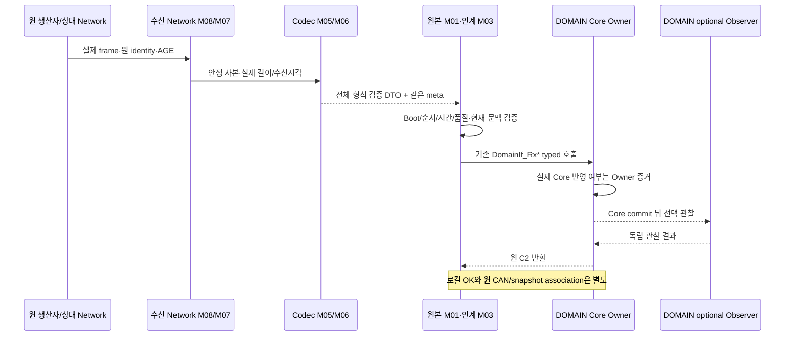

# Network → DOMAIN — Rx, Observer, snapshot의 서로 다른 완료 경계

[B15 개요](../07_DOMAIN_ADAPTER_SERVICE.md) · [Rx22/Observer11](../functions/DOMAIN_RX_ADAPTER.md) · [Query18와 원본 연결](../functions/DOMAIN_QUERY_PROVENANCE.md) · [Layer/Module](../03_LAYER_MODULE_INDEX.md)

B15는 기존 CAN FD/UART-M/UART-C 정본을 연결해 DOMAIN 인계 경계를 상세화한다. 공개 DomainIf 본체, 기능 Manager/정책, Observer11 소비자는 DOMAIN 소유다. Network가 소유하는 Codec·안정 사본·원본 admission·typed 변환·C2 호출 및 반환 관측만 기술한다. 아래 정상 경로는 필요한 양단 채택과 시간·소유·직렬화 근거가 있을 때의 조건부 설계이며 실보드 실행 PASS가 아니다. 요구103·Owner35·Wire48/Rx51·시나리오18·L5/M9/F25/ST12 및 외부 HOLD를 변경하지 않는다.

<a id="boundaries"></a>
## 공통 Layer → Module → Function 경계



| Layer/Module/역할 | 입력·출력과 함수 정본 | 실패/수명 경계 |
|---|---|---|
| L05/M08 F22·M07 F20 수신 보관 | Driver가 실제로 관측한 flags/길이/수신시각 → 안정 프레임 사본 | ISR에서 C2/Manager/Getter 호출 없음; 원 pointer를 반환 후 사용하지 않음 |
| L04/M05 F14 또는 M06 F16/F17 | [CAN Codec](../functions/CAN_COMMON_CODEC.md), [UART frame/stream](../functions/UART_FRAME_STREAM.md) → 같은 수신의 DTO/meta | 실패 임시 OUT 미게시. UART CRC와 CAN 장치 CRC를 혼동하지 않음 |
| L03/M04 F13·L01/M01 F01/F02 | [CAN 수용](../functions/CAN_TRANSFER_CONTROL.md), [UART Router](../functions/UART_M_ROUTER.md) | 원 Boot/순서/AGE/현재 Session·자원 연결 미확인 시 영향 경로만 HOLD |
| L02/M03 F08 | [Rx22](../functions/DOMAIN_RX_ADAPTER.md#rx22), 기존 각 leaf의 typed 변환 | 임시 typed 전체 필드 완성 뒤 DOMAIN Task/Owner 문맥에서 호출; 미확정 meta를 0으로 채우지 않음 |
| DOMAIN 공개 본체·선택 소비자 | Core → [Observer11](../functions/DOMAIN_RX_ADAPTER.md#observer11) | Network가 구현하지 않음. optional 실패가 이전 commit을 rollback하지 않음 |
| L01/M02 F04/F05·M01 원본 연결 | [기존 Query 정본](../functions/UART_M_QUERY_CONTROL.md)와 [provenance](../functions/DOMAIN_QUERY_PROVENANCE.md#association) | 성공 OUT도 원 입력 association 별도. Getter 실패 OUT/flag/count 소비 금지 |
| L05/M08 F23·M09 F24/F25 및 원 Owner | [후발 실패/Health](../functions/NETWORK_FAILURE_HEALTH.md), [수명](../functions/NETWORK_SERVICE_LIFETIME.md) | Driver 결과·참조 해제·기능 완료 구분. 선택 observer가 필수 failure sink를 대체하지 않음 |

<a id="rear"></a>
## CIS_REAR — 원 단위와 같은 입력의 수직 흐름

SC07의 Network 입력 구간과 SC17/SC18 재기동·오류 경계를 기존 [B11 수직 정본](CIS_REAR_144_TO_344.md)에 연결한다. 원 센서 판단과 위험 임계값은 CIS/DOMAIN 기능 Owner의 책임이다.

| 단계 | 정확한 자료/함수·정본 | 의미 보존 및 소비 결과 |
|---|---|---|
| CIS 관측 제출 | `NetSubmitResult CisNet_PublishRear(const NetCisRear *message);` — [접수](../functions/CIS_REAR_TX_SUBMIT.md) | 원 update9, AGE20ms, raw123, VALID/NONE/VALID_DISTANCE를 같은 사본으로 보관한 경우만 local OK |
| CIS 송신 | [NetRear_Dispatch](../functions/CIS_REAR_TX_DISPATCH.md) → [NetRear_Encode](../functions/CIS_REAR_CODEC.md#encode) | 확인된 미반영 대기4ms를 한 번 누적해 AGE24. source update9와 frame TX11은 별도 |
| CAN FD | [CIS_REAR Wire/Data](../data/CIS_REAR_DATA.md#wire) | 후보 ID0x0A0/DLC11/물리20B/used19B/B19 padding0. 추가 payload CRC·VERSION·fragment header 없음 |
| DOMAIN 수신 | [NetRear_ReceiveFrame/NetRear_Admit](../functions/CIS_REAR_RX_ADMISSION.md) | 실제 flags/길이·Boot7/TX11/UPDATE9/수신시각을 한 사건으로 보존. 형식 실패면 정상 Rx/기능 freshness를 만들지 않음 |
| typed 인계 | `NetRearResult NetRear_Deliver(uint32_t nowMs);` — [Adapter 의사코드](../functions/DOMAIN_CIS_REAR_INGRESS.md#adapter) | same raw/meta와 누적 AGE·승인된 품질/원 세대 대응을 확인. 원 멤버 `rear_distance_deci_cm`을 C2 `rearDistanceMm`에 정수 그대로 대응 |
| C2 경계 | `DomainIf_Status_t DomainIf_RxCisRear( const CisRearState_t *state);` | 정확히 같은 입력의 거리/measurementState/distanceQuality/sourceGeneration을 borrowed로 전달. OK는 로컬 인계, 실제 Manager commit 별도 |
| 후속 Query 후보 | `DomainIf_Status_t DomainIf_QueryGetCisRear(uint32_t nowMs, CisRearState_t *outState);` → [M_CIS_REAR](../functions/uart_m/M_CIS_REAR.md) | 실제 Core 반영과 Getter가 같은 원 관측이라는 Owner 근거 필요. DOWN_CONTEXT20B+원 CAN used19B를 사용하고 padding 제외 |

`NetCisRear.rear_distance_deci_cm`의 단위는 0.1cm/raw, 즉 1mm/raw이다. raw123 → `CisRearState_t.rearDistanceMm=123`이며 `/10` 또는 정수 cm 절삭을 하지 않는다. 실행 가이드의 일반적인 “mm↔cm” 예시는 타입/단위 정본을 바꾸는 승인이 아니다. raw65535는 거리 없음/무효 sentinel이고 NO_OBJECT와 FAULT/UNAVAILABLE 등 상태·품질로 구분한다. `VALID_DISTANCE+65535`는 모순이다.

AGE 계산 예의 확인된 미반영 전달5ms와 수신 후3ms를 더하면 20+4+5+3=32ms다. 이는 각 구간이 입증됐다는 문서 사례다. 후보 hop5ms는 실제 Driver 상한이 아니며 미관측 구간을 0으로 만들지 않는다. 같은 UPDATE9가 TX12로 반복되어도 원 관측10·AGE0이 되지 않는다. 수신100/AGE20와 수신130/AGE15를 같은 now150에서 비교하면 70/35ms로 계산되므로 원 관측을35ms로 젊게 만들지 않는다.

원 CAN Boot7과 C2 `sourceGeneration`의 lifecycle 대응은 회신 대기다. DOMAIN 재기동이 원 CIS Boot를 덮을 권한을 주지 않는다. `RxCisRear OK` 또는 거리123의 값 동일성만으로 최근 raw123을 Getter123에 접합하지 않는다. association 미입증이면 해당 projection만 NOT_READY/NOT_AVAILABLE·Query 부분 제한이며 독립 메시지를 전체 차단하지 않는다.

<a id="bcm"></a>
## BCM_RESULT와 BCM_EVENT — 결과와 별도 사건

기존 [BCM 흐름](CAN_BCM_AND_PERMISSION.md) 및 SC01~04/SC08~09의 Network 경계에 연결한다. 원 명령을 발급하거나 물리 완료를 판정하는 본체는 DOMAIN/BCM 기능 Owner다.

```c
NetCanResult NetCan_RxBcmResult(const NetCanFrame *frame,
    NetCanProfile profile, DomainIf_Status_t *consumerStatus);
NetCanResult NetCan_RxBcmEvent(const NetCanFrame *frame,
    NetCanProfile profile, DomainIf_Status_t *consumerStatus);
```

두 기존 Network private 함수의 전체 의사코드는 각각 [BCM_RESULT rx](../functions/can/BCM_RESULT.md#rx), [BCM_EVENT rx](../functions/can/BCM_EVENT.md#rx)에 있다. `frame`은 호출 중 안정 IN, `profile`은 양단 채택된 후보 선택 값, `consumerStatus`는 실제 C2 호출이 있을 때만 원 반환을 기록하는 caller-owned OUT이다. Decode/입장 조건에서 종료되면 그 OUT을 C2 성공처럼 읽지 않는다.

| 단계 | BCM_RESULT | BCM_EVENT |
|---|---|---|
| Codec/입장 | NetBcmResult+같은 NetCanRxMeta, 정확한 enum/조합/padding. command_domain_boot+command_id+kind로 원 명령 대조 | NetBcmEvent+같은 meta, event_kind/occurrence/quality/AGE, 원 BCM Boot·원 사건 연결 |
| typed 변환 | kind1..3 → DOOR/CLIMATE/INTERIOR_LIGHT. result0..5 → ACCEPTED/IN_PROGRESS/DONE/REJECTED/CANCELLED/FAILED. reason0..25는 leaf의 named map | event_kind1..3 → OVERHEAT_DETECTED/FAN_MISMATCH_DETECTED/RECOVERY_CONFIRMED. 원 occurrence·sourceGeneration·quality·누적 ageMs와 affectedFunctionMask 보존 |
| 부가 근거 | door_event/occurrence/target/quality/AGE의 atomic evidence 묶음. door evidence는 별도 BCM_EVENT로 중복 생산하지 않음 | related_domain_boot와 related_command_id는 둘 다0 또는 실제 같은 원 명령 연결. hasRelatedCommand=false면 관련ID를 소비하지 않음 |
| 미결 경계 | confirmation은 Wire에 없음. 기존 UNCONFIRMED 대응 후보 채택 근거가 없으면 CONTRACT_HOLD; DONE을 CONFIRMED로 바꾸지 않음 | Boot→sourceGeneration 승인 연결이 없으면 CONTRACT_HOLD; 늦은 과거 사건으로 최신 current 상태를 후퇴시키지 않음 |
| 공개 호출 | `DomainIf_Status_t DomainIf_RxBcmCommandResult( const DomainIf_BcmCommandResult_t *result);` | `DomainIf_Status_t DomainIf_RxBcmProtectionEvent( const DomainIf_BcmProtectionEvent_t *event);` |
| 선택 관찰 | `onBcmCommandResult` — DOMAIN 소비자 | `onBcmProtectionEvent` — DOMAIN 소비자 |

RESULT255는 타입상 NOT_PRESENT 선언이 있어도 차량 CAN 결과 단계의 채택 문맥이 미합의라 CONTRACT_HOLD다. 예약6..254 malformed와 구별한다. 이미 terminal인 명령에 늦은 ACCEPTED/IN_PROGRESS가 도착해도 terminal을 되돌리지 않는다. 반대로 같은 명령의 ACCEPTED→DONE이라는 허용 단계 변경을 “같은 identity 다른 값”이라는 이유만으로 무조건 불변 관측 충돌로 처리하지 않는다.

Result 자체에 없는 일반 AGE/UPDATE를 도어 evidence AGE로 대신 만들지 않는다. DoorState는 독립 실측 상태이고 결과 수신 순서만으로 새 명령의 성공/실패를 판정하지 않는다. 정당한 Core 반영 뒤 observer 실패가 발생하면 raw C2 반환·실제 commit·관찰 결과를 각각 보존한다. 같은 Result/Event를 무조건 재호출하거나 차량 FAILED를 합성하지 않는다.

<a id="mobile"></a>
## M_CONTEXT, M_REQUEST, M_WARNING_ACK — 현재 문맥과 원 사건

이 경로는 B13 후보 VERSION2와 CF01·Interface 채택 조건을 유지한다. 현재 정상 채택 완료를 선언하지 않는다. [상향 Router](../functions/UART_M_ROUTER.md)와 [상향 흐름](UART_M_UPLINK.md)의 실제 frame 검증·수용 정본을 재사용한다.

| 시작 입력/기존 Network 함수 | C2 인계와 Data | 구체 조건과 종료 한계 |
|---|---|---|
| `DomainIf_Status_t DomainNetPriv_OnGatewayContext(const NetMobileContext *message, const NetUartRxMeta *meta);` — [M_CONTEXT](../functions/uart_m/M_CONTEXT.md#admission) | RxDigitalKeyConnection(deviceContextId, connection), RxProximity(deviceContextId, proximity) | 등록·현재 peer/연결의 shared tuple, App, RSSI 근접의 독립 품질/update/AGE를 보존. 동일 Device/현재 Session과 실제 직렬 문맥 근거 필요. 두 Rx의 부분 반영 정책 미확인 시 호출 전 제한 |
| `NetUartMResult NetUartM_DeliverRequest(const NetMobileRequest *message, const NetUartRxMeta *meta);` — [M_REQUEST](../functions/uart_m/M_REQUEST.md#deliver) | DomainIf_MobileRequest_t → RxMobileRequest → 선택 onMobileRequest | 원 Device/Request Session/RequestID 및 8가지 kind/op union 대응. 원 SENT meta 부재를 수신시각/AGE0으로 메우지 않음. 로컬 OK가 차량 ACCEPTED가 아님 |
| `NetUartMResult NetUartM_DeliverWarningAck(const NetMobileWarningAck *message, const NetUartRxMeta *meta);` — [M_WARNING_ACK](../functions/uart_m/M_WARNING_ACK.md#deliver) | DomainIf_WarningAck_t → RxWarningAck → 선택 onWarningAck | 현재 Device/Session과 원 DOMAIN Boot/warning kind/occurrence 연결 후 raw1..8 명시 변환. C2 ack에 없는 Boot는 private 검사 근거로 보존 |

각 message/meta는 같은 수신 사건의 borrowed IN이고 NULL 불가다. UART meta의 received_at_ms는 실제 로컬 수신시각이며 App SENT/DOMAIN Boot를 담는 필드가 아니다. 공개 typed 임시는 반환까지 유효하고 지연 소비자의 사본은 반환 전에 확보해야 한다. ISR/CAN callback에서 위 함수들을 직접 호출하는 실행 모델을 강제하지 않는다.

M_CONTEXT Device7/Session9에서 registrationConnection revision11, App revision22, proximity revision33은 서로 독립 번호다. 등록/연결의 정상 품질이 App UNKNOWN/NO_DATA를 ACTIVE로 바꾸지 않는다. Connection이 반영된 뒤 Proximity에서 실패했다면 부분 결과를 보존하며 전체 rollback이나 두 호출 전체 반복을 하지 않는다. CF01 profile·quality 투영·부분 반영 처리가 아직 미입증이면 정상 composite 인계 전에 NOT_AVAILABLE로 제한한다.

M_REQUEST kind3/op3은 RGB(0,128,255)를 그대로 전달하고 ARG3..5=0을 확인한다. bool2/Fan255/level101/예약 kind·op는 C2 전에 거부한다. 원 App 요청의 Session/RequestID는 재접속으로 새로 발급하지 않는다. 원 SENT부터3s 정책의 효력과 원 시간 근거가 없으면 그 정책에 의존하는 실행을 제한하되 상태 Query 전체를 차단하지 않는다.

M_WARNING_ACK의 Boot12/REAR/occurrence7 읽음은 같은 현재 Session일 때 그 경고에 연결한다. 이전 Boot11의 occurrence7이나 이전 Session을 현재 경고로 합치지 않는다. 읽음은 위험 CLEAR·소리 STOP·차량 DONE이 아니다. WINDOW 경고 ACK 표현의 존재로 WINDOW 실행/표시 HOLD를 해제하지 않는다.

<a id="rx-outcome-callsite"></a>
### 기존 typed 인계 결과를 분류하는 호출 위치

설계 호출자는 `NETWORK_TO_DOMAIN / L02/M03/F08`의 결과 관측 단계다. 예를 들어 `NetCan_RxBcmResult`의 실제 C2 호출이 반환된 경우 원 `consumerStatus`와 같은 사건의 Core/Observer 증거를 [NetDomain_ClassifyRxCompletion](../functions/DOMAIN_RX_ADAPTER.md#outcome)에 전달한다. Decode/admission에서 종료되어 C2를 호출하지 않았다면 `consumerStatus`를 읽거나 이 결과 분류를 실행하지 않는다. 실제 관측 공급 함수명·Task·직렬화는 BINDING_OPEN이다.

```c
// NETWORK_TO_DOMAIN / M03 F08: 실제 C2 호출 반환이 확인된 같은 사건만 대상
NetDomainRxOutcome classified;
bool classificationOk = NetDomain_ClassifyRxCompletion(
    actualC2Return, actualCommitEvidence, actualObserverEvidence, &classified);
if (classificationOk) {
    // M03/M09가 classified의 원 반환과 확인된 두 단계를 같은 사건에 보존한다.
    // UNKNOWN은 그대로 유지하며 true를 C2 성공·재호출 허가로 읽지 않는다.
} else {
    // classified는 읽지 않는다. 원 관측의 모순을 보존하고 재호출을 HOLD한다.
}
```

`actualCommitEvidence`와 `actualObserverEvidence`는 Owner가 실제로 제공한 단계 증거다. 채널이 없으면 각각 UNKNOWN으로 전달하며 OK에서 APPLIED/SUCCEEDED를 합성하지 않는다. 분류 OUT은 이 처리 동안의 caller-owned 사본이고 지연 소비가 필요하면 같은 사건과 함께 복사한다. 분류 실패는 이미 발생한 Core 반영을 취소하지 않는다.

<a id="recovery"></a>
## 오류·복구·Query까지의 결과 구분

| 사건/반례 | Network의 처리와 재사용 정본 |
|---|---|
| CRC/길이/예약 enum/정확하지 않은 frame | typed 미생산, 정상 last_rx/freshness 갱신 없음. CAN 장치 오류와 UART frame 검사 정본 적용 |
| 같은 원 관측 반복·AGE 감소 | 같은 소비시각으로 경과를 비교해 원 관측이 젊어지지 않게 유지. TX/LINK_SEQUENCE를 새 관측 번호로 사용하지 않음 |
| 시간원 reset/wrap·Driver 미측정 구간 | 숫자 뺄셈만으로 경과/상한 확정 금지. 원 AGE·identity 보존 및 영향 소비 TIME_HOLD |
| 정상 typed 호출 후 non-OK | 원 반환과 실제 반영 단계를 각각 보존. “실패니까 미반영” 단정 없이 [Rx outcome](../functions/DOMAIN_RX_ADAPTER.md#outcome)으로 분류 |
| 실제 Core 완료·Observer 실패 | rollback/같은 Core 호출 재시도 금지. Owner 관찰 실패 경계로 전달하고 commit 증거 유지 |
| 정상 CAN 수신 후 association 부재 | [Getter/provenance](../functions/DOMAIN_QUERY_PROVENANCE.md#association)의 해당11 projection 제한. Rx OK로 연결 증거를 대체하지 않음 |
| 실제 접수 COMMAND/REQUEST_RESULT/OCCURRENCE 후 실패 | [필수 Failure sink](../functions/NETWORK_FAILURE_HEALTH.md)의 기존 전송 전 만료/전송 전 문맥 무효/최종 Driver 제출 실패에 정확히 해당할 때만 통지. 이미 전송 중 오류·결과 미확정을 DRIVER_SUBMISSION_FINAL로 축약하지 않음. CRC reject/Query/주기 상태 누락과 구분. 없는 차량 FAILED·AbortBeforeDispatch 생성 금지 |
| Queue 공간 부족 | 다른 discrete 사건 덮기 없음. 실패 입력의 순서 장부를 먼저 진전시키지 않음. 재시도 수치 임의 확정 금지 |
| Driver timeout/late callback | final 결과와 참조 해제를 따로 확인. 해제 증거 전 재사용 금지, 구 callback을 새 slot 세대로 귀속하지 않음 |
| 통신 회복·Boot/Session 교체 | 새 유효 근거를 재검증. 구 명령 자동재전송·구 Query 재개·과거 Request의 현재 Session 재귀속 없음 |

후속 Query는 기존 `DomainNetPriv_ProcessQuery` 한 정본만 사용한다. Getter 성공 OUT과 원본 association을 확인해 안정 사본으로 제출한 뒤 실제 UART final TX와 End 순서가 입증되어야 count/종료를 평가한다. 로컬 접수·DOMAIN snapshot·UART final TX·ESP32 수신·BLE 전달·App 완료·차량 완료는 각각 다른 증거다.

온도·습도 각 원 TTL2500ms와 후방 활성 Power 원500ms 합의는 해당 범위에 적용한다. 다른 source TTL, Session lifetime, Query deadline, queue/Driver timeout과 owner atomicity는 기존 OPEN을 유지한다. WINDOW 실행·Tx/Rx·표시·timeout, CF02 VSS_WARNING_STATE의 WARNING60 선택 후 실제 양단 지원 검증 대기, Generation0/BOOT_ID/CIS Environment 정책은 이 수직 흐름 작성으로 해소되지 않는다. 협의사항은 기존 S6 큐 동일 ID에 기록하고 S6 이후 승인 절차에서 통합한다.

위 정본 연결·선언·단위·반례는 정적 설계이며 실제 제품 구현·실행·Owner 바인딩의 증거를 대신하지 않는다.

<a id="cis-current-quality"></a>
## PG6-SW01 — 현재 제한의 수직 인계

1. CIS_OCCUPANT M04는 동일 Pi Boot/vision seq의 old/new 실제 DTO/meta와 현재 제한 사건을 [전용 증거](../data/CAN_NODE_DATA.md#type-NetCanOccupantRestrictionEvidence)에 복사한다. 모든 일반 caller의 `occupantRestriction`은 NULL이며 실제 CAN kind만 설정한다.
2. `NetCan_ClassifyRx`의 strict semantic 비교는 그대로 유지한다. 새 적법 TX·원값 불변·AGE·전용 제한 검사까지 통과한 경우만 CURRENT_RESTRICTION이며 M03은 `NetCan_DeliverCisOccupant(&incoming,&incomingMeta)`를 호출한다. EXACT_DUPLICATE는 재소비·정상수신 갱신이 없고 SAME_INPUT은 원 관측을 새로 발행하지 않는다.
3. 환경의 실제 frame/meta는 `NetCan_DeliverCisEnvironment`로 인계한다. 새 frame 없는 사건은 M09가 원 기록과 [NetCisEnvironmentLocalEvent](../data/CAN_NODE_DATA.md#type-NetCisEnvironmentLocalEvent)를 고정해 M03의 `NetCan_InvalidateCisEnvironment(&event)`에 전달하되 일반 ORIGIN_EXPIRED/RX_STOPPED만 기존 공개 Rx 품질 경로를 사용한다. BOOT_CHANGED는 단일 동기 private 목표로 분리되고 현재 ABI/지원 미확인 시 CONTRACT_HOLD이며 공개 Rx NO_DATA로 내려가지 않는다. fake TX/meta를 만들지 않는다.
4. Network 원 기록/제한/호출 공간의 원자 확보는 외부 C2와의 원자 트랜잭션이 아니다. 원 rc·Core 단계·event/원 identity를 따로 남기며 부분 반영/UNKNOWN에 자동 rollback·재호출을 하지 않는다.
5. 일반 Rx의 현재 제한과 이후 Getter는 같은 원 입력의 실제 Core 반영으로 연결한다. 환경 BOOT는 [r1 여섯 단계](../functions/can/CIS_ENVIRONMENT.md#environment-storage-order)의 Network 자기 대기/콜백·미시작 Query 차단 → 고정 요청 한 번 제출 → DOMAIN 동기 private의 구 작업 미래 commit 봉쇄·VSM/Meta·순서 문맥 무효화·구 GOOD Query 방지 → 현재 요청 내용/수용 BOOT/적용 Epoch/명확한 완료 대조 → B 원seq/누적 AGE 공개 Rx → 지연 A 차단을 따른다. 일반 C2 OK/Queue/콜백 반환으로 대체하지 않는다. BOOT용 Rx NO_DATA 중복 호출은 없다. UART에는 이후 B의 실제 공개 Rx 반영과 같은 원 입력 Getter 연결이 필요하며 구 GOOD 잔존·연결 불명은 해당 환경만 NOT_READY/부분이다. 정확한 private 선언·연속 전환·실제 Binding 미검증의 [BG-R05-BOOT](../functions/can/CIS_ENVIRONMENT.md#boot-binding-gap)는 유지하고 새 generation/reset API로 감추지 않는다.

R08 필수 failure sink는 기존 NOT_STARTED의 세 사유와 원 identity에만 연결한다. Driver terminal, buffer reference release, 필수 Core 반영은 서로 별도이며 busy·callback 부재·in-flight unknown을 최종 제출 실패로 바꾸지 않는다.

### PG6-SW02 환경의 대기·실패 분기

A queued는 Network 소유 미실행 환경 항목만 차단/폐기하고 실행 중 자체 callback은 기존 owner 순서로 직렬화한다. DOMAIN에 이미 인계된 A의 후속 commit 차단은 동기 private 경계의 책임이며 Network가 내부 Queue를 정리하지 않는다. 구 비동기 객체가 남아도 미래 commit이 확실히 봉쇄되고 무효화·구 Query 차단·요청/적용 Epoch/완료 대조가 충족되면 완료 가능하다. 차단 여부 불명·거부·부분 적용·결과 불일치는 B 정상 HOLD와 원 요청/오류 보존이며 자동 재호출·다음 Epoch 발급은 없다. 실제 ABI/Binding 미제공 및 현재 다른 Epoch EPOCH_ORDER_UNAVAILABLE를 성공으로 처리하지 않는다. Core/독립 Meta 완료 뒤 optional Observer만 실패하면 재commit하지 않는다. B 대기 AGE는 원 기준에서 한 번 증가시키고2500ms 이상 온습도를 정상복원하지 않는다. 기억된 지연 A는 정상수신/복구 근거로 쓰지 않는다. [Epoch 운영 제안](../functions/can/CIS_ENVIRONMENT.md#sw-b-epoch-proposal)의 수용·연속 Core 보완은 대기이며 BOOT 재사용/단독 재시작 자동복구는 보장하지 않는다.

<a id="vss-a2-receive"></a>
## VSS A2 Status 수신과 부분 결과

기존 HEALTH→FLOW→INPUT 단일 변환에서 만든 완전 보고를 같은 원 DTO/meta로 보호하고 [VSS_STATUS per-K 정본](../functions/can/VSS_STATUS.md#a2-domain-contract)으로 인계한다. K=(VSS 생산 generation,update_sequence)이며 CAN TX/DOMAIN Boot/Getter 시각으로 새 평가를 만들지 않는다. source AGE와 실제 이력 AGE는 원 기준으로 독립 누적하고 부재 이력3은 code/occurrence/AGE0을 보존한다.

State→Fault 순서에서 각 미호출·raw·수용·실제 commit/callback 결과를 따로 남긴다. 같은 K 재수신은 두 Rx 호출0이고 State 수용 뒤 Fault 미등록/실패로 State를 재실행하지 않는다. CALLING/UNKNOWN_FAILED는 자동 재호출0이다. 미호출/무부작용 미접수 실증만 기존 owner의 준비 변화·원 freshness/세대·최대1회 기회 조건에서 해당 경계를 재검토한다. old K 후속 쓰기와 늦은 완료를 새 상태에 귀속하지 않으며 실제 fence가 불명인 해당 VSS 소비를 HOLD한다.

참고 v0.5 State는 service-only, Fault는 observer-only다. Fault에 가짜 Core APPLIED를 넣어 공통 classifier를 통과시키지 않는다. 설치 profile·부분 수용·Getter/TxPort의 같은 accepted 원자료 association은 E-S05 대기다. 값이 같은 최신 raw를 대신 붙이지 않는다. terminal failure는 RX/새 CREATED 유무와 독립된 M09→INPUT 진단→FLOW 후속에서 원 K/BOOT/TX/raw/release를 먼저 보존하며 실제 sink E-S04는 미검증이다. E-S01~05, Host/Board NOT_RUN은 유지한다.
