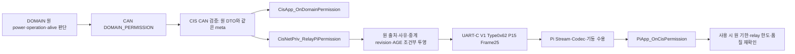

# DOMAIN→CAN→CIS→UART-C→Pi Permission 흐름

UART-C VERSION1 후보의 조건부 흐름이다. `SC08`의 기존 DOMAIN_PERMISSION→CIS→Pi 경계를 상세화하며 원 CAN 수신 4건 중 CIS 의무와 UART-C 수신 1건을 따로 추적한다. DOMAIN의 원 허용 판단과 Pi의 실제 기능은 각 Owner 범위다. 실제 구현·Driver 바인딩·팀 채택은 별도 근거가 필요하다.

[Network 개요](../06_UART_C_OVERVIEW.md) → [M06/F16~F18](../modules/M06_UART_CODEC.md) → [P_PERMISSION 7필드/Codec](../functions/uart_c/P_PERMISSION.md) → [Data 정본](../data/UART_C_DATA.md). 공통 [Frame·Router](../functions/UART_C_FRAME_ROUTER.md), [TX/RX·수명](../functions/UART_C_TX_RX_CONTROL.md), 기존 [CAN Permission](../functions/can/DOMAIN_PERMISSION.md)과 [CAN 합성](CAN_BCM_AND_PERMISSION.md)을 함께 읽는다.

## 두 전송 홉과 같은 입력의 두 소비



CIS App과 relay는 같은 검증된 event의 **형제 소비**다. 서로의 함수 반환을 전제하는 순서나 App의 추가 relay 호출 의무를 만들지 않는다. DOMAIN은 Pi에 직접 UART-C를 보내지 않는다. CAN의 BCM/CIS/WINDOW/VSS 수신 의무4건은 유지하고 WINDOW의 실행 HOLD도 유지한다.

| 연결 | 실제 원 선언/자료 | 같은 사건으로 보존할 정보 | 완료로 주장할 수 없는 것 |
|---|---|---|---|
| DOMAIN 원 생산→CAN | `DomainNet_PublishPermission(const NetDomainPermission*)` | 독립 power/operation/alive 입력의 원 quality·update·AGE, 합성 바인딩 | 한 C2 입력 갱신으로 다른 입력의 fresh 생성 |
| CIS CAN→App | `CisApp_OnDomainPermission(const NetDomainPermission*, const NetCanRxMeta*)` | CAN 원 DTO7필드와 DOMAIN source boot/TX/수신시각 | App void가 Pi relay 접수/송신 성공이라는 해석 |
| CIS CAN→private relay | `CisNetPriv_RelayPiPermission(const NetDomainPermission*, const NetCanRxMeta*)` | 위와 동일 pair + 새 CIS relay 평가의 별도 근거 | 새 NetPiPermission 공개 App 송신 API, 원 reason 단순 복사 |
| CIS→Pi | `WIRE-P03-P_PERMISSION` / `RX-P03-P_PERMISSION-PI` | CIS Boot/update, power/value quality/reason/use-limit/원 AGE | 원 DOMAIN Boot/update가 payload에 포함됐다는 주장 |
| Pi typed 소비 | `PiApp_OnCisPermission(const NetPiPermission*, const NetUartRxMeta*)` | 전체 DTO·같은 UART LinkSequence/로컬 수신시각 | callback void를 현재 허용 승인·차량 결과 완료로 집계 |

역사적 원형 출처는 T10 46~49·235~238행, T26 99~102행, S4A `api/cis.md` 및 `api/pi.md`다. 데이터의 역사적 출처는 T37 786~795행, T25 `NetPiPermission`이다. G6 당시 Interface39 봉인본은 바이트 그대로 보존하며, 현재 별도 후보의 문서 참조는 고정 r1 Interface40개다. UART-C 경계6개는 공개5개와 Network-private relay1개로 구분한다.

## 별개의 식별자와 시간 기준

| 정보 | 발생 주체·원 의미 | 이 흐름에서의 제한 |
|---|---|---|
| CAN `meta.source.boot_id` | 원 DOMAIN CAN 기동 | CIS Boot로 덮지 않음. CIS에는 보관되나 0x62 payload에 직접 없음 |
| DOMAIN 원 성공 평가 Sequence | DOMAIN 기능의 실제 성공 평가 | 성공17 뒤 실패도17·원 시각 유지. CAN/UART payload 번호로 무손실 복원하지 않음 |
| `permission.update_sequence` | Network CAN 합성 UPDATE 후보 | 검증 원 tuple 또는 실제 전달 의미·품질 제한 변경에서 갱신; 원 성공 Sequence와 별개 |
| CAN `meta.source.tx_sequence` | DOMAIN 전송 순번 | 원 평가 번호가 아니며 UART LinkSequence와 별개 |
| `cis_boot_id` | CIS runtime relay 기동 | 원 DOMAIN Boot를 증명하지 않음. CIS 재시작 후 구 원 판단 재표시 금지 |
| relay `update_sequence` | 새 CIS relay 의미 평가 | 원 DOMAIN 평가/세대·품질 제한과의 실제 연결·wrap 미정. 반복은 유지 |
| UART `link_sequence` | CIS→Pi 방향 전송 순번u16 | 같은 relay 반복에서 증가할 수 있음. 새 permission 의미 없음 |
| 원 `source_age_ms` | DOMAIN 판단부터 누적 ms | 원 CAN 자료의 보수 AGE를 계승. relay·Pi RX에서0 초기화 금지 |
| CIS/Pi `received_at_ms` | 각자의 단조 clock | 서로 또는 DOMAIN clock와 직접 차감하지 않음 |

후방 활성 Power의 실제 원 재평가 약200ms와 원 사용기한500ms는 확정 합의다. 아래 나머지 전송·수신·relay 수치 및 실제 바인딩은 각각 구분한다. 이 원 기한을 Operation/Alive나 후방 거리의 TTL로 확대하지 않는다.

| 후보 | 출처와 역할 | 대체할 수 없는 것 |
|---|---|---|
| 후방 활성 Power 원 사용500ms / 실제 재평가 약200ms | 직접 DOMAIN 합의; effective AGE >= 500ms부터 비사용 | UART 반복500ms·relay1500ms로 연장 불가; 다른 Permission 범위에는 일괄 적용하지 않음 |
| UART 보고500ms | T35 32행 | 원 판단 유효기간·새 원 평가 전달 보장 아님 |
| `USE_LIMIT`1500ms 후보 / 조건부500ms | 같은 후방 원 판단을 양끝이 전달·소비한다는 검증이 있을 때만500ms 변경 검토 | 기존 송신값 자동 변경 없음; 원500ms를 연장하지 않음; raw0 의미 미정 |
| UART 수신 중단1500ms | T35 32행 | payload USE_LIMIT와 별개인 통신 감독 후보 |
| CAN5ms/UART50ms 전달 여유 | T37 공통 AGE 제안 | 실제 Driver 지연 상한/실측 또는 조립50ms와 같은 의미가 아님 |

원 수신 AGE에 아직 반영되지 않은 CAN 전달 여유, CIS 대기, UART 전달 여유, Pi 수신 후 경과를 각자 한 번만 반영한다. 이미 수신 DTO AGE에 포함된 구간을 meta를 이유로 다시 더하지 않는다. 실제 시각 기준/보수적 상한을 모르면0으로 채우지 않고 사용 근거를 HOLD한다. 65535는 실제 나이가 그 이상일 수 있는 포화 하한이며 확정된 상한이 아니다.

<a id="relay-projection"></a>
## CIS 원 입력→relay 투영의 구체 조건부 의사코드

아래 자료·함수는 **PROPOSED_PRIVATE_TYPE/FUNCTION**이며 wire 필드·설치 헤더·실제 SDK ABI가 아니다. 이 문서가 단일 정의 위치다. `NetDomainPermission`, `NetCanRxMeta`, `NetPiPermission`은 기존 정본을 참조한다. Boolean은 승인을 생성하는 스위치가 아니라 각 Owner가 확인한 실제 증거의 존재를 표현한다. 현재 미바인딩인 항목을 true로 가정해 경로를 활성화하지 않는다.

`NetUartCPermissionRelayEvidence`의 원 identity는 제출 pair에 고정되어야 한다. 기존 private 멤버명 domainEvaluationSequence는 번호 혼동을 막기 위해 domainCompositeSequence로 명료화했으며 source->update_sequence인 CAN 합성 번호만 담는다. DOMAIN 성공 평가번호가 아니고 필드 수/공개 API/Wire는 변하지 않는다. `sameEventVerified`는 동일 CAN 검증 event에서 DTO·meta·의미 평가가 결합됐다는 증거로 값 동등성만으로 채우지 않는다. revision/reason/quality/use-limit은 실제 합의된 매핑이 산출한 값만 받으며, 이 함수는 그 정책을 대신 결정하지 않는다. 이 외부 정책이 없을 때 false/HOLD로 끝나는 경로를 먼저 구체화한다.

```c
/* PROPOSED_PRIVATE_TYPE — 문서상 투영 검증 입력, 실제 객체 설치 지시 아님. */
typedef struct NetUartCPermissionRelayEvidence {
    bool sameEventVerified;
    bool domainBootAccepted;
    uint32_t domainBoot;
    uint32_t domainFrameSequence;
    uint32_t domainCompositeSequence;
    bool cisBootBound;
    uint32_t cisBoot;
    bool relayRevisionBound;
    uint32_t relayRevision;
    bool qualityMappingBound;
    NetValueQuality restrictedQuality;
    bool reasonMappingBound;
    NetQualityReason relayReason;
    bool useLimitBound;
    uint16_t relayUseLimitMs;
    bool ageAccountingBound;
    uint32_t unaccountedCanHopMs;
    uint32_t cisElapsedSinceRxMs;
} NetUartCPermissionRelayEvidence;

/* PROPOSED_PRIVATE_FUNCTION: 부호 없는 ms를 overflow 없이 u16 포화. */
uint16_t NetUartC_AddPermissionAge(uint16_t age, uint32_t extraMs)
{
    if (age == 65535u) return 65535u;
    uint32_t room = 65535u - (uint32_t)age;
    if (extraMs >= room) return 65535u;
    return (uint16_t)((uint32_t)age + extraMs);
}

/* 실패 OUT 불변. 성공은 문서상 투영 완결이며 로컬 접수·허용 승인이 아님. */
bool NetUartC_ProjectPermission(
    const NetDomainPermission *source,
    const NetCanRxMeta *sourceMeta,
    const NetUartCPermissionRelayEvidence *e,
    NetPiPermission *out)
{
    if (source == NULL || sourceMeta == NULL || e == NULL || out == NULL)
        return false;
    if (sourceMeta->source.boot_id == 0u) return false;
    if (source->vehicle_power_permission != 0u &&
        source->vehicle_power_permission != 1u &&
        source->vehicle_power_permission != 255u) return false;
    if (source->power_permission_quality > 3u) return false;
    if (source->power_operation_state != 0u && source->power_operation_state != 1u &&
        source->power_operation_state != 255u) return false;
    if (source->operation_allowed > 1u || source->operation_quality > 3u)
        return false;
    if (!e->sameEventVerified || !e->domainBootAccepted) return false;
    if (e->domainBoot != sourceMeta->source.boot_id ||
        e->domainFrameSequence != sourceMeta->source.tx_sequence ||
        e->domainCompositeSequence != source->update_sequence) return false;
    if (!e->cisBootBound || e->cisBoot == 0u) return false;
    if (!e->relayRevisionBound || !e->qualityMappingBound ||
        !e->reasonMappingBound || !e->useLimitBound || !e->ageAccountingBound)
        return false;
    if (e->restrictedQuality > 3u || e->relayReason > 9u) return false;
    // 원 비유효 power를 OK로 승격하지 않는다. 숫자 크기의 품질 순서는 만들지 않는다.
    if (source->power_permission_quality != 0u && e->restrictedQuality == 0u)
        return false;
    NetPiPermission local;
    local.cis_boot_id = e->cisBoot;
    local.update_sequence = e->relayRevision;
    local.vehicle_power_permission = source->vehicle_power_permission;
    local.value_quality = e->restrictedQuality;
    local.quality_reason = e->relayReason; // source에는 이 멤버가 없다.
    local.use_limit_ms = e->relayUseLimitMs; // 근거 없을 때 1500/0을 넣지 않는다.
    local.source_age_ms = NetUartC_AddPermissionAge(
        source->source_age_ms, e->unaccountedCanHopMs);
    local.source_age_ms = NetUartC_AddPermissionAge(
        local.source_age_ms, e->cisElapsedSinceRxMs);
    if (!NetUartC_ValidatePermission(&local)) return false;
    *out = local;
    return true;
}
```

`NetUartC_ValidatePermission`의 전체 본문은 [7필드 Codec](../functions/uart_c/P_PERMISSION.md#codec)에 있다. `ageAccountingBound`는 원 AGE 기준점과 CAN 전달 반영 여부, 같은 CIS clock의 `received_at_ms`→평가시점 경과, wrap/재시작 구별까지 확인한 경우만 성립한다. `cisElapsedSinceRxMs`는 그 실제 경과이며 단순 now−timestamp를 신뢰할 수 없는 상태에서는 이 함수를 성공시키지 않는다. 실제 UART 송신 전의 추가 대기는 공통 TX의 **평가시점 이후** 구간만 더한다. 이 시점 이후 대기를 이미 포함한 AGE에 다시 CAN 수신 기준부터 더하지 않는다.

DOMAIN 의미 투영의 [UNKNOWN 조건](CAN_BCM_AND_PERMISSION.md#permission-projection)은 r1 미확정 권장안이다. 이 relay는 bool/사유를 추측하지 않고 이미 검증된 CAN 값·품질을 사용한다. UNKNOWN+OK 원 의미의 무손실 표현 한계를 이 단계에서 해결했다고 가정하지 않는다.

projection은 원 값0/1/255를 그대로 운송한다. 원값이1인 열화/만료 자료도 형식상 보고할 수 있으므로, 투영 성공 자체가 제어 사용 승인은 아니다. power 품질이 OK라도 후방 활성 원500ms와 동일 원 판단의 연결을 입증하지 못하면 아래 Pi 사용 분기에서 허용할 수 없다. 원 operation/alive 품질을 power로 오인하거나 operation 미확인만으로 새로운 원 불허 정책을 만들지 않는다. 원 pair 전체와 추가 제한 근거는 CIS owned item에 남긴다.

## 기존 private relay의 로컬 접수·송신·실패 절차

`CisNetPriv_RelayPiPermission` 원형을 유지한다. 아래 순서는 실제 API 내부를 구현했다는 주장이 아닌 Network 소유 의사코드 절차다. 공통 TX 제어의 소유 item/Driver token·epoch와 연결하며 새 공개 Port를 선언하지 않는다.

1. 두 포인터 NULL·원7필드 raw집합·source Boot0을 검사한다. 확인된 형식 위반만 `NET_SUBMIT_INVALID_ARGUMENT`; 정상 STALE/INVALID/NO_DATA는 raw 오류로 거부하지 않는다.
2. 호출 동안 같은 CAN event pair를 안정화한다. dispatcher의 실제 직렬화·입력 수명·현재 DOMAIN/CIS 세대와 시간 근거가 없으면 `NET_SUBMIT_NOT_READY`다. 숫자가 같다는 이유만으로 다른 event를 결합하지 않는다.
3. `NetUartCPermissionRelayEvidence`의 원 pair identity, relay revision, 품질 제한·사유·use-limit·AGE 근거를 확인한다. DOMAIN이 약200ms마다 실제 재평가를 완료한 사건은 값이 같아도 새 원 evaluation sequence/평가시각을 가진다. 이를 받은 relay는 기존 접수/송신 경로에서 즉시 전달한다(P_PERMISSION 반복 없음). 성공17 뒤200ms 평가 실패(FAILED/NO_DATA) 시 기존 ALLOW 즉시 철회는 DOMAIN Core 담당자 구현 완료 보고이며 원17/시각을 그대로 둔다. UNKNOWN의 원인별 C2 Quality 투영은 DOMAIN Adapter 수용 대기이고 그 제한의 CAN 합성·relay·Pi 실제 전달은 BINDING_NOT_VERIFIED다. 같은 원 성공번호라도 실제 제한 변화는 단순 중복이 아니며 새 CAN 합성/relay 후보로 전달한다. 성공 이력이 없으면 정상 원 번호·시각을 만들지 않는다. 실제 새 원 평가·원 세대 변화·검증된 제한 변화에 대응할 때만 새 relay revision(+1)을 부여하고 단순 CAN 50ms 반복은 relay하지 않는다. Driver 참조 중 frame은 수정하지 않으며 실제 지연 상한은 바인딩 검증 전 보장하지 않는다. 실제 바인딩이 없으면 해당 투영을 HOLD하고 로컬 NOT_READY 의미로 제한하는 후보를 기록한다. 이 반환 매핑의 실제 Owner 수락도 IF-O05/G06에 남긴다.
4. 원 `NetDomainPermission`7필드와 전체 `NetCanRxMeta`를 자기 소유 항목에 **값 복사**한다. `NetUartC_ProjectPermission`으로 임시 relay DTO7필드를 구성한다. 호출자 포인터·외부 meta 포인터를 저장하지 않는다. 함수 실패 후 부분 DTO를 게시하지 않는다.
5. relay DTO·원 pair·평가 기준시각·원본 연결을 함께 보관할 유한 공간이 없으면 `NET_SUBMIT_NO_CAPACITY`; 확보 후에도 게시가 실패하면 이번 예약만 해제한다. 기존 항목을 조용히 지우지 않는다. 실제 저장소 크기·잠금·교체 정책은 미정이다.
6. 완전한 자기 소유 항목의 안정 게시가 끝났을 때만 `NET_SUBMIT_OK`를 반환한다. 원문은 아직 시작하지 않은 같은 의미 현재값의 교체를 허용하는 후보지만 Driver가 참조하는 frame은 교체하지 않는다. 실제 교체 key/순서 수용 미정이면 임의 교체하지 않는다.
7. 실제 송신 전 원 DOMAIN/CIS generation·동일 평가 연결·원 기한/품질·경과 계산 근거와 검증된 현재 제한을 같은 직렬 구간에서 다시 확인한다. 같은 원 성공에 대한 실제 owner 제한 또는 만료 뒤 구 ALLOW 미시작 pending/retry 재게시를 막는다. 새 제한의 접수/송신 실패도 이 제한을 해제하지 않는다. malformed 입력·일반 제출 실패만으로 제한을 발명하지 않는다. 이미 Driver 참조 중인 frame을 취소/변경했다고 가정하지 않는다. 만료된 허용을 정상 허용으로 전송하지 않으며, 승인된 열화 보고로 표현하는 사유/품질 매핑도 없으면 해당 송신은 HOLD한다. 원 AGE에 평가 후 대기만 더하고 포화한다.
8. payload15B를 own frame25B에 encode하고 VERSION1/TYPE0x62/길이·CRC를 완성한다. frame의 LINK_SEQUENCE는 원 평가가 아니다. Driver 호출 전에 item token/epoch·불변 frame·참조 기록을 게시하여 동기 callback 가능성까지 구분한다.
9. Driver accepted, 최종 성공/실패, 참조 해제는 각각 기록한다. 명시 release가 먼저 오면 원 identity/최종결과 pending을 별도 보존한 뒤 물리 buffer만 회수할 수 있다. 최종결과나 timeout만으로 참조가 해제됐다고 추측하지 않는다.
10. OK 이후 만료·전송 실패·문맥 상실은 과거 반환값을 변경하지 않고 원 item과 연결해 관측한다. CIS/Pi 실제 통신 진단·consumer 무효화의 기존 연결은 BINDING_OPEN이다. DOMAIN의 command failure sink·새 failure enum/공개 callback을 복제하지 않는다.

## Pi 수신과 사용 판정을 분리한 의사코드

Pi의 Network는 완전한 CRC 정상25B를 먼저 소비한다. payload raw 검증 성공 뒤 수용한 CIS Boot/순서·같은 수신 meta와 준비된 Pi owner 문맥을 확인한 경우 기존 `PiApp_OnCisPermission`을 호출한다. CRC 정상이라도 enum/Boot0/typed 거부이면 그 frame 전체를 소비하고 payload 내부 SYNC를 새 frame으로 재탐색하지 않는다. malformed·구 세대·미확정 profile을 정상 liveness로 기록하지 않는다. 정상 열화 통지는 값/품질을 보존한다.

다음은 **실제 Pi 기능 코드가 아닌 후방 활성 Power 전용 조건부 검증 함수**다. 다른 Power/Operation/Alive 소비에 이500ms를 공통 TTL로 적용하지 않는다. `sourceAssociationVerified`의 생성자는 보존한 DOMAIN 원 판단과 이 후방 소비의 실제 대응을 확인하고 기존 evidence의 `originalLimitBound=true`, `originalLimitMs=500`, `originalEqualityRuleBound=true`, `originalExpiresAtEquality=true`를 그 계약에 결합한다. 숫자 대입만으로 association을 입증한 것은 아니다. 현재 payload에는 DOMAIN 원 Boot/update가 없으므로 `sourceAssociationVerified`를 payload에서 스스로 계산할 수 없다. 이는 양단이 합의하고 구현에서 입증해야 할 기존 원 연결의 검증 결과다. 그 근거 부재에서 결과는 항상 HOLD다. 새 필드·side-channel·ACK를 제정하지 않는다. 정책과 관측 근거가 갖춰졌다는 조건에서 시간 경계·출력 의미를 검토할 수 있도록 본문을 전개한다.

```c
/* 모두 PROPOSED_PRIVATE_TYPE. 값은 문서상 분기 이름이며 Wire/public enum 아님. */
typedef enum NetUartCPermissionUse {
    NET_UART_C_PERMISSION_FORMAT_ERROR,
    NET_UART_C_PERMISSION_CONTRACT_HOLD,
    NET_UART_C_PERMISSION_UNCONFIRMED,
    NET_UART_C_PERMISSION_CONFIRMED_DENIAL,
    NET_UART_C_PERMISSION_ALLOW_CANDIDATE
} NetUartCPermissionUse;

typedef struct NetUartCPermissionUseEvidence {
    bool cisBootAccepted;
    uint32_t admittedCisBoot;
    bool sourceAssociationVerified;
    bool relayEvaluationAdmitted;
    bool receiverEpochCurrent;
    bool qualityReasonUseBound;
    bool qualityReasonPermitsUse;
    bool originalLimitBound;
    uint32_t originalLimitMs;
    bool relayLimitMeaningBound;
    bool originalEqualityRuleBound;
    bool originalExpiresAtEquality;
    bool relayEqualityRuleBound;
    bool relayExpiresAtEquality;
    bool ageAccountingBound;
    uint32_t unaccountedUartHopMs;
    uint32_t piElapsedSinceRxMs;
    bool sameEvaluationAsPrevious;
    bool previousAgeAtSameNowKnown;
    uint16_t previousAgeAtSameNow;
} NetUartCPermissionUseEvidence;

/* PROPOSED_PRIVATE_FUNCTION. 모든 입력은 stable owned snapshot이다. */
NetUartCPermissionUse NetUartC_CheckPermissionUse(
    const NetPiPermission *message,
    const NetUartCPermissionUseEvidence *e)
{
    if (!NetUartC_ValidatePermission(message))
        return NET_UART_C_PERMISSION_FORMAT_ERROR;
    if (e == NULL || !e->cisBootAccepted ||
        e->admittedCisBoot != message->cis_boot_id ||
        !e->sourceAssociationVerified || !e->relayEvaluationAdmitted ||
        !e->receiverEpochCurrent)
        return NET_UART_C_PERMISSION_CONTRACT_HOLD;
    // 정상 열화/미확인을 확인된 불허0/OK로 바꾸지 않는다.
    if (message->value_quality != 0u || message->vehicle_power_permission == 255u)
        return NET_UART_C_PERMISSION_UNCONFIRMED;
    if (!e->qualityReasonUseBound)
        return NET_UART_C_PERMISSION_CONTRACT_HOLD;
    if (!e->qualityReasonPermitsUse)
        return NET_UART_C_PERMISSION_UNCONFIRMED;
    if (!e->originalLimitBound || !e->relayLimitMeaningBound ||
        !e->originalEqualityRuleBound || !e->relayEqualityRuleBound ||
        !e->ageAccountingBound)
        return NET_UART_C_PERMISSION_CONTRACT_HOLD;
    // 이 호출은 확인된 후방 활성 원 판단만 다룬다. 확정500ms/도달시 만료를 완화하지 않는다.
    if (e->originalLimitMs != 500u || !e->originalExpiresAtEquality)
        return NET_UART_C_PERMISSION_CONTRACT_HOLD;
    // 0의 최종 의미가 미정인 현재 후보에서는 use-limit0을 사용 근거로 해석하지 않는다.
    if (message->use_limit_ms == 0u || e->originalLimitMs == 0u)
        return NET_UART_C_PERMISSION_CONTRACT_HOLD;
    uint16_t age = NetUartC_AddPermissionAge(
        message->source_age_ms, e->unaccountedUartHopMs);
    age = NetUartC_AddPermissionAge(age, e->piElapsedSinceRxMs);
    if (e->sameEvaluationAsPrevious) {
        if (!e->previousAgeAtSameNowKnown)
            return NET_UART_C_PERMISSION_CONTRACT_HOLD;
        if (age < e->previousAgeAtSameNow) age = e->previousAgeAtSameNow;
    }
    // 포화 나이는 상한을 증명할 수 없으므로 한도 내부라고 인정하지 않는다.
    if (age == 65535u) return NET_UART_C_PERMISSION_UNCONFIRMED;
    bool originalExpired = e->originalExpiresAtEquality
        ? ((uint32_t)age >= e->originalLimitMs)
        : ((uint32_t)age > e->originalLimitMs);
    bool relayExpired = e->relayExpiresAtEquality
        ? ((uint32_t)age >= (uint32_t)message->use_limit_ms)
        : ((uint32_t)age > (uint32_t)message->use_limit_ms);
    if (originalExpired || relayExpired)
        return NET_UART_C_PERMISSION_UNCONFIRMED;
    if (message->vehicle_power_permission == 0u)
        return NET_UART_C_PERMISSION_CONFIRMED_DENIAL;
    return NET_UART_C_PERMISSION_ALLOW_CANDIDATE;
}
```

`ALLOW_CANDIDATE`는 문서상 필요 조건을 통과했다는 결과명으로 실제 실행 허가·전원/프로세스 동작을 지시하지 않는다. 후방 활성 원500ms와 원 기한 도달 시 비사용은 합의되어 위 검사에 고정했다. quality/reason 조합의 상세 매핑·relay 한도 및 그 경계·실제 원 연결은 별도 조건으로 남는다. 원499ms는 시간 필요조건만 통과하며 품질·현재 Boot·association이 없으면 허용하지 않는다. 위 함수는 raw 이유를 삭제하지 않고 전체 message를 원형대로 보관한다. 확인된 0/OK라도 너무 오래됐거나 출처를 확인하지 못하면 **현재** 불허 판정의 증거로 재확정하지 않고 이전 raw 사실과 현재 사용 불가를 구분한다.

`sameEvaluationAsPrevious`는 실제 원 판단/relay 의미 association이 확인된 경우만 true다. LinkSequence만 비교해 산출하지 않는다. 같은 원 판단을 relay revision 변경만으로 새것으로 취급하지 않으며, 원/domain association 판정이 불가하면 `sourceAssociationVerified` 또는 `relayEvaluationAdmitted`를 통과시킬 수 없다. 다른 revision·wrap의 순서는 숫자 크기/half-range를 임의 선택하지 않는다. `previousAgeAtSameNow`는 과거 수신 당시 AGE가 아니라 **같은 Pi 현재시각**으로 재계산한 값이다. 바뀐 clock/epoch·미상 전달 구간을 제외한 단순 now 차감은 근거가 아니다.

## 재부팅·무수신·오류·자체검수 반례

| ID | 원인/입력 | 분기와 관측 결과 | 원 근거/미결 |
|---|---|---|---|
| C-P11 | CAN DTO와 meta가 다른 event | Project의 sameEvent/원 boot·frame·evaluation 대조 실패, OUT 불변 | T10 private relay, IF-O09/D-02 |
| C-P12 | original powerINVALID인데 relayOK로 정상화 | Project의 비유효→OK 차단, NONE/revision0/AGE0 기본치 생성 없음 | T25/T37, IF-O05/G02/Q11 |
| C-P13 | value0/OK와 value255/NO_DATA | 현재 수명·출처가 확인된0은 CONFIRMED_DENIAL; 255는 UNCONFIRMED, raw 값 보존 | T25 허용 소비 |
| C-P14 | 후방 원 AGE499/500/501ms, original500/relay1500ms 후보 | 499는 다른 조건도 필요;500/501은 UNCONFIRMED. relay 여유로 원 기한 연장 없음 | 직접 합의500ms·도달 시 비사용; relay500 채택은 별도 조건 |
| C-P15 | 같은 원 판단 반복, 낮아진 새 AGE·새 LinkSequence | 같은 now의 이전 AGE와 비교해 더 늙은 근거 보존. 새 허용 revision 발급 없음 | T35·S4C 시간 계약 |
| C-P16 | SOURCE_AGE65535 또는 누적 중 포화 | raw 보고는 가능, CheckUse는 UNCONFIRMED, 0 wrap 없음 | T37 AGE 규칙 |
| C-P17 | CIS reboot 또는 Pi 재연결 후 지연한 이전 허용 | admitted Boot/receiverEpoch/source association 미확인 HOLD. 구 pending/cache 새 generation stamping 금지 | IF-O09/D-02 |
| C-P18 | UART 연결 복구·CRC 정상만 확인 | profile·CIS Boot·원 판단·기한 근거 없으면 허용 재사용 없음 | T25/T26·G02 |
| C-P19 | borrowed 원 DTO/meta를 caller가 반환 후 재사용 | OK 전 owned full copy만 유효, callback pointer 보관 금지 | T10/T26·D-05 |
| C-P20 | queue full·Driver accepted후 fail·오래된 callback | 새 부분 접수 없음, accepted≠final TX, token/epoch 불일치는 현재 slot에 적용하지 않음 | IF-O12/D-03/G06 |
| C-P21 | frame 조립중 link reset, 새 bytes 도착 | 이전 half-frame 폐기, 새 epoch와 합치지 않음; 이전 permission 복원 없음 | S4C Stream·복구 계약 |
| C-P22 | ISR에서 Pi callback 시도 | raw/error 짧은 전달만. parsing/의미 callback은 준비된 Owner 문맥에서 수행 | T38·D-05 |

무수신/만료·원 DOMAIN 세대 변경 시 기존 허용을 현재 사용의 증거로 재활용하지 않는다. 실제 supervisor가 Pi consumer에 이를 전달하는 기존 연결·타이머·직렬화·재시도·queue 깊이는 BINDING_OPEN이다. 위 표는 문서 반례 대조이며 Host 주입 시험·실제 UART/보드 시험이 아니다.

## 기존 미결로 되돌아가는 경계

IF-O05/G02/Q11은 reason/quality/relay revision/합성 O05와 USE_LIMIT의 관계를 유지한다. 후방 원500ms/약200ms 재평가 합의는 이 미결에 되돌리지 않는다.  IF-O09/D-02는 Boot/원 identity, IF-O12/D-03/D-05/G06은 Driver/해제/문맥의 실제 증거가 필요하다. S6Q-05·S6Q-06·S6Q-12·S6Q-14에 같은 ID로 영향을 누적한다. 공통 Owner35·요구103·시나리오18·Wire48/Rx51을 줄이거나 미합의 항목을 종료하지 않는다. G5-0 OFFICIAL_RELEASE_HOLD와 실제 Driver/Clock/소비자 바인딩 미확인은 계속 유효하다.

<a id="named-private-paths"></a>
## CIS 송신·Pi 수신 담당 문맥의 기존 private 호출

설계상 호출자는 위 `기존 private relay의 로컬 접수·송신·실패 절차`의 CIS M04 송신 담당과 `Pi 수신과 사용 판정을 분리한 의사코드`의 Pi M06/M04/M03 수신 담당이다. `CisNetPriv_RelayPiPermission`의 접수와 비동기 송신은 별개다. 실제 Task/함수 심볼·Clock·profile·Driver/소비자 바인딩은 미확정이며, 다음은 새 공개 API가 아닌 기존 Flow 내 호출 순서다.

```c
// CIS M04: 원 pair→ProjectPermission→owned 사본 접수 후 송신 시점의 원 기한·AGE 재확인
encoded = NetUartC_Encode(&ownedDecoded, linkSequence, profile, &ownedFrame);
// OK에만 0x62/15B payload의 25B Frame OUT을 기존 M07/M08 Driver 경계에 인계한다.
// 실패/HOLD이면 OUT을 쓰거나 원 허용을 새로 발급하지 않는다.

// Pi M06: StreamNext의 OK 완전 Frame 확보 후
decoded = NetUartC_Decode(&frame, NET_UART_C_CIS_TO_PI, profile, &typed);
// decoded != OK이면 중단. OK일 때만 같은 CIS Boot/원 relay/LinkSequence/raw/AGE로 비교한다.
if (decoded == NET_UART_C_OK) {
    classified = NetUartC_ClassifyRx(&comparison);
    if (classified == NET_UART_C_OK) {
        delivered = NetUartC_Deliver(&typed, admittedSourceAndOrder,
            ownerContextReady, callbackBindingVerified);
        // OK는 PiApp_OnCisPermission의 void 반환이며 실제 허용 성공이 아니다.
    } else if (classified == NET_UART_C_DUPLICATE) {
        if (comparison.incomingLinkSequence == comparison.previousLinkSequence) {
            // 정확한 동일 frame: callback·정상 수신감시·원 AGE 기준 갱신 없음.
        } else {
            // 수용된 새 Link/동일 원 평가: transport/raw/보수 AGE 원자 반영 조건 검사.
            // Pi Permission callback 반복 규칙은 기존대로 유지; Vision의 반복 callback을 복제하지 않는다.
            // 정상 감시의 실제 Pi 소비 연결은 별도 BINDING_NOT_VERIFIED다.
        }
    }
    // 오류/HOLD이면 정상 의미 인계 없이 중단.
}
```

Permission의 sameImmutableInput은 원 성공번호만 같은지가 아니라 검증된 relay 의미·현재 제한 상태가 동일한지까지 포함한다. 원 성공17을 유지한 실제 제한 변경은 수용된 새 relay revision과 functionalTransitionKnown 근거로 정상 전이 경로에 둔다. 같은 relay revision의 다른 의미를 semanticExactlyEqual에서 임의 허용하지 않는다. 원 성공/합성/relay association이 부족하면 해당 전이를 HOLD하며 단순 번호 증가로 원 AGE를 초기화하지 않는다.

`comparison`과 세 bool은 원 수신의 확인된 근거로 구성하며 상수 true로 채우지 않는다. 분류 당시 previous/incoming Link·원 raw·typed/meta·보수 AGE를 같은 직렬 구간의 안정 사본으로 고정한 뒤에만 분기를 읽는다. 다른 작업의 갱신 뒤 Link 필드를 다시 읽어 중복과 반복을 바꾸지 않는다. 실패 분기를 지나 다음 호출로 진행하지 않는다. Decode OUT은 성공에만 소비하고, 전달 DTO/meta의 borrowed 수명은 callback 반환까지다. 후속 사용은 Pi 소비자가 확보한 전체 사본과 원 기한 근거를 요구한다. CIS Driver의 실제 token/epoch 사건은 [M08/M07 관측·회수 연결](../functions/UART_C_TX_RX_CONTROL.md#named-caller-lifecycle)의 `NetUartC_ObservePort` → `NetUartC_CanReturnBuffer`로 처리한다. release 먼저이면 buffer 반환만 검토하고 최종결과 미확정 identity/원 relay 예약은 유지한다.
