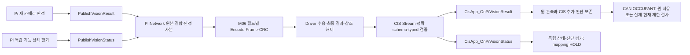

# UART-C Pi → CIS — 원 판정·상태와 CAN 연결의 경계

P03의 두 독립 수신 의무 `RX-P03-P_VISION_RESULT-CIS`, `RX-P03-P_VISION_STATUS-CIS`를 다룬다. VERSION1 후보의 조건부 책임 경계를 설명하며 Owner35와 외부 HOLD를 보존한다. G6 당시 Interface39는 역사적 봉인 기준선이고, 현재 별도 후보는 고정 r1 Interface40개에 문서 동기화되어 있다. Pi 영상 알고리즘과 CIS 기능 평가·Driver/OS 구현은 각 Owner의 책임이며 실제 바인딩 근거가 필요하다.

[Network](../01_NETWORK_OVERVIEW.md) → [UART-C](../06_UART_C_OVERVIEW.md) → [L02 인계](../layers/L02_TYPED_HANDOFF.md) / [L03 메시지 서비스](../layers/L03_MESSAGE_SERVICE.md) / [L04 Codec](../layers/L04_FRAME_CODEC.md) → [M03](../modules/M03_TYPED_HANDOFF.md) / [M04](../modules/M04_MESSAGE_SERVICE.md) / [M06](../modules/M06_UART_CODEC.md) → [Frame·Router](../functions/UART_C_FRAME_ROUTER.md) / [Tx·Rx 제어](../functions/UART_C_TX_RX_CONTROL.md) → [Data](../data/UART_C_DATA.md).

<a id="paths"></a>
## 두 경로와 세대의 주체

| Wire / 독립 Rx | 같은 사건으로 묶을 자료 | 기존 로컬 Producer → Consumer | 상세 |
|---|---|---|---|
| `WIRE-P03-P_VISION_RESULT` / `RX-P03-P_VISION_RESULT-CIS` | PiBoot·VisionSequence·VisionAGE·Presence/Count 각각 validity/reason·동반 Pi 상태/고장 | `PiNet_PublishVisionResult` → UART Type0x60 → `CisApp_OnPiVisionResult` | [19B/29B·11필드](../functions/uart_c/P_VISION_RESULT.md) |
| `WIRE-P03-P_VISION_STATUS` / `RX-P03-P_VISION_STATUS-CIS` | PiBoot·StatusSequence·StatusAGE·현재/최근 고장·영향 기능 | `PiNet_PublishVisionStatus` → UART Type0x61 → `CisApp_OnPiVisionStatus` | [16B/26B·7필드](../functions/uart_c/P_VISION_STATUS.md) |



도식의 화살표는 후보 책임 경계다. Driver TX가 관측되어도 CIS RX 화살표의 실현을 증명하지 않는다. UART-C에 UART-M Device/Session/Query 필드를 붙이지 않는다. Boot는 원 Pi 실행 세대, Vision/StatusSequence는 서로 다른 생산자의 평가, LINK_SEQUENCE는 한 방향의 UART frame, CIS CAN Boot/TX_SEQUENCE는 CIS 송신 주체다.

<a id="tx"></a>
## Pi 생산 → 로컬 접수 → Driver

1. Pi 비전 담당자가 값·두 독립 품질·VisionSequence·현재 원 AGE를 생산한다. 상태 담당자는 별도의 StatusSequence·원 AGE·active/last fault를 생산한다. 같은 PiBoot라도 두 평가 시점은 같다고 가정하지 않는다.
2. Pi runtime/Network가 local admission에서 해당 원 관측/상태와 같은 generation의 Boot를 고정한다. App은 runtime Boot를 임의 초기화할 의무가 없다. 아직 결합되지 않은 Boot 슬롯을 읽거나 새 runtime의 Boot로 old record를 재표시하지 않는다. generation 발급/수용·process 재시작 대응 증거가 없으면 새 접수 준비를 제한한다.
3. 원형 `const NetVisionResult *` 또는 `const NetVisionStatus *`의 전 멤버·시간 기준·원 세대 연결을 자기 소유 저장소로 복사한다. 실패 시 부분 접수/기존 대기 덮어쓰기 없이 기존 네 `NetSubmitResult` 의미를 따른다. 사본 완료 뒤 `NET_SUBMIT_OK`이며 UART 완료나 CIS 기능 성공이 아니다.
4. 송신 담당 문맥은 아직 AGE에 반영하지 않은 대기 구간만 한 번 포화 누적한다. 동일 원 평가의 재전송은 Vision/StatusSequence를 유지한다. Queue 용량·대기 기한·재시도 횟수는 새로 정하지 않는다. 아직 송신하지 않은 동일 key 현재값 교체도 실제 Owner의 교체/사건 보존 계약이 있어야 하며 Driver 참조 중 frame은 제외한다.
5. 각 leaf의 `NetUartC_EncodeVisionResultPayload` 또는 `NetUartC_EncodeVisionStatusPayload`가 19/16B를 만들고, [Frame Builder](../functions/UART_C_FRAME_ROUTER.md)가 VERSION1·정확 Type/P/방향·별도 LinkSequence와 CRC를 붙인다. `NetUartM*` private 함수를 실존 공유 API로 호출하거나 B13 타입을 UART-C 겸용으로 수정하지 않는다.
6. 안정된 frame을 Driver에 넘기기 전에 token/지역 수명 identity를 게시하는 [공통 제어](../functions/UART_C_TX_RX_CONTROL.md) 조건을 적용한다. accepted, 최종 TX outcome, 참조 해제는 각각 기록한다. 실제 해제가 먼저이면 물리 버퍼를 반환할 수 있어도 outcome 귀속 identity는 필요한 동안 보존한다. 해제·callback identity 미확인 상태를 성공이나 자동 재시도 근거로 쓰지 않는다. 과거 OK 반환을 뒤늦게 FAILED로 수정하지 않는다.

Pi/CIS의 실제 Serial/SDK·ISR/Task·Driver ABI는 Owner 범위다. 문서에 없는 failure sink/API를 신설하지 않고 D-03/IF-O12/G06의 후발 실패 전달·감독 바인딩을 남긴다.

<a id="rx"></a>
## CIS Stream → 완전 typed 자료 → callback

수신 ISR은 짧은 원 byte/오류 관측 인계까지만 한다. M06은 Owner 문맥에서 분할 SYNC/Header/Body/CRC, 잡음·겹친 A5·연속 frame을 처리한다. 잘못된 VERSION/Type/방향/P·CRC·조립 기한은 후보 시작+1 suffix를 재탐색한다. CRC가 맞는 frame의 enum·세대·소비 거부는 **전체 frame 경계를 소비**한다. payload 안의 A5 5A를 새로운 frame으로 해석하지 않는다. 50ms 조립 기한은 후보이고 실제 byte 도착시각을 보존하여 worker 처리 지연과 구분한다.

각 Decoder는 모든 필드를 임시 객체에 읽고 허용 코드/예약 bit 검증 후에만 OUT을 commit한다. 이어 Router는 실제 profile 채택, 원 PiBoot 수용, source 평가·link 순서의 문맥, 현재 link epoch, 소비자 연결/처리 문맥을 확인한다. 증거 미확인은 해당 정상 전달 HOLD이고 raw 형식이 맞다는 사실만으로 기능 사용을 승인하지 않는다. 정상 코드의 INVALID/UNKNOWN/FAULT 보고는 원 의미를 보존한다.

Router가 호출할 `CisApp_OnPiVisionResult(&result,&meta)` 또는 `CisApp_OnPiVisionStatus(&status,&meta)`의 meta는 바로 그 frame의 LinkSequence와 실제 수신시각이다. callback 실행 현재시각을 received_at_ms로 대체하지 않는다. 소비자가 지속 보관하면 DTO와 meta를 함께 복사한다. callback 반환은 호출 종료만 뜻한다. 수신 Network와 App의 실제 저장/기능 평가/CAN 제출 완료를 하나의 성공으로 기록하지 않는다.

<a id="age"></a>
## AGE를 다시 시작하지 않는 연결

| 구간 | 반영할 원 AGE와 아직 포함하지 않은 경과 | 금지된 갱신 |
|---|---|---|
| Pi 평가 → Pi submit | 생산자가 제공한 VisionAGE 또는 StatusAGE | 두 평가의 시각/AGE를 서로 복사 |
| Pi submit → UART 인계 | Pi Network가 확인한 미반영 로컬 대기 | enqueue와 dispatch에서 같은 대기를 두 번 더함 |
| UART 전송 → CIS RX | 팀이 확인한 전달 경과/보수 여유 근거 | Pi clock과 CIS clock 직접 뺄셈, 미측정 지연을0 처리 |
| CIS RX → CIS 사용/제출 | 같은 RX 기준점에서 아직 포함하지 않은 로컬 경과 | callback 지연을 더하고 같은 RX기준으로 다시 더함 |
| CIS CAN submit → 실제 CAN 인계 | 기존 CAN Network의 별도 미반영 대기 | 새 CIS Boot/TXSequence 때문에 원 VisionAGE0 |
| DOMAIN RX → 기능 소비/후속 투영 | 기존 B12/B13의 해당 원 입력 AGE 연결 | 새 UART-M LinkSequence·Query로 원 평가 최신화 |

모든 u16 AGE는 넓은 중간 합으로 계산해 65535에 포화한다. 포화는 정확65535ms가 아니라 그 이상일 수 있는 하한이다. 신뢰할 시간 기준/미반영 구간이 없으면 해당 최신성 소비를 HOLD하며 임의 상한이나0을 넣지 않는다. B08/T37의 UART50ms·CAN5ms 여유도 후보로 유지하고 실제 측정/팀 채택 없이 확정 지연으로 더하지 않는다. 동일 원 평가를 다시 받았을 때 이미 경과한 나이가 새 수신시각 때문에 낮아지거나 사용기한이 연장되지 않도록 같은 관측의 나이 근거를 유지한다.

<a id="projection"></a>
## 원 품질과 CIS 판단을 분리한 CAN OCCUPANT 계약 검사

CAN [`CIS_OCCUPANT`](../functions/can/CIS_OCCUPANT.md)에는 Presence와 Count **각각** validity/reason이 있다. [NetCisOccupant](../data/CAN_NODE_DATA.md#type-NetCisOccupant)의 두 쌍은 원 T09 L88–101·S4A 선언으로 확인했다. 한계는 각 값의 한 쌍에 Pi 원 품질과 CIS 추가 제한의 두 사유를 모두 별도로 실을 수 없다는 점이다. “CAN 메시지 전체의 품질이 한 쌍뿐”이라는 해석은 사용하지 않는다.

선택 Interface의 Network 선정 규칙은 원 Pi record를 보존하면서 이후 실제 수신 중단·만료·수용된 기동 변화·해당 기능 Fault로 현재 사용 품질을 제한한다. 원 사유 그대로 투영하는 경로와 확인된 현재 제한 사유를 투영하는 경로를 구분한다. 여러 사건의 대표 사유 우선순위나 아직 없는 기능 mapping은 새로 정하지 않는다. CIS 기능 상태 mapping도 별도다. 아래 검사는 **제안된 투영이 원본을 훼손하는지 보는 문서상 조건**이며 CIS 영상/기능 평가 알고리즘이 아니다. `candidate`는 CIS Owner가 별도로 생산한 완전 객체이고 Network가 없는 reason/상태를 만들어 채우지 않는다.

```c
// PROPOSED_PRIVATE_FUNCTION: 문서상 계약 검사. 실제 채택/SDK API가 아니다.
// source/candidate/meta/제한 사건은 같은 처리 구간의 안정 사본이다.
bool NetUartC_CheckVisionProjection(const NetVisionResult *source,
    const NetCisOccupant *candidate, uint16_t verifiedCurrentAgeMs,
    bool sameEvaluationProven, bool ageBasisProven,
    bool qualityMappingAdopted, bool cisStateAssociationProven,
    const NetUartRxMeta *sourceMeta,
    const NetVisionRestrictionEvidence *restrictions)
{
    if (source == NULL || candidate == NULL || sourceMeta == NULL) return false;
    if (!NetUartC_ValidateVisionResult(source)) return false;
    if (!sameEvaluationProven || !ageBasisProven || !qualityMappingAdopted ||
        !cisStateAssociationProven) return false;
    if (candidate->pi_boot_id != source->pi_boot_id ||
        candidate->vision_sequence != source->vision_sequence) return false;
    if (verifiedCurrentAgeMs < source->vision_age_ms ||
        candidate->vision_age_ms != verifiedCurrentAgeMs) return false;
    if (candidate->occupant_presence != source->occupant_presence ||
        candidate->occupant_count != source->occupant_count) return false;
    if (candidate->presence_validity > 1 || candidate->count_validity > 1 ||
        candidate->presence_reason > 9 || candidate->count_reason > 9 ||
        candidate->vision_function_status > 4) return false;

    // 두 필드 각각 사용 가능한 같은 원 판정일 때만 상호 모순을 검사한다.
    bool bothUsable = source->presence_validity == 1u && source->count_validity == 1u &&
        source->occupant_presence != 255u && source->occupant_count != 255u;
    if (bothUsable && 두 필드 중 하나의 기한·현재 기능 조건을 입증하지 못했으면)
        bothUsable = false;
    bool conflict = bothUsable &&
        ((source->occupant_presence == 0u && source->occupant_count > 0u) ||
         (source->occupant_presence == 1u && source->occupant_count == 0u));
    if (conflict && (candidate->presence_validity != 0u ||
        candidate->count_validity != 0u)) return false;
    for (uint8_t field = 0u; field < 2u; ++field) {
        NetValidity originalValidity = field == 0u ? source->presence_validity : source->count_validity;
        NetQualityReason originalReason = field == 0u ? source->presence_reason : source->count_reason;
        NetValidity currentValidity = field == 0u ? candidate->presence_validity : candidate->count_validity;
        NetQualityReason currentReason = field == 0u ? candidate->presence_reason : candidate->count_reason;
        if (originalValidity == 0u && currentValidity != 0u) return false;
        // 같은 원 관측에 이미 적용한 제한은 READY·재접속·늦은 VALID로 제거하지 않는다.
        if (이 필드의 기존 현재 제한 기록이 누락되었거나 새 원 평가/복구 근거 없이 해제되었으면)
            return false;
        bool hasRestriction = restrictions != NULL &&
            restrictions[field].kind != NET_VISION_RESTRICTION_NONE;
        // bothUsable=false는 현재 VALID 유지의 근거가 아니다. 각 필드를 따로 확인한다.
        if (originalValidity == 1u && currentValidity == 1u &&
            이 필드의 현재 원 기한·기능 사용 가능 조건을 실제 기록에서 확인하지 못했으면)
            return false;
        if (currentValidity == originalValidity && currentReason == originalReason &&
            !hasRestriction) continue;
        // 품질/사유 변경은 현재 INVALID 제한만 허용한다. 원 VALID 회복을 만들지 않는다.
        if (currentValidity != 0u || currentReason == 0u || !hasRestriction) return false;
        const NetVisionRestrictionEvidence *r = &restrictions[field];
        uint8_t mask = (uint8_t)(1u << field);
        if (r->sourcePiBoot != source->pi_boot_id ||
            r->sourceVisionSequence != source->vision_sequence ||
            r->sourceMeta.link_sequence != sourceMeta->link_sequence ||
            r->sourceMeta.received_at_ms != sourceMeta->received_at_ms ||
            (r->affectedFunctions & mask) == 0u ||
            (r->affectedFunctions & 0xFCu) != 0u || currentReason != r->mappedReason)
            return false;
        // eventIdentity는 실제 보존 사건의 identity다. 임의 nonzero로 확인하지 않는다.
        if (r의 eventIdentity·linkEpoch·clockEpoch·observedAtMs가 실제 M09/M04 또는
            CIS 평가 기록과 다르거나 원 관측 이후의 현재 제한임을 확인하지 못했으면)
            return false;
        if (해당 kind와 필드의 기존 reason 매핑이 없거나 여러 사건의 대표 사유가 미정이면)
            return false;
        switch (r->kind) {
        case NET_VISION_RESTRICTION_RX_INTERRUPTED:
            if (!r->limitBound || r->limitMs == 0u) return false;
            if (!(r->expiresAtEquality ? r->elapsedMs >= r->limitMs : r->elapsedMs > r->limitMs))
                return false;
            // 같은 clock에서 이 Result의 마지막 유효 새 Link 이후 중단 경과만 사용한다.
            if (r->mappedReason != 7u) return false; // 기존 COMMUNICATION_FAULT
            break;
        case NET_VISION_RESTRICTION_ORIGIN_EXPIRED:
            if (!r->limitBound || r->limitMs == 0u || r->elapsedMs != verifiedCurrentAgeMs)
                return false;
            if (!(r->expiresAtEquality ? r->elapsedMs >= r->limitMs : r->elapsedMs > r->limitMs))
                return false;
            if (r->mappedReason != 5u) return false; // 기존 STALE
            break;
        case NET_VISION_RESTRICTION_BOOT_CHANGED:
            if (r->currentPiBoot == 0u || r->currentPiBoot == source->pi_boot_id) return false;
            // 실제 수용된 새 Boot와 종료된 원 Boot를 잇는 사건만 허용한다.
            // 이 사건의 최종 reason 매핑 미확정이면 앞의 매핑 검사에서 HOLD한다.
            break;
        case NET_VISION_RESTRICTION_FUNCTION_FAULT:
            if (!NetUartC_ValidateVisionStatus(&r->status) ||
                r->status.pi_boot_id != source->pi_boot_id ||
                r->status.vision_status != 3u || r->status.active_fault == 0u ||
                (r->status.affected_function & mask) == 0u) return false;
            if (r의 status 전 필드와 statusMeta가 현재 수용 기록과 다르거나
                원 판정 이후 이 필드에 Fault를 적용할 시간·기능 근거가 없으면)
                return false;
            break;
        case NET_VISION_RESTRICTION_VALUE_CONFLICT:
            if (!conflict || r->affectedFunctions != 3u || r->mappedReason != 9u)
                return false; // 기존 DATA_INVALID, 원 값은 보존한다.
            break;
        default: return false;
        }
    }
    return true; // 보존/현재 제한 검사 완료. CAN 접수·DOMAIN 반영은 별도다.
}
```

현재 제한 근거의 단일 선언·생성 조건은 [NetVisionRestrictionEvidence](../data/UART_C_DATA.md#type-NetVisionRestrictionEvidence)에 있다. 원 사유 그대로인 투영에는 제한 사건을 만들지 않는다. 사유가 바뀌는 필드에는 실제 사건 사본을 요구하고 원 INVALID→VALID·값 변경·근거 없는 reason 교체는 거부한다. 선택 규칙은 후보에 반영했으며 실제 M09/기능 평가→사본→CAN publish 연결은 `BINDING_NOT_VERIFIED`다. 필수 품질/원 관측 결합·사유 mapping이 없는 개별 투영은 `CONTRACT_HOLD`로 남긴다. 향후 근거가 생겨 검사를 통과해도 기존 `NetSubmitResult CisNet_PublishOccupant(const NetCisOccupant *message);`의 **로컬 접수**를 별도로 수행해야 한다. 이 조건부 검사만으로 그 API 본체·CAN 소비·C2 Adapter 실행이 확인되지는 않는다. 원 Pi record와 추가 CIS 근거를 먼저 보존하며 각 값의 사유 우선순위가 미확정인 경우 값을0으로 만드는 대신 해당 사용/투영을 보류한다.

Pi `vision_status`와 CIS `vision_function_status`는 코드 어휘가 같아도 생산 주체가 다르다. 최신 CIS_STATUS를 과거 occupant 자료에 덮지 않는다. Pi fault/status의 모든 자료가 CAN OCCUPANT에 실린다고 주장하지 않는다. CAN source의 CISBoot/TXSequence와 payload의 PiBoot/VisionSequence를 각각 보존하고, DOMAIN C2/Getter/후속 UART-M에는 기존 동일 입력 연결 HOLD를 적용한다.

<a id="status"></a>
## 상태·고장·복구의 독립 경로

Status READY/RECOVERING은 독립 상태 평가다. 이 사건으로 이전 Result의 Sequence·AGE·품질을 새 판정처럼 변경하지 않는다. Result가 아직 없으면 미관측 그대로다. ACTIVE_FAULT 해제도 LAST_FAULT 이력 삭제가 아니다. 같은 PiBoot라도 서로 다른 Status와 Result를 단순 최신값 조합으로 하나의 평가로 만들지 않는다.

UART-C `affected_function`의 bit0/bit1은 Presence/Count다. CIS_STATUS bit0/bit1은 CIS 비전/온도라는 다른 의미이므로 직복사하지 않는다. Pi fault와 CIS fault도 별도 코드다. 실제 상태/고장/링크 Health를 CIS 진단 Owner가 반영하는 mapping·발생번호·전달 근거가 없으면 그 변환만 HOLD하고 다른 정상 센서 입력을 덮지 않는다. Network 수신 누락을 센서 자체 고장 발생으로 합성하지 않는다.

링크 reset을 실제 관측하면 공통 Stream은 이전 half-frame을 새 epoch의 byte와 합치지 않는다. pending/Driver 참조의 수명은 별도 증거로 마무리한다. PiBoot/process 세대 변경·원 순서 wrap 미확인·오래된 대기는 source 정상 사용 근거가 아니다. 재접속만으로 과거 품질·현재 허용·최근 고장을 재작성하거나 자동으로 새 송신을 만들지 않는다. 재시도/회복 시간 수치·Task·큐는 미정이다.

<a id="counterexamples"></a>
## 흐름 반례와 S6 인계

| ID | 원 상태/사건 | 원인 → 검사·결과 → 기존 HOLD |
|---|---|---|
| VC-F01 | Presence VALID, Count255/INVALID | 두 독립 품질 보존 → Count0·Presence 무효화 없음 → IF-O13/19 |
| VC-F02 | Presence INVALID, Count VALID | 원 Presence 사유 보존 → Count 독립 입력 유지, CAN 대표 사유 미합의 투영 보류 → IF-O13 |
| VC-F03 | Result INVALID 뒤 Status READY | 다른 평가 → Result cache 불변 → IF-O13/19 |
| VC-F04 | 같은 VisionSequence·의미의 수용된 새 Link 반복 / 정확한 동일 Link·raw | 전자는 해당 감시와 기존 callback 연결, 원 나이·수명 불변. 후자는 감시·callback 없음 → IF-O09/D-02 |
| VC-F05 | caller 반환/Queue full·Driver accepted 뒤 실패 | 사본·outcome·release 독립 → 부분 OK/조기해제/소급 반환 변경 없음 → IF-O12/D-03/G06 |
| VC-F06 | 원 Pi 사유·CIS 추가 사유 동시 존재 | 값별 한 품질쌍의 표현 한계 → 원본과 별도 근거 보존, 승인 전 대표값 생성 없음 → IF-O13/19 |
| VC-F07 | 시간 근거 불명/AGE65535/다른 노드 clock | 최신성 입증 불가 → 해당 사용 HOLD, 지연0·foreign clock 차감 없음 → IF-O09 |
| VC-F08 | PiBoot 변경 후 old 평가·half-frame 도착 | 원 세대/지역 link epoch 분리 → 이전 bytes와 새 bytes 혼합·old 평가 새 Boot stamp 없음 → D-02/IF-O09 |
| VC-F09 | Pi status mask1 → CIS mask1 자동 복사 | 의미 불일치 → 해당 진단 mapping HOLD, 새 상태/최근 고장 합성 없음 → IF-O13/19/G06 |
| VC-F10 | 동일 값이지만 다른 PiBoot/VisionSequence | 동등값은 같은 원 사건 근거 아님 → CAN/C2 association 확인 전 정상 투영 없음 → IF-O09/24 |

S6Q-04/06/07/12/14의 같은 ID에 UART-C 영향만 누적한다. 원 Owner35·C2 공개72/TxPort26/Observer11·Wire48/Rx51·시나리오18을 변경하지 않는다. SC06의 Pi 카메라→CIS→DOMAIN 경고 연결, SC10의 비전 부분 고장, SC18의 공통 수신/용량 오류에 해당하나 기능 실행 완료를 의미하지 않는다.

근거: S4C `evidence/b08/UART_C_ROUTING.md#vision/#tx/#dispatch`, `UART_C_CONTRACT.md#identity`, `uart_c/P_VISION_RESULT.md`, `uart_c/P_VISION_STATUS.md`; 원 T35 L15–24·L30–31·L36–74, T25 L26–85·L132 이후, T09 `pi-원-관측과-cis-추가-평가`·`Source AGE를 한 번씩 누적`, T10/T26 정확 API. 시간·자원은 S4C `TIME_IDENTITY_CONTRACT.md`, `RESOURCE_QUEUE_DRIVER_FLOW.md` 후보를 유지한다. 원본 출처·SHA는 제출 SOURCE_REGISTER에 기록한다.

[Result 함수](../functions/uart_c/P_VISION_RESULT.md) · [Status 함수](../functions/uart_c/P_VISION_STATUS.md) · [반대 방향 Permission](UART_C_CIS_TO_PI_PERMISSION.md) · [기존 CAN 흐름](CAN_CIS_WINDOW_VSS.md) · [기존 UART-M 투영](UART_M_CAN_PROJECTION.md).

<a id="named-private-paths"></a>
## Pi 송신·CIS 수신 담당 문맥의 기존 private 호출

호출자는 위 `Pi 생산 → 로컬 접수 → Driver`의 M04 송신 담당과 `CIS Stream → 완전 typed 자료 → callback`의 M06/M04/M03 수신 담당이다. 다음 호출 순서는 기존 Task 또는 Superloop의 설계 책임을 구체화한다. 제품 함수/Task 심볼, 실제 profile·Clock·callback·Driver 연결은 Owner 확인 전 HOLD이며 새 entrypoint를 선언하지 않는다.

```c
// Pi M04: PublishVisionResult/Status가 접수한 owned 사본의 원 세대·미반영 AGE 확인 후
encoded = NetUartC_Encode(&ownedDecoded, linkSequence, profile, &ownedFrame);
// OK일 때만 ownedFrame 전체를 M07/M08에 인계한다. 실패 OUT은 사용하지 않는다.
// token/epoch·원 identity·참조 기록 게시 후 기존 Driver 경계에 제출한다.

// CIS M06: StreamNext의 OK 완전 Frame을 안정 사본으로 받은 뒤
decoded = NetUartC_Decode(&frame, NET_UART_C_PI_TO_CIS, profile, &typed);
// decoded != OK: typed OUT 사용/의미 callback/정상 수신 갱신 없이 해당 Frame 거부.
// decoded == OK: M04가 이 typed와 같은 수신의 source/Boot/SEQ/raw/AGE 근거로 comparison 구성.
if (decoded == NET_UART_C_OK) {
    classified = NetUartC_ClassifyRx(&comparison);
    bool acceptedRepeat = classified == NET_UART_C_DUPLICATE &&
        comparison.incomingLinkSequence != comparison.previousLinkSequence;
    if (classified == NET_UART_C_OK || acceptedRepeat) {
        // 0x60/0x61 전용 분기. 비교 당시 typed/meta/raw/comparison을 고정한다.
        if (전체 원 raw·meta·보수 AGE·메시지별 감시를 게시할 공간이나
            admittedSourceAndOrder·ownerContextReady·callbackBindingVerified의 실제 근거가 없으면) {
            // 장부 일부 게시·callback 없이 해당 인계를 HOLD한다.
        } else {
            // M04 원자 게시: latest Link/raw/meta + 보수 AGE 근거 + 해당 메시지 수신감시.
            // raw AGE는 변조하지 않는다. 현재 보수 AGE는 별도 기준점으로 보존한다.
            delivered = NetUartC_Deliver(&typed, admittedSourceAndOrder,
                ownerContextReady, callbackBindingVerified);
            // 기존 Result/Status callback은 유효 반복에도 호출한다. 원 seq/원 시각은 그대로다.
            // OK는 void 반환이다. App 저장 ACK·새 관측·외부 commit으로 해석하지 않는다.
        }
    } else if (classified == NET_UART_C_DUPLICATE) {
        // 같은 Link/raw 정확한 중복: 정상 감시·callback·원 freshness 갱신 없음.
    }
    // HOLD/오류: 정상 감시·callback·원 의미 갱신 없음.
}
```

위 코드는 서로 다른 송신/수신 문맥의 조건부 단계 표시다. 오류/HOLD 및 정확한 frame 중복은 callback으로 진행하지 않는다. 유효 새 Link 반복은 위의 명시 분기에서만 callback으로 인계한다. `comparison`과 원 raw·`typed`·meta·별도 보수 AGE는 분류부터 게시/callback 종료까지 같은 직렬 구간의 안정 사본이다. `admittedSourceAndOrder`는 이 고정된 원 세대·순서 수용 근거에서만 도출하며 상수 true로 대신하지 않는다. 원자 게시 전에 확보한 consumer 문맥을 callback 중 재진입으로 교체하지 않는다. `typed`와 meta는 같은 안정 사본이며 callback 반환까지만 빌려준다. 소비자는 같은 Boot/관측번호의 반복을 수신 감시에만 반영하고 새 원 시각을 만들지 않는다. raw AGE와 별도 현재 AGE를 혼동하지 않으며 동일 소비시각으로 계산한 더 오래된 근거를 유지한다. 이 소비자 저장·감시 연결은 아직 실행 검증하지 않았다. 이후 보관은 소비자의 전체 복사 책임이다. Decode/Encode 실패 OUT은 불변, ClassifyRx는 상태를 쓰지 않으며 Deliver는 미준비/미수용이면 callback을 호출하지 않는다. Driver 관측 후의 `NetUartC_ObservePort` → `NetUartC_CanReturnBuffer` 호출은 [M08/M07 공통 연결](../functions/UART_C_TX_RX_CONTROL.md#named-caller-lifecycle)을 그대로 따른다.
