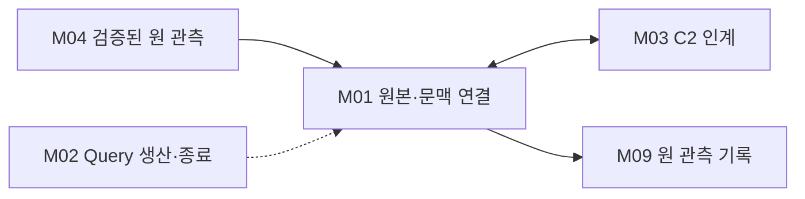

# L01 노드 통신 문맥

원 자료와 C2에 인계한 자료가 같은 관측인지 연결한다. 값만 같다는 이유로 다른 기동·관측 번호의 자료를 결합하지 않는다.

## 경계와 배치

기능별 위험·권한 판단과 DOMAIN Manager 상태를 소유하지 않는다. M01의 원본·문맥·Pi relay와 M02의 Query 생산·종료 감독을 함께 포함한다.

입력과 출력: 검증된 CAN/UART 의미 자료와 출처 → 동일 관측의 C2 인계 근거; Query 요청·성공 Getter 사본·최종 송신 관측 → 원 Query의 응답/종료. NetCisRear는 원본 연결의 대표 예다.

구성 모듈: [M01 원본·문맥 연결](../modules/M01_SOURCE_CONTEXT.md) · [M02 Query 감독](../modules/M02_QUERY_CONTROL.md).

## 정상 처리

M04가 확보한 원 자료를 M03의 변환과 함께 보존한다. DOMAIN 반환으로 인계 결과를 확인하되 Getter가 동일 관측을 반환한다는 사실까지 추정하지 않는다.

## 예외와 실행 문맥

기동·관측 결합을 확인할 수 없으면 해당 C2 투영을 제한한다. 값·품질만 새 수신값으로 덮고 출처는 과거에 남기는 부분 갱신을 금지한다.

단일 담당 문맥에서 상태 변화를 직렬화하는 내부 설계를 적용한다. 실제 Task 개수·Queue 깊이·동기화 primitive는 각 노드 바인딩에서 확인한다. DOMAIN C2 호출을 ISR에서 실행하지 않는다.

## 상세 탐색

[M01 원본·문맥 연결](../modules/M01_SOURCE_CONTEXT.md) · [M02 Query 감독](../modules/M02_QUERY_CONTROL.md)

[전체 Layer·Module](../03_LAYER_MODULE_INDEX.md) · [Network](../01_NETWORK_OVERVIEW.md) · [수직 흐름](../flows/CIS_REAR_144_TO_344.md)

## CAN 원 출처·허용 입력

Permission의 power/operation/alive는 독립 입력이며 합성 정책은 보류다. CIS Environment의 서로 다른 관측·Pi의 원 BOOT와 CAN CIS BOOT를 합치지 않는다.

[담당 Module](../modules/M01_SOURCE_CONTEXT.md) · [공통 함수](../functions/CAN_TRANSFER_CONTROL.md#registration) · [22종 상세](../04_CAN_FD_OVERVIEW.md#messages) · [공통 흐름](../flows/CAN_NETWORK_PATHS.md)

## UART-M 문맥·조회

M01의 현재 peer/Device/Session·DOMAIN Boot와 원 CAN/Pi 기동을 분리하고 동일 입력 association을 보존한다. M02는18 Getter 성공 OUT·원 Query·응답 final TX를 감독한다. Session 발급과 Manager 상태는 DOMAIN/ESP32 Owner 소유다.

[M01](../modules/M01_SOURCE_CONTEXT.md) · [M02](../modules/M02_QUERY_CONTROL.md) · [조회 함수](../functions/UART_M_QUERY_CONTROL.md) · [원본 흐름](../flows/UART_M_CAN_PROJECTION.md) · [UART-M](../05_UART_M_OVERVIEW.md)

## UART-C 연결

Pi 원 품질·DOMAIN 원 허용과 CIS relay 계보를 M01/F03에서 연결한다. [상세](../flows/UART_C_PI_TO_CIS.md) · [UART-C 전체](../06_UART_C_OVERVIEW.md)

## DOMAIN 원본과 조회의 연결

M01은 원 DTO/meta와 DOMAIN 수용·Snapshot의 같은 관측 근거를 보존하고, M02는 기존 Query 생산·최종 송신·종료 감독을 재사용한다. 값이 같거나 Rx가 OK를 반환했다는 사실만으로 두 자료를 결합하지 않는다.

[M01](../modules/M01_SOURCE_CONTEXT.md) · [M02](../modules/M02_QUERY_CONTROL.md) · [Query·원본 상세](../functions/DOMAIN_QUERY_PROVENANCE.md) · [DOMAIN 경계 개요](../07_DOMAIN_ADAPTER_SERVICE.md)
