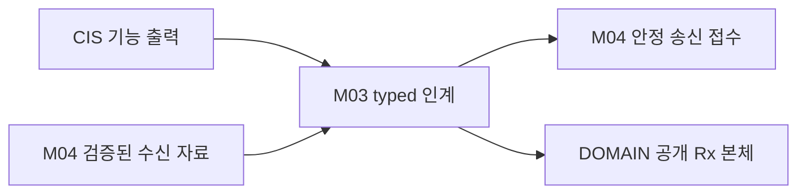

# L02 타입 기반 인계 경계

노드의 기존 공개 선언에 맞게 Network 자료를 인계한다. 호출자의 인자 수명과 소비자의 반환 의미를 연결한다.

## 경계와 배치

DomainIf 공개 본체나 센서 알고리즘을 구현하지 않는다. 새로운 병렬 공개 API를 만들지 않는다.

입력과 출력: 각 노드의 기존 typed 송신 입력 / 검증된 Network 자료 → 안정 접수 / 해당 노드의 typed 소비. 아래 CIS→DOMAIN 도식은 대표 경로이며 C2 등록·TxPort·Rx와 다른 노드 경계는 아래 정본을 따른다.

구성 모듈: [노드 타입 인계](../modules/M03_TYPED_HANDOFF.md).

## 정상 처리

CIS 측 접수는 입력을 Network 수명으로 복사한다. DOMAIN 측에서는 원형을 유지한 채 단위·enum·품질을 명시 변환하고 ISR 밖 단일 담당 문맥에서 공개 Rx를 호출한다.

## 예외와 실행 문맥

NULL·미준비·표현 불가 시 소비자를 호출하지 않는다. API 실패를 cache 반영 성공으로 기록하거나 Observer 오류를 이유로 이미 적용한 자료를 반복 적용하지 않는다.

단일 담당 문맥에서 상태 변화를 직렬화하는 내부 설계를 적용한다. 실제 Task 개수·Queue 깊이·동기화 primitive는 각 노드 바인딩에서 확인한다. DOMAIN C2 호출을 ISR에서 실행하지 않는다.

## 상세 탐색

[노드 타입 인계](../modules/M03_TYPED_HANDOFF.md)

[전체 Layer·Module](../03_LAYER_MODULE_INDEX.md) · [Network](../01_NETWORK_OVERVIEW.md) · [수직 흐름](../flows/CIS_REAR_144_TO_344.md)

## CAN 양단 typed 경계

DOMAIN 공개 본체는 DOMAIN, Network는 TxPort 본체·등록 요청·Rx 호출을 맡는다. 기존 선언과 원 반환값을 보존하며 후보 sourceGeneration 추가로 표현 손실을 숨기지 않는다.

[담당 Module](../modules/M03_TYPED_HANDOFF.md) · [공통 함수](../functions/CAN_TRANSFER_CONTROL.md#admission) · [22종 상세](../04_CAN_FD_OVERVIEW.md#messages) · [공통 흐름](../flows/CAN_NETWORK_PATHS.md)

## UART-M 기존 typed 경계

상향4와 하향17/private2의 기존 원형·반환·중첩 borrowed 입력 수명을 유지한다. Network는 DOMAIN 공개 본체를 중복 구현하지 않고 양단 후보 Adapter와 원본/표현 손실의 미결을 숨기지 않는다.

[M03](../modules/M03_TYPED_HANDOFF.md) · [Router](../functions/UART_M_ROUTER.md) · [23 API/Codec](../05_UART_M_OVERVIEW.md#messages) · [UART-M](../05_UART_M_OVERVIEW.md)

## UART-C 연결

기존 Pi/CIS 공개 5개·private 1개 경계의 원형·전체 복사·void callback 수명을 M03/F10에서 보존한다. [상세](../functions/UART_C_FRAME_ROUTER.md#dispatch) · [UART-C 전체](../06_UART_C_OVERVIEW.md)

## DOMAIN 등록·TxPort·Rx 인계

M03의 기존 F06~F10 안에서 등록 요청과 소비자 준비, TxPort26의 입력 사본, Rx22의 원형·변환·반환 경계를 연결한다. 공개72 본체와 Core 상태는 DOMAIN 소유이며 Observer11을 Network 구현 대상으로 바꾸지 않는다.

[등록](../functions/DOMAIN_REGISTRATION.md) · [TxPort](../functions/DOMAIN_TX_PORT.md) · [Rx Adapter](../functions/DOMAIN_RX_ADAPTER.md) · [DOMAIN 경계 개요](../07_DOMAIN_ADAPTER_SERVICE.md)
