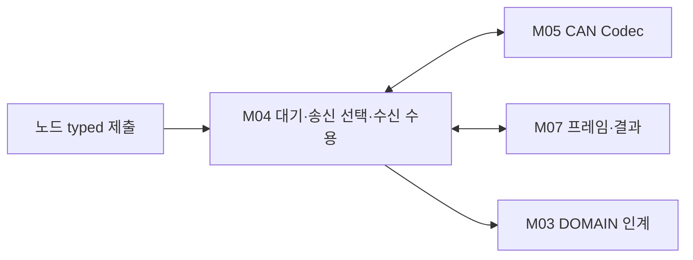

# L03 링크별 메시지 처리

전송을 기다리는 의미 자료와 수신 순서를 관리한다. 원 관측 번호와 매 전송 프레임 번호를 분리한다.

## 경계와 배치

차량 Result·새 센서 관측·새 원 생산 세대를 발급하지 않는다. 모든 링크에 하나의 대기열을 강제하지 않는다.

입력과 출력: typed 제출 / 검증된 수신 값 → Codec·Transport 제출 / 순서가 확인된 인계.

구성 모듈: [링크별 메시지 서비스](../modules/M04_MESSAGE_SERVICE.md).

## 정상 처리

CAN·UART-M·UART-C의 의미 자료를 안정 접수하고 송신 선택 때 미반영 경과를 AGE에 한 번 누적한다. CIS 후방 현재값은 대표 경로다. 수신 노드는 기동과 프레임·원 관측 순서를 구분해 수용하며 뒤 단계 저장소 확보 전에 인계 완료 상태를 갱신하지 않는다.

## 예외와 실행 문맥

Queue 부족·오래된 자료·재기동·중복·순서 역전은 서로 다른 이유로 처리한다. 기동 승인·wrap 비교·TTL이 정해지지 않은 분기를 임의 숫자로 완성하지 않는다.

단일 담당 문맥에서 상태 변화를 직렬화하는 내부 설계를 적용한다. 실제 Task 개수·Queue 깊이·동기화 primitive는 각 노드 바인딩에서 확인한다. DOMAIN C2 호출을 ISR에서 실행하지 않는다.

## 상세 탐색

[링크별 메시지 서비스](../modules/M04_MESSAGE_SERVICE.md)

[전체 Layer·Module](../03_LAYER_MODULE_INDEX.md) · [Network](../01_NETWORK_OVERVIEW.md) · [수직 흐름](../flows/CIS_REAR_144_TO_344.md)

## CAN 접수·선택·순서

최신 상태의 pending 교체와 명령/결과/사건의 독립 보관을 구분한다. 원 BOOT/TX와 기능 identity, 같은 소비시각 AGE를 검증한 후 원자적으로 인계한다.

[담당 Module](../modules/M04_MESSAGE_SERVICE.md) · [공통 함수](../functions/CAN_TRANSFER_CONTROL.md#rx-order) · [22종 상세](../04_CAN_FD_OVERVIEW.md#messages) · [공통 흐름](../flows/CAN_NETWORK_PATHS.md)

## UART-M 접수·순서·AGE

방향별 LINK_SEQUENCE와 원 Request/Query/Warning·CAN/Pi Boot/관측번호는 별도다. 입력 전체를 사본으로 확보한 뒤 로컬 접수를 반환하고 원 AGE에는 미반영 로컬 대기만 한 번 누적한다. 실제 후발 결과와 현재 수용은 별도 관측이다.

[M04](../modules/M04_MESSAGE_SERVICE.md) · [TX/RX 제어](../functions/UART_M_TX_RX_CONTROL.md) · [M02 종료](../functions/UART_M_QUERY_CONTROL.md#terminal) · [UART-M](../05_UART_M_OVERVIEW.md)

## UART-C 연결

M04/F11~13은 원 평가 번호와 LINK_SEQUENCE를 분리하고 AGE·기동·반복을 확인한다. [상세](../functions/UART_C_TX_RX_CONTROL.md) · [UART-C 전체](../06_UART_C_OVERVIEW.md)

## DOMAIN 요청과 공통 Service

M04는 TxPort 입력을 완전한 사본과 대기 공간으로 확보한 뒤 로컬 접수를 반환한다. 현재 상태의 제한된 교체와 개별 명령·결과·사건의 보관을 구분한다. Driver 결과가 미확인인 항목을 다시 제출하거나 원 AGE를 초기화하지 않는다.

[공통 수명](../functions/NETWORK_SERVICE_LIFETIME.md) · [Service Data](../data/NETWORK_SERVICE_DATA.md) · [DOMAIN 명령 흐름](../flows/DOMAIN_COMMAND_TO_NETWORK.md) · [M04](../modules/M04_MESSAGE_SERVICE.md)
