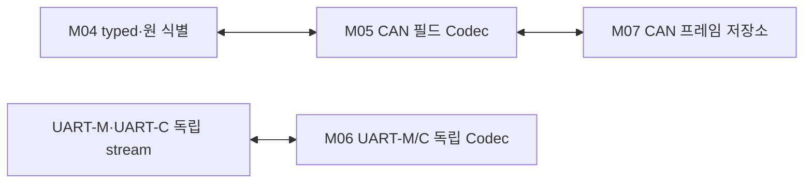

# L04 프레임 검증과 변환

CAN 및 UART-M/UART-C 필드와 C 자료의 의미를 명시적으로 변환한다. 길이와 코드가 유효한 완전한 입력만 상위로 전달한다.

## 경계와 배치

순서 수용·차량 판단·Driver 완료를 소유하지 않는다. C struct 메모리를 Wire로 복사하지 않는다.

입력과 출력: CAN22의 typed 자료·출처 ↔ CAN frame·수신 출처; UART-M23/UART-C3의 의미 필드 ↔ 독립 Frame/Stream. NetCisRear의 20바이트 변환은 CAN 대표 예다.

구성 모듈: [M05 CAN 필드 Codec](../modules/M05_CAN_CODEC.md) · [M06 UART-M/C Frame·Stream·Codec](../modules/M06_UART_CODEC.md).

## 정상 처리

ID·flags·DLC·획득 길이를 확인한 뒤 필드·예약값·padding을 검증한다. 출력은 임시 자료에서 완성한 후 한 번에 인계한다. 같은 Layer의 별도 M06이 UART stream/CRC와 메시지별 변환을 담당한다.

## 예외와 실행 문맥

CAN CRC 오류는 장치가 제공한 관측으로 처리한다. CIS_REAR payload에 응용 CRC나 버전 byte를 추가하지 않는다. 형식 오류와 정상 형식의 열화 품질을 구분한다.

Codec는 호출별 임시 자료만 사용한다. 공유 버퍼 수명은 M07이, 순서 수용 상태는 M04가 관리한다. 실제 Driver 입력의 동기화는 Port에서 확인하며 Codec에 전역 순서 상태나 별도 Queue를 추가하지 않는다. DOMAIN C2 호출은 ISR 밖의 인계 문맥에서 수행한다.

## 상세 탐색

[M05 CAN 필드 Codec](../modules/M05_CAN_CODEC.md) · [M06 UART-M/C Frame·Stream·Codec](../modules/M06_UART_CODEC.md)

[전체 Layer·Module](../03_LAYER_MODULE_INDEX.md) · [Network](../01_NETWORK_OVERVIEW.md) · [수직 흐름](../flows/CIS_REAR_144_TO_344.md)

## CAN 22종 변환

공통 frame 검증과 메시지별 raw/enum/품질 변환을 분리한다. Codec는 자체 clock·순서 ledger·Manager를 변경하지 않으며 WARNING51/60을 추측하지 않는다.

[담당 Module](../modules/M05_CAN_CODEC.md) · [공통 함수](../functions/CAN_TRANSFER_CONTROL.md#age) · [22종 상세](../04_CAN_FD_OVERVIEW.md#messages) · [공통 흐름](../flows/CAN_NETWORK_PATHS.md)

## UART-M Stream과23 Codec

M06은 UART-M의 정확한 Type/방향/P·CRC·명시 offset을 검사한다. 원 수신시각을 붙인 suffix 재탐색과 CRC정상 전체 경계 소비를 분리한다. M05 CAN CRC/패딩 계약을 UART 외형에 복사하지 않으며 UART-C 개별 schema는 아래 별도 P03 상세에서 연결한다.

[M06](../modules/M06_UART_CODEC.md) · [공통 Frame/Stream](../functions/UART_FRAME_STREAM.md) · [필드/23 Codec](../05_UART_M_OVERVIEW.md#messages) · [UART-M](../05_UART_M_OVERVIEW.md)

## UART-C 연결

M06/F16~18은 UART-C VERSION 1·TYPE 0x60/0x61/0x62·25필드와 원 시각을 보존한 Stream을 맡는다. [상세](../functions/UART_C_FRAME_ROUTER.md) · [UART-C 전체](../06_UART_C_OVERVIEW.md)

## DOMAIN Adapter가 사용하는 기존 Codec

DOMAIN Adapter는 M05/M06의 기존 메시지별 Codec를 호출하는 경계를 연결한다. C2 의미 변환과 Wire 직렬화는 별도 책임이며 공개72·TxPort26을 같은 수의 Wire나 Frame으로 세지 않는다. 공통 Service 상세화로 기존 ID·필드·CRC·후보 profile을 바꾸지 않는다.

[TxPort 경로](../functions/DOMAIN_TX_PORT.md) · [Rx 경로](../functions/DOMAIN_RX_ADAPTER.md) · [DOMAIN 경계 개요](../07_DOMAIN_ADAPTER_SERVICE.md)
