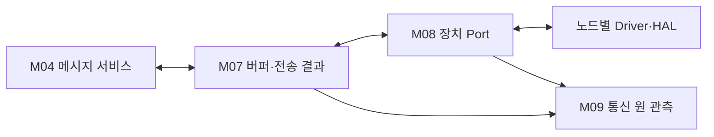

# L05 전송 수명과 장치 경계

장치가 사용하는 프레임 수명과 수신 저장소를 관리하고 실제 RX/TX/error 관측을 상위에 전달한다.

## 경계와 배치

핀·RTD·HAL·IRQ·Transceiver 설정과 차량 고장 판단을 구현하지 않는다.

입력과 출력: 완성 프레임 / 장치 관측 → 안정된 수신 사본 / 귀속 가능한 전송 결과.

구성 모듈: [전송 버퍼·결과 관측](../modules/M07_BUFFER_OUTCOME.md) · [장치 Port 경계](../modules/M08_DEVICE_PORT.md) · [Network 관측 자료](../modules/M09_OBSERVATION.md).

## 정상 처리

ISR은 최소 관측·저장 요청만 처리한다. Network 소비 문맥에서 Codec와 DOMAIN 인계를 진행한다. 접수된 TX 저장소는 장치 참조 종료 근거가 있을 때 해제한다.

## 예외와 실행 문맥

내부 Port 계약에서 미접수를 뜻하는 BUSY는 접수 전 실패다. 실제 Driver 반환이 이 계약과 일치하는지는 바인딩에서 확인한다. 접수 후 실패·Bus-off·늦은 callback은 별도 처리한다. reset 사실만으로 이전 Driver 참조가 종료됐다고 간주하지 않는다.

단일 담당 문맥에서 상태 변화를 직렬화하는 내부 설계를 적용한다. 실제 Task 개수·Queue 깊이·동기화 primitive는 각 노드 바인딩에서 확인한다. DOMAIN C2 호출을 ISR에서 실행하지 않는다.

## 상세 탐색

[전송 버퍼·결과 관측](../modules/M07_BUFFER_OUTCOME.md) · [장치 Port 경계](../modules/M08_DEVICE_PORT.md) · [Network 관측 자료](../modules/M09_OBSERVATION.md)

[전체 Layer·Module](../03_LAYER_MODULE_INDEX.md) · [Network](../01_NETWORK_OVERVIEW.md) · [수직 흐름](../flows/CIS_REAR_144_TO_344.md)

## CAN 저장소·Driver 관측

accepted/최종 결과/released를 분리한다. ISR은 짧은 raw 인계만 수행하고 DOMAIN에서는 Task에서, 다른 ECU에서는 합의된 Task/Superloop에서 typed 경계를 호출한다. 실제 Driver/복구·동기화는 바인딩 전 후보로 남긴다.

[담당 Module](../modules/M07_BUFFER_OUTCOME.md) · [공통 함수](../functions/CAN_TRANSFER_CONTROL.md#port) · [22종 상세](../04_CAN_FD_OVERVIEW.md#messages) · [공통 흐름](../flows/CAN_NETWORK_PATHS.md)

## UART-M 저장소·관측

M07/M08은 실제 byte 수신시각·안정 사본·Driver accepted/final TX/release와 제출 수명을 연결한다. M09/F24/F25의 ST12는 raw 통신 관측만 보존하며 실제 Health 공급 바인딩을 확인하지 않고 공개 Getter 성공을 주장하지 않는다. parser·typed·C2 처리는 ISR 밖에서 수행한다.

[M07](../modules/M07_BUFFER_OUTCOME.md) · [M08](../modules/M08_DEVICE_PORT.md) · [M09/ST12](../modules/M09_OBSERVATION.md) · [TX/RX/관측](../functions/UART_M_TX_RX_CONTROL.md) · [UART-M](../05_UART_M_OVERVIEW.md)

## UART-C 연결

M07~09는 Pi/CIS Driver의 admission·terminal·release와 원 identity를 별도로 보존한다. [상세](../functions/UART_C_TX_RX_CONTROL.md#port-observe) · [UART-C 전체](../06_UART_C_OVERVIEW.md)

## 공통 전송 수명과 DOMAIN 관측

M07/M08은 안정된 Frame 저장소와 원 제출 identity를 실제 Driver 접수·최종 결과·참조 해제에 연결한다. M09는 이 사실을 보존하고, 표현 가능한 로컬 실패만 기존 DOMAIN 입력에 인계한다. Health 공급과 DOMAIN Snapshot 조회는 별도 바인딩이며 원격 실행 성공을 추정하지 않는다.

[Service 수명](../functions/NETWORK_SERVICE_LIFETIME.md) · [로컬 실패·Health](../functions/NETWORK_FAILURE_HEALTH.md) · [Service Data](../data/NETWORK_SERVICE_DATA.md) · [DOMAIN 경계 개요](../07_DOMAIN_ADAPTER_SERVICE.md)
