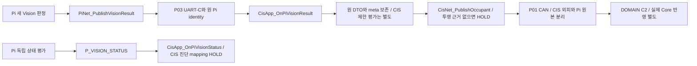

# N03 CIS·N06 Pi — 원 센싱·비전과 허용 중계 경계

[노드 전체](../08_NODE_BOUNDARIES.md) · [원 Node/Link 지도](../02_NODE_LINK_MAP.md) · [UART-C](../06_UART_C_OVERVIEW.md) · [DOMAIN Adapter](../07_DOMAIN_ADAPTER_SERVICE.md)

CIS/Pi의 Network 경계를 설명하는 정적 상세설계다. CIS는 센서 생산과 Pi 관측 취합, Pi는 카메라 원 판정·독립 기능 상태 생산을 맡는다. Network는 동일 원 관측을 잃지 않는 typed 인계·Codec·전송·수신을 맡는다. 실제 CIS/Pi Application·영상 알고리즘·전원 정책을 구현하는 문서가 아니다. 기존 Interface는 `PROPOSED_DESIGN / BINDING_OPEN`이고 C 원형은 Pi의 구현 언어·OS·RTOS를 강제하지 않는다.

<a id="scope"></a>
## 경계와 정본

| Node/Link | 이 문서가 연결하는 책임 | 원 생산자 → 소비자 | 상태·범위 |
|---|---|---|---|
| N03 CIS / I03 | 센싱 typed submit, Pi typed Rx, CAN permission App 소비·private relay | CIS 센서/진단·취합 App ↔ CIS Network | `PROPOSED_DESIGN / BINDING_OPEN` |
| N06 Pi / I06 | Vision Result·Status 제출, 원 DOMAIN 허용의 제한 소비 | Pi 비전/상태 App ↔ Pi UART-C 연결 | `PROPOSED_DESIGN / BINDING_OPEN`; 내부 언어·프로세스·영상 코드 범위 밖 |
| P03 | Pi↔CIS 물리 UART-C, 후보3 Wire/3 Rx | Pi와 CIS 각각의 송수신 Network | 후보 VERSION1/3종과 구2종 차이 채택 HOLD |
| P01 / R02 | 공유 CAN 위 DOMAIN↔CIS 관계 | CIS 보고4종 → DOMAIN, DOMAIN_PERMISSION → CIS | P01은 공유 버스다. 전용 물리선·추가 메시지를 만들지 않음 |
| R06 | Pi→UART-C→CIS→CAN→DOMAIN; 반대 방향 원 Permission 제한 중계 | Pi 원 관측, CIS 추가 제한, DOMAIN 기능 소비 | 논리 다중 홉이며 Pi↔DOMAIN 직접 물리 연결은 `NOT_APPLICABLE` |

기존 책임은 [L01/M01/F01~F03](../modules/M01_SOURCE_CONTEXT.md)의 원 자료 연결, [L02/M03/F10](../modules/M03_TYPED_HANDOFF.md)의 typed 인계, [L03/M04/F11~F13](../modules/M04_MESSAGE_SERVICE.md)의 접수·AGE·순서, [L04/M05](../modules/M05_CAN_CODEC.md)와 [M06](../modules/M06_UART_CODEC.md)의 Codec, [M07](../modules/M07_BUFFER_OUTCOME.md)·[M08](../modules/M08_DEVICE_PORT.md)·[M09](../modules/M09_OBSERVATION.md)의 저장소·Driver·진단이다. F/ST의 단일 정본은 [구조 색인](../03_LAYER_MODULE_INDEX.md)이다. ST01/02 원 연결, ST04 인계, ST05~07 pending/송수신 근거, ST08 UART 조립, ST09~11 저장소/Driver 수명, ST12 통신 관측을 재사용한다. 별도 차량 상태 Manager를 추가하지 않는다.

<a id="api"></a>
## 기존 선언 11개와 호출 책임

아래는 `EXISTING_DECLARATION`이며 **기존 문서에 선언되어 있음**을 뜻한다. 구현 설치·양단 채택 상태는 모두 `BINDING_OPEN`이다. CIS 8개 중 마지막 relay 1개는 `NETWORK_PRIVATE`; 나머지 CIS 7개와 Pi 3개는 각 노드 로컬 App/Network 경계다. 이 11개를 C2 공개72·TxPort26·Observer11에 추가하지 않는다.

| 정확한 원형 | 호출자 → 본체 Owner / Wire | Data·단일 원문 |
|---|---|---|
| `void CisApp_OnDomainPermission(const NetDomainPermission *message, const NetCanRxMeta *meta);` | CIS CAN Dispatcher → CIS 전원 허용 소비 App / DOMAIN_PERMISSION | [API](../../interface/02_NODES/CIS/20_API.md#api-cisapp_ondomainpermission), [Data](../data/CAN_BCM_DATA.md#type-NetDomainPermission) |
| `NetSubmitResult CisNet_PublishRear(const NetCisRear *message);` | CIS 초음파 생산자 → CIS Network / CIS_REAR | [API](../../interface/02_NODES/CIS/20_API.md#api-cisnet_publishrear), [Data](../data/CIS_REAR_DATA.md#type-NetCisRear) |
| `NetSubmitResult CisNet_PublishEnvironment(const NetCisEnvironment *message);` | CIS 환경 생산자 → CIS Network / CIS_ENVIRONMENT | [API](../../interface/02_NODES/CIS/20_API.md#api-cisnet_publishenvironment), [Data](../data/CAN_NODE_DATA.md#type-NetCisEnvironment) |
| `NetSubmitResult CisNet_PublishOccupant(const NetCisOccupant *message);` | CIS Pi 관측 취합 App → CIS Network / CIS_OCCUPANT | [API](../../interface/02_NODES/CIS/20_API.md#api-cisnet_publishoccupant), [Data](../data/CAN_NODE_DATA.md#type-NetCisOccupant) |
| `NetSubmitResult CisNet_PublishStatus(const NetCisStatus *message);` | CIS 진단 App → CIS Network / CIS_STATUS | [API](../../interface/02_NODES/CIS/20_API.md#api-cisnet_publishstatus), [Data](../data/CAN_NODE_DATA.md#type-NetCisStatus) |
| `void CisApp_OnPiVisionResult(const NetVisionResult *message, const NetUartRxMeta *meta);` | CIS UART-C Dispatcher → CIS Pi 관측 취합 App / P_VISION_RESULT | [API](../../interface/02_NODES/CIS/20_API.md#api-cisapp_onpivisionresult), [Data](../data/UART_C_DATA.md#type-NetVisionResult) |
| `void CisApp_OnPiVisionStatus(const NetVisionStatus *message, const NetUartRxMeta *meta);` | CIS UART-C Dispatcher → CIS 비전 진단 App / P_VISION_STATUS | [API](../../interface/02_NODES/CIS/20_API.md#api-cisapp_onpivisionstatus), [Data](../data/UART_C_DATA.md#type-NetVisionStatus) |
| `NetSubmitResult CisNetPriv_RelayPiPermission(const NetDomainPermission *permission, const NetCanRxMeta *meta);` | CIS CAN permission Dispatcher → CIS Network private relay / P_PERMISSION | [API](../../interface/02_NODES/CIS/20_API.md#api-cisnetpriv_relaypipermission), [입력 Data](../data/CAN_BCM_DATA.md#type-NetDomainPermission) |
| `NetSubmitResult PiNet_PublishVisionResult(const NetVisionResult *message);` | Pi 비전 판정 생산자 → Pi Network/Serial 연결 / P_VISION_RESULT | [API](../../interface/02_NODES/PI/20_API.md#api-pinet_publishvisionresult), [Data](../data/UART_C_DATA.md#type-NetVisionResult) |
| `NetSubmitResult PiNet_PublishVisionStatus(const NetVisionStatus *message);` | Pi 비전 기능·고장 생산자 → Pi Network/Serial 연결 / P_VISION_STATUS | [API](../../interface/02_NODES/PI/20_API.md#api-pinet_publishvisionstatus), [Data](../data/UART_C_DATA.md#type-NetVisionStatus) |
| `void PiApp_OnCisPermission(const NetPiPermission *message, const NetUartRxMeta *meta);` | Pi UART-C Dispatcher → Pi 차량용 결과 사용 허용 App / P_PERMISSION | [API](../../interface/02_NODES/PI/20_API.md#api-piapp_oncispermission), [Data](../data/UART_C_DATA.md#type-NetPiPermission) |

모든 포인터는 NULL 불가 IN이며 호출 구간의 안정된 읽기 전용 자료다. `NetSubmitResult`의 OK는 DTO 전 멤버·필수 원 identity·AGE 기준·같은 meta를 Network 소유 저장소로 복사하고 원자적으로 게시한 뒤에만 반환한다. NULL/표현 오류는 `NET_SUBMIT_INVALID_ARGUMENT`, 실제 준비·원 연결 근거 부재는 `NET_SUBMIT_NOT_READY`, 전체 보관 공간 부족은 `NET_SUBMIT_NO_CAPACITY`다. 실패에는 새 부분 접수가 없다. 정상 형식 INVALID/FAULT/NO_DATA 자체는 인자 오류가 아니다.

`void` callback은 Network가 검증 후 알리는 로컬 통지다. DTO와 meta는 반환까지만 borrowed이며 이후 사용할 App은 **같은 사건의 전 필드·수신 기준점**을 함께 복사한다. 반환은 저장 완료·기능 소비·Pi 허용·CAN 전송의 ACK가 아니다. App 저장 실패를 받을 새 반환형이나 실패 callback은 만들지 않는다. 해당 연결·용량·진단 경계는 외부 Owner가 확인해야 한다. ISR은 raw byte/오류 확보만 하고 parser·의미 callback은 바인딩된 Task 또는 Superloop에서 실행한다.

<a id="data"></a>
## 원 자료와 변환의 최소 보존 단위

| 자료 | 함께 보존할 필드·단위 | Node 특수 조건 |
|---|---|---|
| NetCisRear | `update_sequence`, `source_age_ms`, `rear_distance_deci_cm`, `validity`, `quality_reason`, `proximity_status` | raw 0.1cm = **1mm**. C2 `rearDistanceMm`에는 raw 정수를 그대로 옮김. 123raw→123mm; `/10`은 3mm 정보를 잃거나 값 단위를 틀리게 함. 65535는 거리 sentinel이며 NO_OBJECT와 FAULT/UNAVAILABLE을 구분 |
| NetCisEnvironment | 온도 `int16_t temperature_centi_c` 0.01°C, 습도 `uint16_t humidity_centi_percent` 0.01%RH, 조도 `uint32_t illuminance_lux` 1lx; 각각 별도 `*_sequence`, `*_age_ms`, `*_validity`, `*_reason` | 온도 -32768, 습도65535, 조도0xFFFFFFFF sentinel을 정상0으로 바꾸지 않음. 조도70000을 u16로 줄이지 않음. 한 센서 갱신으로 다른 센서 순번/AGE를 초기화하지 않음 |
| NetVisionResult | `pi_boot_id`, `vision_sequence`, `vision_age_ms`, presence/count와 각각 validity/reason, 동반 `vision_status`, `vision_fault_code` | 11개 필드의 원 record 보존. presence255와 count255는 확인 불가이며 없음/0명이 아님 |
| NetCisOccupant | 원 `pi_boot_id`, `vision_sequence`, 누적 `vision_age_ms`, 원 presence/count, 각 최종 validity/reason, 같은 update의 `vision_function_status` | 원 Pi 품질과 CIS 추가 제한을 각 값의 한 quality/reason 쌍으로 완전히 따로 표현할 수 없음. 대표 사유·기능 상태 변환 O13/O19 미합의이면 해당 투영 HOLD |
| NetVisionStatus | `pi_boot_id`, 독립 `status_sequence`, `vision_status`, `active_fault`, `last_fault`, `status_age_ms`, `affected_function` | READY는 새 Vision 판정이 아님. mask bit0=Presence·bit1=Count를 CIS mask에 직복사 금지 |
| NetCisStatus | CIS 상태, 기능5개·interface2개 상태, `fault_mask`, `active_fault`, `recovering`, `last_fault`, `last_fault_occurrence`, `affected_function`, `update_sequence`, `source_age_ms` | 기능 상태와 실제 링크 관측의 생산자가 다름. active 해제는 최근 고장 이력 삭제가 아님. CIS mask bit0=비전·bit1=온도 등으로 Pi mask와 의미가 다름 |
| NetDomainPermission / NetPiPermission | 원 DOMAIN의 power·operation·독립 quality·update·AGE 및 CAN meta / CIS Boot·relay update·power·quality·reason·use-limit·원 AGE | 원 입력에는 `quality_reason` 없음. reason·relay revision·use-limit을 NONE/0/1500 기본값으로 발명하지 않음. Pi payload에는 원 DOMAIN Boot/update가 직접 없음 |

전체 선언은 위 API 표의 Data 링크에 한 번만 둔다. 센서 범위/품질/기능 판단은 [CIS Data](../../interface/02_NODES/CIS/10_DATA.md), Pi 원 자료와 언어 중립 책임은 [Pi Data](../../interface/02_NODES/PI/10_DATA.md)가 근거다. DTO의 `const`는 실제 직렬화·타 스레드 변경 방지 구현을 대신하지 않는다.

<a id="can"></a>
## R02 — CIS 센서·진단에서 DOMAIN까지

| 원 생산·Wire/Rx | Network Function 정본 → DOMAIN 내부 인계 | 기능 소유와 실패 경계 |
|---|---|---|
| CIS 초음파 / `WIRE-P01-CIS_REAR`·`RX-P01-CIS_REAR-DOMAIN` | [기존 Rear 전체 수직 흐름](../flows/CIS_REAR_144_TO_344.md), [단위·Ingress](../functions/DOMAIN_CIS_REAR_INGRESS.md) → `DomainIf_RxCisRear` | CAUTION/EMERGENCY/CLEAR는 DOMAIN 생산. NO_OBJECT를 센서 FAULT와 동일시하지 않음 |
| CIS 환경 / `WIRE-P01-CIS_ENVIRONMENT`·`RX-P01-CIS_ENVIRONMENT-DOMAIN` | [Environment Codec·Deliver](../functions/can/CIS_ENVIRONMENT.md) → `DomainIf_RxCisCabinEnvironment` | 세 채널 품질·AGE 독립. C2 원 선언에 없는 sourceGeneration을 추가하지 않음 |
| CIS Pi 취합 / `WIRE-P01-CIS_OCCUPANT`·`RX-P01-CIS_OCCUPANT-DOMAIN` | [Occupant Codec·Deliver](../functions/can/CIS_OCCUPANT.md) → `DomainIf_RxCisOccupant` | Pi 계보와 CIS CAN 외피 구분. UNKNOWN255의 C2 bool 비사용 표현·품질 투영 근거 없으면 HOLD |
| CIS 진단 / `WIRE-P01-CIS_STATUS`·`RX-P01-CIS_STATUS-DOMAIN` | [Status Codec·Deliver](../functions/can/CIS_STATUS.md) → `DomainIf_RxCisStatus` | 실제 통신 관측→진단 Owner mapping 필요. 별도 CIS_FAULT frame 없음 |
| DOMAIN 원 허용 / `WIRE-P01-DOMAIN_PERMISSION`·`RX-P01-DOMAIN_PERMISSION-CIS` | [CAN Permission](../functions/can/DOMAIN_PERMISSION.md) → `CisApp_OnDomainPermission` 및 private relay | 한 CAN 수신 의무의 두 로컬 가지. 전체 BCM/CIS/WINDOW/VSS Rx4를 보존 |

CIS 송신은 타입 검사→동일 생산 세대·원 AGE 확인→완전 사본/공간 확보→원자 게시→기존 Codec→Driver 순서다. Rear의 B11 Admission과 B12 공통 Admission을 같은 입력에 중복 적용하지 않는다. 수신 DOMAIN은 실제 CAN flags/ID/DLC/길이/padding·필드→Boot/순서→같은 관측/AGE·품질→C2 인계 순서로 처리한다. CAN ACK·Decode 성공·C2 반환을 원 센서의 정상 판정이나 DOMAIN Core commit으로 확장하지 않는다. [B15 Rx Adapter](../functions/DOMAIN_RX_ADAPTER.md)와 [원 관측/Getter](../functions/DOMAIN_QUERY_PROVENANCE.md)의 실제 동일 관측 결합 HOLD를 그대로 적용한다.

온도와 습도 각각의 원 사용기한2500ms/도달 시 비사용은 확정 합의이며 독립 만료·복구를 적용한다. 조도1000ms와 CIS local5000ms는 이 합의로 확정하지 않는다. 새 CIS BOOT 전환은 DOMAIN 소유 단일 동기 Private 경로를 목표로 하여 BOOT용 공개 Rx NO_DATA를 중복 호출하지 않고 일반 만료·수신중단은 기존 공개 C2 품질 경로로 처리하되, 수신중단의 STALE/NO_DATA 정책은 미결로 유지한다. DOMAIN Private Core의 순차 Epoch 지원은 확인됐지만 Network의 실제 Private 호출·Receipt 대조와 Rx→VSM→Getter 연결은 BINDING_NOT_VERIFIED이므로 해당 환경 경로의 HOLD를 유지한다. 200ms CAN 보고·600ms 수신 중단 후보는 원 센서 TTL이 아니다. DataQuality 산출, 공통 대 센서별 Generation, C2 Generation0 정책을 B16에서 확정하지 않는다. 습도 실패를 다른 정상 센서의 무효화 이유로 사용하지 않는다.

<a id="vision-flow"></a>
## R06 — Pi Vision → CIS → DOMAIN의 관측 전환



1. Pi 비전 Owner는 판정의 presence/count·독립 validity/reason·VisionSequence·원 AGE를 제출한다. Pi runtime/Network는 **그 관측을 만든** 실행 세대에 Boot를 고정한다. App의 미결합 Boot 슬롯을 먼저 읽어 형식 오류로 만들지 않으며, 과거 record를 현재 Boot로 재표시하지 않는다.
2. Pi Network는 [Result 19B/29B](../functions/uart_c/P_VISION_RESULT.md)와 [Status 16B/26B](../functions/uart_c/P_VISION_STATUS.md)의 기존 Codec·Frame을 사용한다. VisionSequence·StatusSequence는 독립 평가 번호다. LINK_SEQUENCE는 방향별 frame 번호이며 새 평가를 만들지 않는다.
3. CIS는 [Frame/Router](../functions/UART_C_FRAME_ROUTER.md)로 profile·VERSION/Type/방향·정확 P/CRC·모든 필드를 검증한다. 구2종과 새3종을 길이로 자동 선택하지 않는다. source Boot/순서·실제 callback 문맥/수명 근거가 없는 경로는 정상 전달 HOLD다. 합법 INVALID/FAULT는 원 품질로 전달한다.
4. CIS App은 callback 반환 전에 원 11필드와 실제 UART meta를 자기 보관소에 복사한다. `received_at_ms`를 callback 실행시각으로 바꾸지 않는다. Pi 원 record는 CIS 추가 제한 평가의 출력으로 덮지 않는다. 원 INVALID인 값의 승격을 금지하고 원 사유를 원 record에 보존한다. 이후 실제 CIS 제한 사건이 확인되면 현재 전달 reason은 해당 제한으로 바뀔 수 있다는 Network 선정 규칙을 적용한다. 기능별 영향·원 사건 결합·아직 미정인 대표 사유/상태 mapping은 별도 검증 대상이다.
5. CIS Owner가 같은 원 관측에 대응하는 완전한 `NetCisOccupant` 후보를 마련했을 때만 아래 연결 검사와 기존 [CheckVisionProjection](../flows/UART_C_PI_TO_CIS.md#projection)을 검토한다. 원 사유 유지와 검증된 현재 제한의 두 경로를 후보에 정의한다. 필요한 사건·사유 매핑이 없는 경로만 CONTRACT_HOLD이며 실제 연결은 BINDING_NOT_VERIFIED다. 독립 CIS_STATUS READY를 과거 occupant update에 붙이지 않는다.
6. 양단 합의·실제 결합 근거가 향후 갖춰져도 `CisNet_PublishOccupant`는 별도의 로컬 접수다. CAN의 CIS Boot/TX와 payload의 Pi Boot/VisionSequence를 함께 보존하고 원 AGE에 미반영된 대기만 한 번씩 더한다. DOMAIN의 원 CAN→C2→Getter 연결은 또 다른 근거다. Pi↔DOMAIN 원격 Query API는 없다.

<a id="origin-check"></a>
### F03/F10 연결 검사의 C형 의사코드

다음 한 함수는 `PROPOSED_PRIVATE_FUNCTION`이며 **문서상 경계 검사**다. 기존 Codec·CIS 평가·App 본체를 복제하지 않는다. 호출자는 CIS의 동일 원 관측을 안정화한 M01/M03 소유자 문맥이고, 실제 Owner 저장·동기화 바인딩이 없는 현재 상태에서 제품 호출을 지시하지 않는다. B14의 기존 Validator·AGE 누적·품질 투영 검사를 사용해 R06의 시간·원 자료 연결을 검사한다.

```c
NetUartCResult NetNodeCis_CheckOccupantTransfer(
    const NetVisionResult *source,
    const NetCisOccupant *candidate,
    const NetUartRxMeta *capturedMeta,
    const NetUartRxMeta *projectionMeta,
    uint32_t unaccountedCisElapsedMs,
    uint32_t unaccountedHopMs,
    bool sourceBindingVerified,
    bool timeBasisVerified,
    bool qualityMappingAdopted,
    bool cisStateAssociationProven,
    const NetVisionRestrictionEvidence *restrictions)
{
    if (source == NULL || candidate == NULL || capturedMeta == NULL ||
        projectionMeta == NULL) return NET_UART_C_INVALID_ARGUMENT;
    if (!NetUartC_ValidateVisionResult(source)) return NET_UART_C_MALFORMED;
    if (!sourceBindingVerified) return NET_UART_C_CONTEXT_HOLD;
    if (capturedMeta->link_sequence != projectionMeta->link_sequence ||
        capturedMeta->received_at_ms != projectionMeta->received_at_ms)
        return NET_UART_C_CONTEXT_HOLD;
    if (!qualityMappingAdopted || !cisStateAssociationProven)
        return NET_UART_C_CONTRACT_HOLD;
    uint16_t currentAgeMs;
    NetUartCResult ageResult = NetUartC_AccumulateAge16(
        source->vision_age_ms, unaccountedCisElapsedMs,
        unaccountedHopMs, timeBasisVerified, &currentAgeMs);
    if (ageResult != NET_UART_C_OK) return ageResult;
    if (!NetUartC_CheckVisionProjection(source, candidate, currentAgeMs,
        sourceBindingVerified, timeBasisVerified, qualityMappingAdopted,
        cisStateAssociationProven, capturedMeta, restrictions)) return NET_UART_C_CONTRACT_HOLD;
    return NET_UART_C_OK;
}
```

`source`는 UART 검증·원 Pi 세대 수용을 마친 **원 RX 기준의 사본**이며, `candidate`는 CIS Owner가 별도로 만든 같은 관측의 평가 후보다. 두 meta는 각각 그 원 입력 보관과 평가 연결에 기록된 값이다. meta 숫자가 같다는 것만으로 동일 사건을 증명할 수 없다. `sourceBindingVerified`는 동일 수신 사건·수용된 PiBoot/VisionSequence·현재 로컬 link epoch와 순서, 값/품질 불변 연결이 실제로 입증된 선행 결과다. 이 입력을 상수 true로 채우지 않는다.

미반영 CIS 경과와 hop은 `source`의 AGE에 아직 포함되지 않은 구간만 ms로 입력한다. `timeBasisVerified`는 같은 로컬 clock·wrap/reset·중복 누적 방지 근거다. 이미 소비시점 AGE로 바뀐 source와 RX 이후 전체 경과를 다시 조합하지 않는다. `qualityMappingAdopted`와 `cisStateAssociationProven`은 Owner 채택/동일 평가 결합의 **검수 근거 조건**이며 새 공개 runtime API·설정 스위치가 아니다. 양측 평가가 서로 갱신되지 않는 같은 처리 구간을 실제로 보장해야 한다. 추가 IN `restrictions`는 [Data 정본](../data/UART_C_DATA.md#type-NetVisionRestrictionEvidence)의 Presence/Count 두 사건 사본이며 NULL이면 원 품질 그대로인 투영만 허용한다. M09/M04와 CIS 기능 Owner가 실제 관측으로 채운 원 identity/meta/clock/영향 필드를 CheckVisionProjection에서 대조한다. 전체 사건·원 record·candidate는 검사부터 기존 publish의 owned-copy 인수까지 안정화한다. 새 공개 API/Wire나 임의 true helper를 만들지 않는다.

IN은 전부 호출 동안 borrowed/read-only이며 저장하지 않는다. OUT·외부 부수효과가 없다. OK는 명시 보존 검사를 통과했다는 뜻이고 **최신성·기능 허용·로컬 접수·전송·DOMAIN 반영을 보증하지 않는다**. 포화65535도 raw 보존 검사에는 통과할 수 있으나 정상 제어 사용은 별도 TTL/시간 근거가 없어 허용되지 않는다. 정상 열화 품질이 projection을 통과한 경우도 기능 사용 가능 판정이 아니다. 반환 실패는 candidate나 원 record를 수정하지 않는다.

검사 OK 후에도 실제 CIS 기능 Owner의 사용 조건·원 TTL·Driver 준비·자원 조건을 확인한 기존 `CisNet_PublishOccupant(candidate)`의 네 반환을 그대로 관측한다. 검사 성공을 제출 OK로 대체하지 않는다. 이에 필요한 기존 단일 함수는 [AGE 누적](../functions/UART_C_TX_RX_CONTROL.md#age), [Pi 원 품질 투영](../flows/UART_C_PI_TO_CIS.md#projection), [CAN 접수](../functions/can/CIS_OCCUPANT.md#submit)다.

<a id="permission-flow"></a>
## DOMAIN Permission → CIS App·private relay → Pi

같은 검증된 `NetDomainPermission`·`NetCanRxMeta` pair를 CIS App과 private relay에 분배한다. 두 가지는 형제 소비이며 App callback 완료가 relay 성공 조건이 아니다. App이 Pi 허용 DTO를 새로 만들어 공개 송신하는 API도 없다. `operation_allowed`나 WINDOW 품질을 원 power 품질로 바꾸지 않는다.

| 단계 | 기존 처리·자료 | 정상·실패 의미 |
|---|---|---|
| DOMAIN→CIS | CAN 검증·admission 후 동일 원 pair, CIS App은 원 power 판단 소비 | source Boot/원 update/CAN TX와 수신시각을 보존. CRC/길이·코드 오류는 정상 수신·허용 근거 갱신 없음 |
| CIS private relay | [NetUartC_ProjectPermission](../flows/UART_C_CIS_TO_PI_PERMISSION.md#relay-projection)에서 원 pair·relay evidence 대조 | 원 reason이 없어 사유·품질·revision·use-limit 매핑 미확인 시 false/OUT 불변. 기존 API는 NOT_READY 후보 경계, 형식 위반은 INVALID_ARGUMENT |
| 안정 접수 | 원 DTO7필드·중첩 CAN meta·relay DTO7필드·평가/시간 근거의 own 사본 | 공간 부족 NO_CAPACITY. 전체 게시 뒤만 OK. caller 포인터는 보관하지 않음 |
| 송신 전 | 같은 원 DOMAIN/CIS 세대·원 기한과 미반영 대기를 재확인 | 오래된 허용을 새 CIS Boot/revision·AGE0으로 발급하지 않음. 열화 보고의 합의도 없으면 해당 송신 HOLD |
| CIS→Pi | [P_PERMISSION 15B/25B](../functions/uart_c/P_PERMISSION.md)·Router 후 `PiApp_OnCisPermission` | callback 반환은 현재 허용 성공이 아님. 원 DTO/meta를 유지하며 Pi 수신 이후 보관 경과를 한 번 누적 |
| Pi 실제 사용 시 | 기존 [NetUartC_CheckPermissionUse](../flows/UART_C_CIS_TO_PI_PERMISSION.md)의 원 association·Boot·AGE·원/relay 한도·사유 검사 | FORMAT_ERROR / CONTRACT_HOLD / UNCONFIRMED / CONFIRMED_DENIAL / ALLOW_CANDIDATE를 구별. 마지막 값도 실제 기능 실행 승인 결과가 아님 |

현재 payload의 CIS Boot/revision만으로 DOMAIN 원 Boot/update를 복원할 수 없다. 실제 원 연결 근거가 없는 `sourceAssociationVerified`는 false/HOLD이며 새 side-channel·Wire 필드·ACK를 도입하지 않는다.

후방 활성 Power의 원 **500ms 사용기한·도달 시 비사용**, DOMAIN의 실제 **약200ms 재평가**는 합의다. CAN50ms 송신/150ms 수신 중단과 UART-C500ms 반복/1500ms 수신 중단은 별도 기준을 유지한다. 값이 같아도 실제 새 평가가 완료되면 새 원 순번·평가시각을 전달하고 가능한 즉시 relay하며500ms 반복 타이머를 기다리지 않는다. 단순 반복은 원·relay 평가 번호를 유지하고 AGE만 경과대로 증가한다. CAN 수신 후500ms를 기다린 동일 판단은 이미 원500ms에 도달했으므로 허용에 사용하지 않는다. USE_LIMIT1500ms 기존 후보는 원500ms를 연장하지 않고 wire500ms 변경은 동일 후방 원 판단의 양끝 의미가 입증될 때만 조건부다. source association·O05 생성/합성·사유·실제 무효화 연결은 별도 OPEN이다.

값0/OK는 출처·시간이 현재 유효할 때 확인된 불허, 255 또는 NO_DATA/INVALID/STALE는 허용 확인 불가다. 값1/INVALID도 원 값과 품질을 그대로 보관할 수 있으나 허용으로 사용하지 않는다. 확인 불가를 정상 불허0/OK로 합성하지 않는다. 포화AGE65535와 USE_LIMIT0의 raw 표현은 정상 사용 승인과 다르다. Pi 프로세스 종료·물리 전원 차단은 이 Network 경계에서 결정하지 않는다.

<a id="failure"></a>
## 수명·실패·재부팅의 Node별 연결

| 사건 | 처리와 보존 | 다음 진행에 필요한 근거 |
|---|---|---|
| 입력 NULL·예약값·잘못된 schema/CRC | 해당 형식 거부, 부분 DTO·정상 liveness·App 통지 없음. CRC 정상 typed 거부는 완전 frame을 소비 | 같은 버전/방향·원 수용 근거. 길이로 구profile 자동 선택 금지 |
| 정상 원 INVALID 또는 일부 센서 고장 | 해당 값/사유를 보존, 다른 정상 채널을 덮지 않음 | 품질 사용/대표 사유·CIS 상태 mapping의 Owner 결정 |
| 중복/구 순번·재송신 | PiBoot/VisionSequence·StatusSequence·relay 평가와 LinkSequence를 따로 판정. 새 관측/AGE0 없음 | wrap/최초 수용·같은 소비시점 AGE 근거. 수치 대소만으로 새 원본 확정 금지 |
| Pi 또는 CIS 부재·UART 단절 | 실제 통신 관측을 진단 Owner에 연결. 그 사실만으로 카메라 고장·센서 고장·새 발생번호 생성 금지 | 기존 Health→진단 연결·사용 제한·회복 조건. Pi fault mask raw를 CIS mask로 cast하지 않음 |
| Queue/사본 공간 부족 | 새 입력 전체 미접수, 기존 pending 보존. 원 순서장부만 먼저 전진 금지 | 실제 안전한 공간 회수·현재 기동/AGE/품질 재확인 |
| 로컬 OK 후 최종 TX 실패/만료 | 과거 반환은 그대로. 원 관측·relay item에 실패 관측 연결, DOMAIN 명령용 실패 sink를 CIS/Pi에 복제하지 않음 | 해당 Owner의 실제 실패 통지·supervision 바인딩 |
| Driver release 먼저, terminal 미정 | 실제 참조 종료가 입증되고 필요 자료가 별도 보존된 경우 물리 frame 회수 가능. **원 source 예약/identity는 유지** | terminal과 필수 소비 결과·예약 정리 근거. 남는 frame 공간은 재송신 허가가 아님 |
| terminal 먼저, reference 불명 | 결과 관측과 별개로 frame 불변·재사용 금지 | 실제 DMA/FIFO/Driver 참조 종료 증거 |
| Pi runtime/process 세대 변경 | 이전 Vision/Status pending을 새 Pi Boot로 다시 찍지 않음. old half-frame·새 link epoch 분리 | runtime/process 기동과 관측 lifecycle 연결·새 관측 |
| CIS 재부팅 | 이전 relay 허용·원 Pi record의 수명 근거를 현재 것으로 복원하지 않음 | 현재 CIS runtime·수용한 Pi/DOMAIN 문맥·시간 기준 재확인 |
| DOMAIN만 재부팅 | CISBoot가 같아도 구 DOMAIN 허용 association을 현재 허용으로 재사용하지 않음 | 새 원 DOMAIN 세대·평가의 실제 relay 연결 |
| 과거 Driver callback | 기존 local token/epoch의 항목에만 대조, 불일치면 현재 항목 불변 | [UART-C Port 관측](../functions/UART_C_TX_RX_CONTROL.md#port-observe)과 [B15 수명](../functions/NETWORK_SERVICE_LIFETIME.md#retirement)의 실제 바인딩 |

PiBoot·VisionSequence·StatusSequence·CIS CAN Boot/TX·DOMAIN Boot·CIS relay revision은 의미 식별자다. Driver `localToken/localEpoch`는 로컬 제출수명 식별이며 이들로 대체하지 않는다. 과거 callback의 token을 새 시도에 재사용하는 정책은 미확정이다. 재접속은 원 관측·허용의 자동 재생 근거가 아니다. Clock wrap/reset이 불명확하면 시간 HOLD이고 다른 노드 timestamp를 빼서 복구하지 않는다.

<a id="counterexamples"></a>
## Node 반례와 판정

| ID / B16 필수 번호 | 입력·사건 | 정적 기대 판정 |
|---|---|---|
| NP-02 / 2 | 후방 원 Permission 수신 후 CIS에서500ms 뒤 Pi 중계 | 원 AGE>=500ms로 비사용. 새500ms를 발급하지 않으며1500ms relay 후보로 연장 금지 |
| NP-03 / 3 | Pi Presence INVALID/VISION_FAULT, Count VALID2; CIS READY | Presence 원 INVALID/사유 보존, Count 독립. READY로 Pi 관측 승격 없음. O13 채택 전 투영 정상 실행 HOLD |
| NP-04 / 4 | rear raw123을 정수 `/10` 후 mm필드에12 또는 cm복원120으로 전달 | 원123mm와 다름. raw를 그대로123으로 보존하고 sentinel65535는 실제 거리로 사용하지 않음 |
| NP-09 / 9 | release가 먼저이고 terminal UNKNOWN | frame 메모리 반환 가능성과 source 예약을 분리. source 예약/identity 보존, 자동 retry 금지 |
| NP-10 / 10 | 새 로컬 epoch에서 이전 callback 또는 구 PiBoot Vision 도착 | Driver token/epoch와 원 생산 Boot/Sequence를 각각 검사. 새 항목에 과거 결과·해제 귀속 금지 |
| NP-11 | Pi Status READY, Active0/Last2, 기존 Result INVALID/AGE포화 | 원 최근 고장2·Result 품질/AGE 보존. STATUS_SEQUENCE로 VISION_SEQUENCE 갱신 없음 |
| NP-12 | 습도 sentinel/INVALID, 온도-123·조도70000 정상 | -1.23°C·70000lx와 독립 순번/AGE 유지. 습도 실패로 전체0/INVALID 생성 금지 |
| NP-13 | Pi affected_function=1을 CIS_STATUS affected_function=1로 복사 | Presence와 CIS 비전 전체는 동일 의미가 아님. 실제 진단 mapping 전 HOLD |
| NP-14 | 같은 meta 숫자지만 다른 수신 사건을 occupant에 결합 | 숫자 일치만으로 sourceBindingVerified를 만들 수 없음. CONTEXT_HOLD; 같은 사건의 source+meta만 사용 |
| NP-15 | NetDomainPermission reason없음, 매핑 회신없음 | NetPiPermission reason=NONE을 임의 생성하지 않음. relay NOT_READY/CONTRACT_HOLD |
| NP-16 | CRC 정상25B, power1/INVALID 또는 USE_LIMIT0 | raw 보존 가능; 허용 성공 아님. USE_LIMIT0 의미 임의 결정 없음 |
| NP-17 | Pi Vision 사본은 마련됐으나 Queue 게시 실패 | NET_SUBMIT_OK 금지, 이번 예약만 정리. 이전 pending/Driver frame 불변 |

위 표는 정적 반례이며 제품·Host·실보드 시험의 증거를 대신하지 않는다. 실제 연결·API/ABI·Data 수명은 Owner 바인딩 근거가 필요하다.

<a id="holds"></a>
## 미결과 S6 이후 인계

IF-O05/G02/Q11의 O05 합성·reason/use-limit/relay 실제 연결(후방 원500ms/약200ms 재평가 합의는 유지), IF-O09/D-02의 Boot·원 세대와 시간, IF-O12/D-03/D-05/G06의 실제 Port·소비/실패·동기화, IF-O13/19의 Pi/CIS 품질·진단 mapping, IF-O20의 조도 TTL·환경 실제 무효화 연결(온습도2500ms 합의는 유지), IF-O24의 C2 동일 관측 연결을 유지한다. 영향은 기존 S6Q-04/05/06/07/12/14 아래 근거로만 누적한다. Owner35를 닫거나 새 Owner 항목으로 증식하지 않는다. Interface 협의 변경은 S6 완료 후 Owner 근거·승인된 통합과 회귀검수로 반영한다.

G55-A01/A02/A03의 실제 C2/Driver/원 관측 근거는 미확인이고 A04/A05의 선행조건·비중첩/직렬화는 문서 규칙이다. G5-0 게시 HOLD와 C2 v0.6/Vehicle v0.3 미승인 후보를 보존한다. Node 경계의 문서화가 보드·Node Owner 채택을 대신하지 않는다.

근거: Interface CIS·Pi 각각 00/10/20 및 UART-C30, S4A `api/cis.md`·`api/pi.md`, S4C 시간·AGE, 기존 B12 CIS4/DOMAIN_PERMISSION와 B14 UART-C Data·Codec·Flow, B15 Service 정본. 제출 검수 로그에 각 원 파일 SHA와 실제 읽기 범위를 기록한다.
